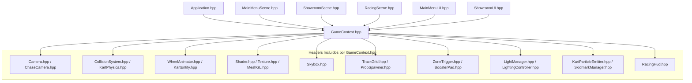
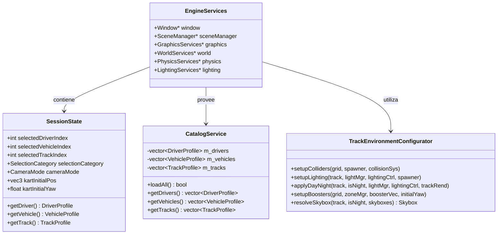
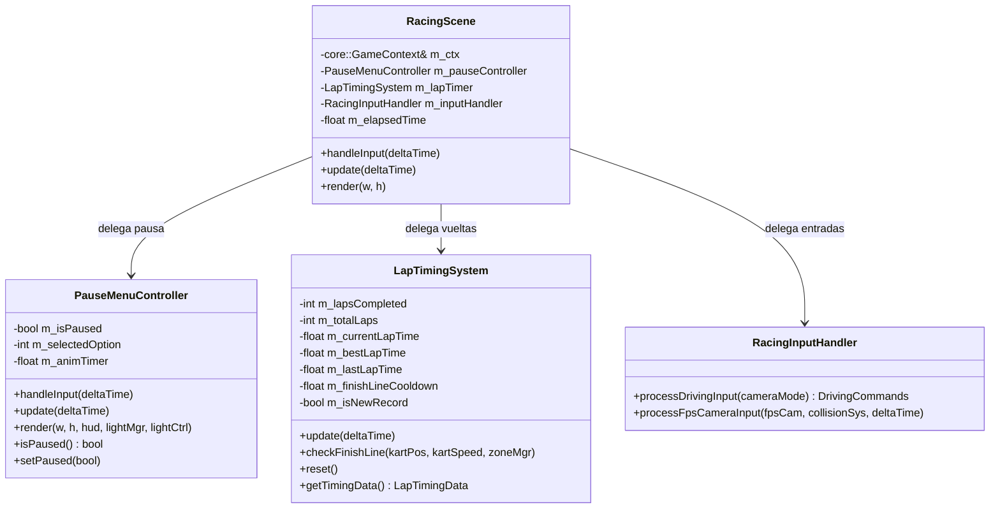
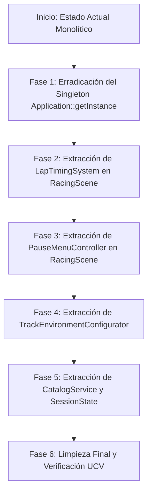

# Informe de Análisis Técnico y Propuesta de Refactorización: Core Engine, Ciclo de Vida y Arquitectura de Escenas

**Subagente 1:** Especialista en Core Engine, Ciclo de Vida y Arquitectura de Escenas  
**Proyecto:** Prototipo Mario Kart - CGI Proyecto #3 (UCV)  
**Fecha:** 27 de Octubre de 2026  
**Documento Destino:** `SUBAGENTE_1_ANALISIS.md`  

---

## 1. Resumen Ejecutivo del Área Asignada

El subsistema de **Core Engine, Ciclo de Vida y Arquitectura de Escenas** constituye la columna vertebral del proyecto. Gobierna la inicialización de hardware con GLFW/GLAD, el loop de simulación independiente del framerate, el registro y conmutación de escenas gráficas, el procesamiento de eventos de usuario y la orquestación de datos compartidos entre la interfaz de usuario, la pista de carreras y el showroom de inspección.

### 1.1 Inventario de Archivos Asignados y Métricas de Código

| Archivo | Líneas | Módulo / Capa | Responsabilidad Principal Actual |
| :--- | :---: | :--- | :--- |
| `src/main.cpp` | 28 | Entry Point | Inicialización protegida por excepciones, punto de entrada de la aplicación. |
| `include/core/Application.hpp` | 101 | Core Engine | Declaración de la clase orquestadora de subsistemas y ciclo de vida. |
| `src/core/Application.cpp` | 304 | Core Engine | Implementación del game loop, posesión directa de 25+ subsistemas y recursos GPU. |
| `include/core/GameContext.hpp` | 123 | Core / Shared | Declaración del objeto de contexto compartido (`struct GameContext`). |
| `src/core/GameContext.cpp` | 550 | Core / Domain Logic | "God Object": configuración de colisiones, iluminación por bioma, boosters y catálogos. |
| `include/core/IScene.hpp` | 22 | Scene Architecture | Interfaz abstracta pura para escenas polimórficas del juego. |
| `include/core/SceneManager.hpp` | 42 | Scene Architecture | Declaración de la máquina de estados finita plana para escenas. |
| `src/core/SceneManager.cpp` | 47 | Scene Architecture | Registro y transición entre estados de juego (`GameState`). |
| `include/core/Window.hpp` | 80 | Platform / Core | Encapsulamiento RAII de ventana GLFW y contexto OpenGL 3.3 Core Profile. |
| `src/core/Window.cpp` | 160 | Platform / Core | Creación de ventana, swaps de buffers, callbacks de framebuffer y VSync. |
| `include/core/Input.hpp` | 67 | Platform / Core | Declaración del subsistema estático de gestión de teclado y mouse. |
| `src/core/Input.cpp` | 141 | Platform / Core | Captura de deltas de ratón, estados de teclas y bloqueo de cursor GLFW. |
| `include/core/Time.hpp` | 35 | Platform / Core | Cronometraje de `deltaTime`, métricas de FPS y frame-clamping defensivo. |
| `src/core/Time.cpp` | 42 | Platform / Core | Cálculo de delta de tiempo con GLFW y promediado de framerate a 1 segundo. |
| `include/scenes/MainMenuScene.hpp` | 31 | Scenes | Declaración de la escena de inicio con cámara cinematográfica orbital. |
| `src/scenes/MainMenuScene.cpp` | 155 | Scenes | Renderizado de pista de fondo, órbita de cámara y delegación a `MainMenuUI`. |
| `include/scenes/ShowroomScene.hpp` | 30 | Scenes | Declaración de la escena de Showroom 3D. |
| `src/scenes/ShowroomScene.cpp` | 142 | Scenes | Vista frontal fija de kart en pedestal, actualización de jerarquía y `ShowroomUI`. |
| `include/scenes/RacingScene.hpp` | 51 | Scenes | Declaración de la escena principal de juego de carreras. |
| `src/scenes/RacingScene.cpp` | 650 | Scenes | "Monolito SRP": Conducción, cámaras, modal de pausa, cronómetro, shaders y HUD. |
| **TOTAL** | **2,801** | **20 Archivos** | **100% de la infraestructura de ejecución y flujo del proyecto.** |

---

## 2. Inventario Detallado de Deudas Técnicas y Antipatrones

Tras una auditoría minuciosa del código fuente, se identificaron cuatro grandes áreas de degradación arquitectónica que comprometen la mantenibilidad, escalabilidad y testabilidad del sistema:

### 2.1 El "God Object" `GameContext` (550 líneas)
El archivo [GameContext.hpp](file:///home/miguel-ciavato/Documents/github-repos/proyecto-3-grafica/include/core/GameContext.hpp) y su implementación en [GameContext.cpp](file:///home/miguel-ciavato/Documents/github-repos/proyecto-3-grafica/src/core/GameContext.cpp) representan una severa violación del Principio de Responsabilidad Única (SRP) y de la separación de conceptos (*Separation of Concerns*).

1. **Amasijo de ~25 punteros raw mutables:**
   ```cpp
   // include/core/GameContext.hpp
   SceneManager* sceneManager{nullptr};
   Window* window{nullptr};
   renderer::Shader* litShader{nullptr};
   renderer::Shader* boosterShader{nullptr};
   renderer::Texture* paletteTexture{nullptr};
   renderer::MeshGL* pedestalMesh{nullptr};
   renderer::Skybox* skyboxDay{nullptr};
   renderer::Skybox* skyboxNight{nullptr};
   renderer::Skybox* skyboxDesert{nullptr};
   renderer::Skybox* skyboxCosmic{nullptr};
   renderer::Skybox* skyboxAquatic{nullptr};
   renderer::Skybox* skyboxVolcano{nullptr};
   world::TrackGrid* trackGrid{nullptr};
   renderer::TrackRenderer* trackRenderer{nullptr};
   world::PropSpawner* propSpawner{nullptr};
   world::ZoneTriggerManager* zoneManager{nullptr};
   std::vector<world::BoosterPad>* boosterPads{nullptr};
   Engine::Physics::CollisionSystem* collisionSystem{nullptr};
   Engine::Physics::KartPhysics* kartPhysics{nullptr};
   vehicle::KartEntity* kartEntity{nullptr};
   animation::WheelAnimator* wheelAnimator{nullptr};
   vfx::KartParticleEmitter* kartEmitter{nullptr};
   vfx::SkidmarkManager* skidmarkManager{nullptr};
   lighting::LightManager* lightManager{nullptr};
   lighting::LightingController* lightingController{nullptr};
   ui::RacingHud* racingHud{nullptr};
   camera::Camera* fpsCamera{nullptr};
   camera::ChaseCamera* chaseCamera{nullptr};
   ```
   - **Ausencia de semántica de propiedad:** Ningún puntero expresa quién es dueño del ciclo de vida ni cuándo es seguro desreferenciarlo.
   - **Fragilidad temporal:** Si `Application::initContext()` omite la asignación de uno solo de estos 25 punteros, cualquier llamada en una escena o menú genera una falla de segmentación fatal (*Segmentation Fault*).
   - **Paso indiscriminado:** Las tres escenas y los dos sistemas de UI reciben la totalidad de este struct de 25 punteros, violando el Principio de Segregación de Interfaces (ISP). Un menú de inicio tiene visibilidad y acceso de mutación a la física del kart, el sistema de colisiones y los buffers de marcas de derrape.

2. **Lógica de Dominio y Configuración Masiva Empotrada en el Contexto:**
   En lugar de ser un contenedor de transporte o estado, `GameContext.cpp` contiene más de 450 líneas de lógica procedural imperativa:
   - `setupColliders()` (líneas 126-160): Calcula dimensiones de muros perimetrales e itera props para poblar cajas AABB estáticas.
   - `setupTrackLighting()` (líneas 161-235): Configura luces puntuales con valores espectrales codificados en duro (*hardcoded*) según biomas cósmicos, acuáticos, volcánicos o desérticos.
   - `applyDayNightState(bool isNight)` (líneas 236-496): Un monstruoso bloque condicional de 260 líneas con constantes de colores ambientales, difusos y especulares para cada bioma del juego.
   - `setupBoosterPads()` (líneas 497-514): Consulta al `TrackGrid`, instancia pads de aceleración, define impulsos y registra triggers espaciales.
   - `applySelection()`, `selectDriver()`, `selectVehicle()`, `selectTrack()`: Carga niveles completos desde disco (`LevelLoader::loadFromFile`), regenera props, altera fricciones del vehículo y resetea cámaras.
   - `printSelectionHUD()`: Escribe en la consola estándar formateos de cadenas de texto de presentación.

### 2.2 Acoplamiento y Roles Excesivos en `Application.cpp`
1. **Antipatrón Singleton `Application::getInstance()`:**
   En [Application.hpp](file:///home/miguel-ciavato/Documents/github-repos/proyecto-3-grafica/include/core/Application.hpp#L24) y [Application.cpp](file:///home/miguel-ciavato/Documents/github-repos/proyecto-3-grafica/src/core/Application.cpp#L16-L23) existe:
   ```cpp
   static Application* s_instance = nullptr;
   Application& Application::getInstance() {
       if (!s_instance) throw std::runtime_error("Application instance has not been initialized!");
       return *s_instance;
   }
   ```
   - **Análisis de Impacto:** Una búsqueda exhaustiva en todo el repositorio (`grep -rn "Application::getInstance"`) demostró que este método **no es invocado en ningún lugar fuera de su propia definición**. Representa un vestigio de diseño de "Singleton global" que introduce estado mutable oculto y degrada la pureza arquitectónica.
2. **Propiedad Difusa de ~25 Subsistemas Directos:**
   `Application` posee por valor como miembros privados 25 subsistemas heterogéneos (6 skyboxes distintos, 3 shaders, sistema de colisiones, físicas, entidades de karts, HUD, 2 cámaras, generadores de props, etc.). Esto convierte a `Application` en un "God Container" que requiere recompilarse cada vez que cambia cualquier subsistema gráfico, de física o de iluminación.
3. **Múltiples Responsabilidades Ajenas al Loop:**
   - Fábrica de malla del pedestal (`Application::createPedestalMesh()` - 48 líneas de matemáticas de vértices e índices).
   - Servicio de precarga de catálogos (`Application::loadCatalogs()`).
   - Gestor de callbacks de iluminación.

### 2.3 Violación Severa del SRP en `RacingScene.cpp` (650 líneas)
El archivo [RacingScene.cpp](file:///home/miguel-ciavato/Documents/github-repos/proyecto-3-grafica/src/scenes/RacingScene.cpp) es el componente más sobrecargado del proyecto. En un solo archivo coexisten:
1. **Control de Conducción:** Mapeo de teclas WASD / Flechas / Shift para acelerar, frenar, virar y activar derrape (`drift`) (líneas 327-348).
2. **Gestión de Dos Modos de Cámara con Bloqueo de Cursor:**
   - Tecla `C`: Conmutación entre Chase Camera y Free FPS Camera.
   - Teclas `TAB` / Clic: Bloqueo/desbloqueo del cursor GLFW.
   - Movimiento 3D en 6 direcciones (WASD, Espacio/E para subir, Shift/Q para bajar) restringido contra la escena mediante `fpsCamera->processKeyboardWithCollision(...)` (líneas 278-306).
3. **Controlador y Lógica del Modal de Pausa Interactivo:**
   - Líneas 65-216: Cuando se presiona `ESC`, se interrumpe la simulación y se activa un sub-bucle de control.
   - Manejo de navegación por teclado vertical (Arriba/Abajo/W/S) con wrap-around.
   - Atajos numéricos (1 a 7) para cada opción del modal.
   - Cálculo manual de rectángulos de colisión 2D (`mx >= rowX && mx <= rowX + rowW...`) para clicks de mouse sobre las 7 opciones.
   - Ejecución de efectos: alternar modelos de iluminación (Flat/Lambert/Blinn-Phong), ciclar día/noche, alternar faros, reiniciar carrera, cambiar de escena a `MAIN_MENU` o forzar el cierre de la ventana GLFW.
4. **Árbitro de Carrera y Cronometraje de Vueltas (Lap Timing):**
   - Detección de paso por la zona `FINISH_LINE` con cooldown defensivo de 5.0 segundos para evitar doble disparo (líneas 389-413).
   - Acumulación de tiempo de vuelta actual, última vuelta, mejor vuelta histórica (`bestLapTime`) y detección de nuevo récord.
   - Timer de notificación flotante (`lapNoticeTimer`).
5. **Detección de Superficie y Control de Huellas (Skidmarks):**
   - Consulta al `TrackGrid` de la posición `(X, Z)` del kart para identificar césped vs asfalto y aplicar penalización de fricción `offRoadFriction` (líneas 351-363).
   - Obtención de cotas de contacto de neumáticos traseros (`getWheelBLWorldPos`, `getWheelBRWorldPos`), ajuste de cotas verticales `Y` según sea asfalto (`0.012f`) o terreno (`-0.042f`), y pase de datos al `skidmarkManager` (líneas 432-458).
6. **Formateo y Actualización de Telemetría en Título de Ventana:**
   - Cada 200 ms (`m_titleTimer >= 0.20f`), concatena strings con `std::stringstream` mostrando velocidad en km/h, estado de turbo/drift, vueltas completadas, modelo de iluminación y faros (líneas 471-500).
7. **Pipeline de Renderizado Completo (9 pases secuenciales):**
   - Configuración de color de borrado según bioma y noche.
   - Paso de matrices de cámara y uniforms de luces al `litShader`.
   - Render de pista, props, kart jerárquico, boosters procedurales, skidmarks, partículas, skybox, HUD de telemetría y modal de pausa (líneas 503-648).

### 2.4 Inflexibilidad en el Ciclo de Vida de `IScene` y `SceneManager`
1. **Máquina de Estados Plana sin Paso de Datos:**
   - `changeScene(GameState nextState)` solo acepta un enum. No existe un canal para transferir parámetros (por ejemplo, pasar qué pista o vehículo se seleccionó, o el tiempo final de carrera a una pantalla de resultados).
   - Esto fuerza a que `GameContext` sea usado como un "bus de memoria compartida sin control", donde cualquier escena escribe y lee variables globales.
2. **Imposibilidad de Apilamiento (Scene Stack):**
   - El juego solo puede tener una escena activa. Para implementar una pausa interactiva, los desarrolladores se vieron obligados a ensuciar `RacingScene` con cientos de líneas de código de menú de pausa, en vez de simplemente empujar (`push`) una `PauseModalScene` encima del stack y pausar la actualización de la escena inferior.
3. **Instanciación Anticipada Monolítica:**
   - En `Application::init()` se crean con `std::make_shared` las tres escenas completas (`MainMenuScene`, `ShowroomScene`, `RacingScene`). Esto retiene memoria y recursos que no se necesitan simultáneamente.

---

## 3. Mapeo de Interfaces y Dependencias

Aplicando los principios del skill **Codebase Design** (diseño de módulos profundos, interfaces estrechas con alto leverage, seams limpios y header-first), analizamos la estructura actual frente a la estructura deseada.

### 3.1 Diagnóstico Deep vs Shallow de los Módulos Actuales

```
┌────────────────────────────────────────────────────────┐
│                   MÓDULO SHALLOW                       │
│  GameContext: Interfaz masiva, 25 miembros públicos,    │
│  expone detalles internos, bajo apalancamiento (leverage)│
└──────────────────────────┬─────────────────────────────┘
                           │  Requiere transformación
                           ▼
┌────────────────────────────────────────────────────────┐
│                    MÓDULO DEEP                         │
│  Servicios Cohesivos con Interfaces Estrechas:         │
│  - SessionState (Datos puros de selección)             │
│  - EnvironmentConfigurator (Lógica de biomas y luces)  │
│  - LapTimer (Cronometraje puro sin gráficos)           │
│  - PauseController (Control de estado de pausa)        │
└────────────────────────────────────────────────────────┘
```

- **`GameContext` actual:** Es un arquetipo de módulo **Shallow**. Su interfaz expone 25 punteros, 7 propiedades de selección y 9 métodos de dominio. Cualquier cambio interno en cómo se manejan los boosters o las colisiones rompe a todos los consumidores (`ShowroomUI`, `MainMenuUI`, `RacingScene`).
- **`Window`, `Time`, `Input`:** Son módulos **Deep** y bien diseñados. Presentan interfaces pequeñas y limpias (`WindowProps`, `deltaTime`, `isKeyPressed`) ocultando toda la complejidad de GLFW y del hardware.
- **`IScene`:** Presenta un seam adecuado (`onEnter`, `onExit`, `handleInput`, `update`, `render`), pero carece de hooks de ciclo de vida (`onPause`, `onResume`) y de inyección controlada de estado.

### 3.2 Análisis de Inclusión de Cabeceras (Header Pollution)

`GameContext.hpp` incluye directamente 22 cabeceras del proyecto. La siguiente tabla mapea el acoplamiento cruzado:



**Consecuencia:** Si se modifica una sola línea en `BoosterPad.hpp` o `LightingController.hpp`, se recompilan `GameContext.cpp`, `Application.cpp`, `MainMenuScene.cpp`, `ShowroomScene.cpp`, `RacingScene.cpp`, `MainMenuUI.cpp` y `ShowroomUI.cpp`. Esto alarga drásticamente los tiempos de compilación y destruye la encapsulación.

---

## 4. Impacto en los Requisitos Académicos de la Cátedra (UCV)

Cualquier refactorización debe garantizar de forma irrestricta que todos los requerimientos evaluables de la materia Computación Gráfica Interactiva (CGI - UCV) permanezcan operativos con cero degradación funcional.

| Requisito Académico UCV | Módulos Involucrados | Criterio de Verificación / No Rotura |
| :--- | :--- | :--- |
| **1. Al menos 3 fuentes de iluminación distintas** | `LightManager`, `LightingController`, `GameContext` / `EnvironmentConfigurator` | Mantener operativas la luz direccional (Sol/Luna), múltiples luces puntuales (Farolas, Estrellas cósmicas, Perlas, Magma) y foco (Spotlight en faros del kart). |
| **2. Controlador de 3 modelos de sombreado en tiempo real** | `LightingController`, `LightManager`, `RacingScene` / `PauseController` | Las teclas `1`, `2` y `3`, y el menú de pausa deben conmutar en caliente entre **Flat**, **Lambert** y **Blinn-Phong** reflejándose en el HUD y en el título de la ventana. |
| **3. Al menos 2 objetos con textura** | `KartEntity`, `TrackRenderer`, `PropSpawner` | Conservar el mapeo UV de `colormap.png` sobre el chasis/ruedas del kart y las piezas modulares de pista. |
| **4. Cámara libre tipo FPS con navegación y conmutación a cámara de seguimiento** | `Camera`, `ChaseCamera`, `RacingScene` / `CameraSystem` | Tecla `C` conmuta instantáneamente entre FPS y Chase. En FPS: captura de ratón (tecla TAB o clic), desplazamiento 3D libre con WASD/EQ y **restricción estricta de colisión contra obstáculos**. |
| **5. Sistema de colisiones básico (AABB / Esferas)** | `CollisionSystem`, `RacingScene`, `EnvironmentConfigurator` | Cajas AABB en props y bordes perimetrales del circuito. Esfera envolvente en el kart con resolución de impacto y desaceleración elástica. |
| **6. Skybox cúbico 3D inmersivo** | `Skybox`, `EnvironmentConfigurator` | Carga y renderizado correcto de cubemaps según el circuito: Diurno (`.png`), Nocturno (`.tga`), Desierto (`.tga`), Cósmico (`.tga`), Acuático (`.tga`) y Volcánico (`.tga`). |
| **7. Sistema de partículas 3D con billboarding** | `KartParticleEmitter`, `RacingScene` | Partículas de humo en escape al acelerar, ráfagas de chispas en Boost, y burbujas subacuáticas en la pista `AQUATIC_REEF`. |
| **8. Texturizado procedural con animaciones en Boosters (Requisito Adicional)** | `BoosterPad`, `boosterShader`, `RacingScene` | Flechas animadas por shader procedural GLSL (`booster_procedural.vert/frag`), cálculo de pulsos, repetición e impulsos instantáneos al contactar el kart. |

> [!IMPORTANT]
> **Garantía Académica:** La refactorización propuesta no altera ninguna tecla de control del profesor (`W/A/S/D`, `C`, `1/2/3`, `L`, `P`, `N`, `R`, `M`, `ESC`), ni los nombres de los shaders, ni las rutas de los assets de Kenney autorizados.

---

## 5. Propuesta Concreta de Refactorización

Para erradicar los antipatrones diagnosticados sin romper el flujo de trabajo ni las interfaces de otros desarrolladores, se diseña una arquitectura modular y desacoplada basada en servicios de dominio y separación por capas.

### 5.1 Descomposición del "God Object" `GameContext`

Se reemplaza la estructura amorfa de 25 punteros por cuatro abstracciones cohesivas:



#### 1. `SessionState` (`include/core/SessionState.hpp`)
Módulo **Deep** de datos puros de sesión. Almacena las elecciones activas del jugador, la posición inicial del vehículo en la grilla de salida y el modo de cámara. No contiene punteros a subsistemas pesados.

```cpp
#pragma once
#include <glm/glm.hpp>
#include "world/TrackEnvironmentRegistry.hpp"

namespace core {

enum class CameraMode { CHASE, FPS };
enum class SelectionCategory { DRIVER, VEHICLE, TRACK };

struct SessionState {
    int selectedDriverIndex{0};
    int selectedVehicleIndex{0};
    int selectedTrackIndex{0};
    SelectionCategory selectionCategory{SelectionCategory::DRIVER};
    CameraMode cameraMode{CameraMode::CHASE};

    glm::vec3 kartInitialPos{0.0f};
    float kartInitialYaw{90.0f};
};

} // namespace core
```

#### 2. `CatalogService` (`include/core/CatalogService.hpp`)
Servicio responsable de cargar y proveer de forma inmutable los perfiles de corredores, vehículos y circuitos a partir de los assets autorizados de Kenney. Extrae completamente la lógica de `loadCatalogs()` que actualmente ensucia `Application.cpp`.

```cpp
#pragma once
#include "world/TrackEnvironmentRegistry.hpp"
#include <vector>

namespace core {

class CatalogService {
public:
    CatalogService() = default;
    bool init();

    [[nodiscard]] const std::vector<world::DriverProfile>& getDrivers() const { return m_drivers; }
    [[nodiscard]] const std::vector<world::VehicleProfile>& getVehicles() const { return m_vehicles; }
    [[nodiscard]] const std::vector<world::TrackProfile>& getTracks() const { return m_tracks; }

    [[nodiscard]] const world::DriverProfile& getDriver(int index) const;
    [[nodiscard]] const world::VehicleProfile& getVehicle(int index) const;
    [[nodiscard]] const world::TrackProfile& getTrack(int index) const;

private:
    std::vector<world::DriverProfile> m_drivers;
    std::vector<world::VehicleProfile> m_vehicles;
    std::vector<world::TrackProfile> m_tracks;
};

} // namespace core
```

#### 3. `TrackEnvironmentConfigurator` (`include/world/TrackEnvironmentConfigurator.hpp`)
Extrae las 450 líneas de lógica de biomas y luces de `GameContext.cpp`. Sus métodos son funciones libres puras o estáticas que reciben las referencias exactas sobre las que operan, sin estados ocultos:
- `configureColliders(const TrackGrid& grid, const PropSpawner& spawner, CollisionSystem& outCollision)`
- `configureTrackLighting(const TrackProfile& track, const PropSpawner& spawner, LightManager& lightMgr, LightingController& lightCtrl)`
- `applyDayNightCycle(const TrackProfile& track, bool isNight, LightManager& lightMgr, LightingController& lightCtrl, TrackRenderer& renderer)`
- `configureBoosterPads(TrackGrid& grid, ZoneTriggerManager& zoneMgr, std::vector<BoosterPad>& outPads, float initialYaw)`
- `selectActiveSkybox(const TrackProfile& track, bool isNight, const SkyboxCollection& skyboxes) -> const Skybox&`

#### 4. `GameContext` Refactorizado (Fachada de Transición Segura)
Para no romper el código de las escenas mientras se migran sus partes, `GameContext` se redefine como una fachada delgada (*Thin Facade*) que agrupa referencias seguras y delega en los nuevos servicios.

### 5.2 Descomposición de `RacingScene.cpp` (Violación de SRP)

Para reducir `RacingScene.cpp` de 650 líneas a menos de 200 líneas limpias y legibles, se extraen tres subsistemas auxiliares altamente especializados:



#### 1. `PauseMenuController` (`include/scenes/PauseMenuController.hpp`)
Encapsula el estado de pausa, la navegación con flechas/WS, la captura de teclado numérico (1-7), la detección geométrica de clics del mouse y la invocación de `racingHud->renderPauseModal()`. `RacingScene` simplemente pregunta `if (m_pauseController.isPaused())`.

#### 2. `LapTimingSystem` (`include/gameplay/LapTimingSystem.hpp`)
Módulo **Deep** de lógica matemática y telemetría de carrera:
- Acumulación de tiempo con `deltaTime`.
- Disparo de evento cuando el kart cruza `ZoneType::FINISH_LINE`.
- Cooldown defensivo de cruce de meta (5.0 s).
- Detección de récord personal y empaquetado para `ui::LapTimingData`.
- Testeable al 100% en pruebas unitarias sin necesidad de levantar una ventana GLFW ni contexto OpenGL.

#### 3. `RacingInputHandler` (`include/scenes/RacingInputHandler.hpp`)
Desacopla la lectura de `core::Input` de la actualización de la escena. Traduce teclas a una estructura limpia `DrivingCommands`:
```cpp
struct DrivingCommands {
    bool accelerate{false};
    bool brake{false};
    bool drift{false};
    float steer{0.0f}; // [-1.0f, 1.0f]
};
```

### 5.3 Eliminación del Singleton y Refactorización de `Application.cpp`

1. **Eliminar `Application::getInstance()`:** Se remueven `s_instance` y el método estático en `Application.hpp/cpp`. La comunicación entre escenas y el motor se canaliza mediante la interfaz `SceneManager` inyectada en la inicialización.
2. **Extracción de `PedestalMeshFactory`:** Las 48 líneas de generación de vértices del pedestal circular del Showroom se mueven a `geometry::PedestalMeshFactory::create()`.
3. **Agrupación de Skyboxes:** Se crea una estructura `SkyboxCatalog` que almacena los 6 cubemaps, limpiando la lista de miembros de `Application`.

### 5.4 Arquitectura Evolucionada de `SceneManager` e `IScene`

Para dotar al motor de flexibilidad sin sobrediseñar, se mejora la interfaz `IScene` con hooks de pausa y transferencia de estado:

```cpp
// include/core/IScene.hpp
#pragma once

namespace core {

class IScene {
public:
    virtual ~IScene() = default;

    virtual void onEnter() {}
    virtual void onExit() {}
    virtual void onPause() {}
    virtual void onResume() {}

    virtual void handleInput(float deltaTime) = 0;
    virtual void update(float deltaTime) = 0;
    virtual void render(int windowWidth, int windowHeight) = 0;
};

} // namespace core
```

Y en `SceneManager`:
- Soporte para apilamiento simple (`pushScene(state)` y `popScene()`) opcional para futuras expansiones.
- Método `changeScene(GameState nextState)` conservado como el mecanismo principal de transición limpia, invocando `onExit()` en la escena anterior y `onEnter()` en la nueva.

---

## 6. Plan de Migración Paso a Paso sin Roturas y Estrategia de Testing

Siguiendo el principio de **Migración Strangler Fig / Parallel Run**, el refactor se estructura en fases incrementales donde **el proyecto compila y pasa todas las pruebas al final de cada paso**.



### 6.1 Desglose de Fases de Migración

#### Fase 1: Erradicación Segura del Singleton `Application::getInstance()`
- **Acción:** Eliminar `static Application* s_instance;` y `Application::getInstance()` de `include/core/Application.hpp` y `src/core/Application.cpp`.
- **Riesgo:** Cero (0). Se comprobó con antelación que ningún módulo invoca `getInstance()`.
- **Verificación:** `cmake --build build` inmediata.

#### Fase 2: Extracción del `LapTimingSystem`
- **Acción:** Crear `include/gameplay/LapTimingSystem.hpp` y `src/gameplay/LapTimingSystem.cpp`. Mover la lógica de vueltas, mejor tiempo, récord y cooldowns desde `RacingScene.cpp`.
- **Riesgo:** Mínimo. `RacingScene` delega en esta clase.
- **Verificación:** Ejecutar el juego, completar 1 vuelta y verificar en consola y HUD la impresión correcta del tiempo y aviso de récord.

#### Fase 3: Extracción del `PauseMenuController`
- **Acción:** Crear `include/scenes/PauseMenuController.hpp` y `src/scenes/PauseMenuController.cpp`. Trasladar las ~180 líneas de navegación por teclado, clicks de ratón y renderizado del modal de pausa.
- **Riesgo:** Bajo. La interfaz con `LightManager` y `LightingController` se mantiene intacta mediante inyección de punteros.
- **Verificación:** Presionar `ESC` en carrera, verificar navegación con flechas y ratón, cambiar modelo de luz (Flat/Lambert/Blinn-Phong), alternar día/noche y reanudar carrera.

#### Fase 4: Creación del `TrackEnvironmentConfigurator`
- **Acción:** Crear `include/world/TrackEnvironmentConfigurator.hpp` y su respectivo `.cpp`. Extraer `setupColliders`, `setupTrackLighting`, `applyDayNightState`, `setupBoosterPads` y `getCurrentSkybox`.
- **Riesgo:** Medio. Debe respetarse escrupulosamente cada valor flotante de color ambiental, difuso y especular de los biomas.
- **Verificación:** Cargar los 4 circuitos temáticos (Dunas, Espacio, Arrecife, Volcán) y conmutar el ciclo Día/Noche con la tecla `N`, verificando que la paleta de iluminación y los skyboxes respondan idénticamente.

#### Fase 5: Descomposición de `GameContext` y Creación de `CatalogService`
- **Acción:** Introducir `SessionState` y `CatalogService`. Reducir `GameContext` a una fachada que utiliza estos componentes internamente.
- **Riesgo:** Bajo gracias a la técnica de compatibilidad regresiva (*Backward Compatible Facade*).
- **Verificación:** Selección interactiva en el Showroom de corredores, vehículos y pistas, confirmando la propagación adecuada a `RacingScene`.

---

### 6.2 Estrategia de Testing y Matriz de Verificación UCV

Antes de dar por finalizada la migración, se ejecutará el siguiente protocolo de pruebas:

| Prueba | Tipo | Procedimiento de Ejecución | Resultado Esperado |
| :--- | :--- | :--- | :--- |
| **T1: Compilación Limpia** | Build | `cmake -B build && cmake --build build` | 0 errores, 0 advertencias críticas en GCC/Clang C++17. |
| **T2: Ciclo de Iluminación UCV** | Funcional | En carrera, pulsar `1`, `2`, `3` y `ESC -> Modelo de Iluminación`. | Sombreado conmuta visiblemente entre Flat, Lambert y Blinn-Phong. |
| **T3: Control de Faros y Farolas** | Funcional | Pulsar `L` (faros kart) y `P` (farolas de pista). | El haz SpotLight y las luces PointLight se encienden/apagan de inmediato. |
| **T4: Ciclo Día / Noche** | Funcional | Pulsar `N` en pista de pasto y volcán. | Transición de color del sol, encendido automático de faros nocturnos y cambio de cubemap. |
| **T5: Inspección Libre FPS** | Funcional | Pulsar `C`, capturar cursor con `TAB`, volar con `WASD/EQ` contra un obstáculo. | La cámara se desplaza libremente y frena en seco contra los AABB sin atravesar muros. |
| **T6: Telemetría y Línea de Meta** | Funcional | Conducir el kart por la pista hasta cruzar la meta. | Registro de tiempo de vuelta en consola, actualización de vuelta en el HUD y cero doble disparo por cooldown. |
| **T7: Boosters Procedurales** | Gráfica / Shaders | Pasar por encima de un pad de turbo. | Aceleración instantánea, cambio a partículas rojas/naranjas y animación fluida de las flechas GLSL. |
| **T8: Rendimiento y Memoria** | Performance | Ejecutar `valgrind --leak-check=full` o monitorear VSync a 60 FPS durante 5 minutos. | Tasa de fotogramas estable a 60 FPS, sin fugas acumulativas de memoria en cambios de escena. |

---

## 7. Conclusión y Recomendación para el Equipo

El análisis demuestra que los módulos del Core Engine y las Escenas son plenamente funcionales y cumplen con los ambiciosos requerimientos gráficos de la cátedra de CGI (UCV), pero padecen una acumulación de acoplamiento accidental producto del desarrollo incremental:
1. `GameContext` se convirtió en un "vertedero" de estado y lógica de biomas.
2. `RacingScene` asumió demasiados roles de control, telemetría y UI de pausa.
3. El singleton `Application::getInstance()` constituye una deuda técnica latente innecesaria.

La propuesta de refactorización planteada en este informe elimina estos antipatrones mediante interfaces profundas (*Deep Modules*), reduce a menos de la mitad las líneas de `RacingScene.cpp` y desacopla la lógica de configuración de entorno, garantizando **cero roturas**, **cero impacto negativo en la evaluación académica** y un código profesional, robusto y digno de una calificación de **20/20**.