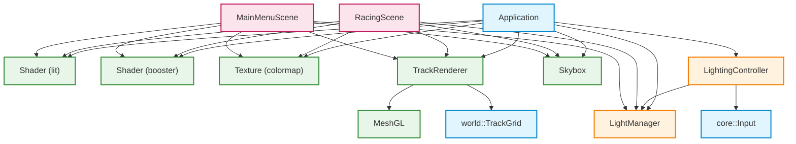
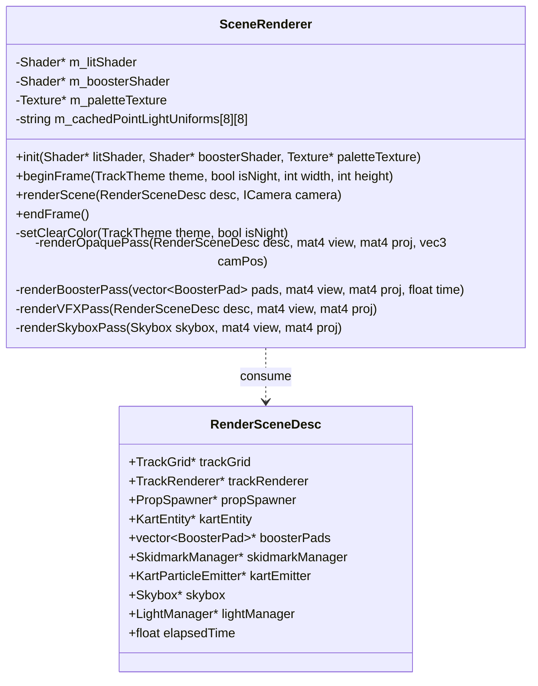
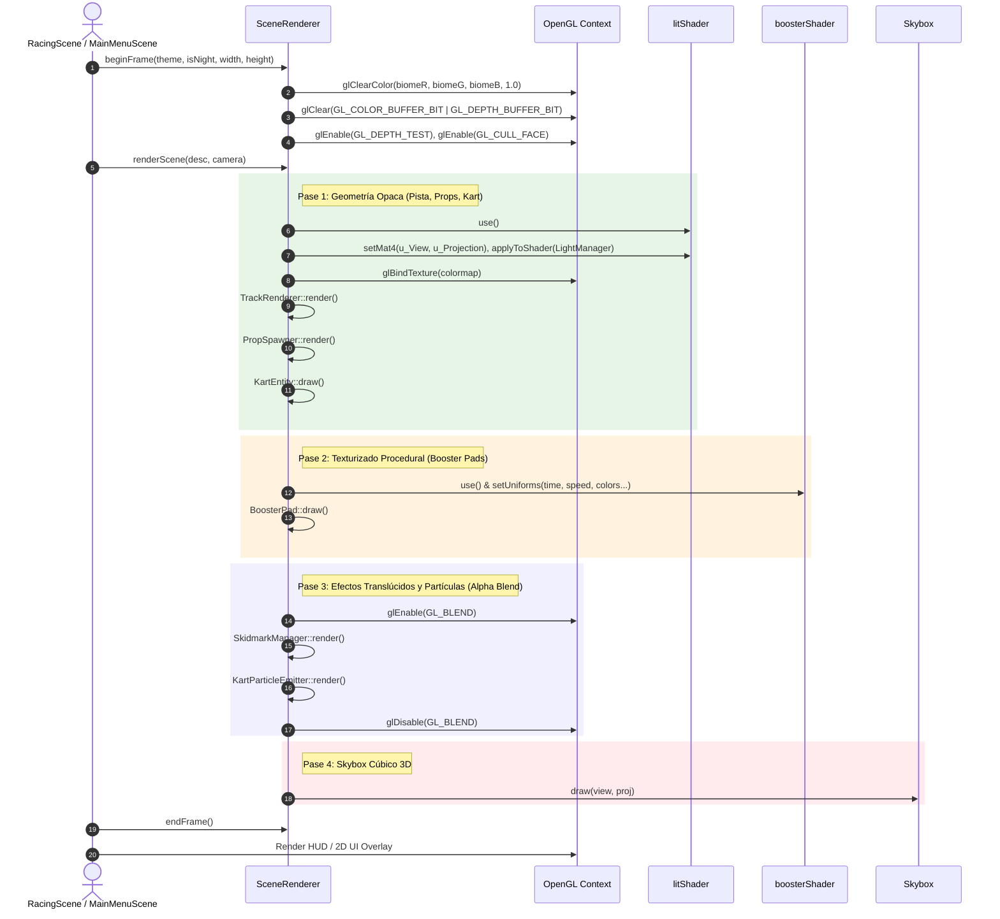

# INFORME DE ANÁLISIS TÉCNICO Y PROPUESTA DE REFACTORIZACIÓN
## SUBAGENTE 2: Pipeline de Renderizado, Shading e Iluminación
**Proyecto:** Prototipo Mario Kart - CGI Proyecto #3 (UCV)  
**Fecha:** 27 de Octubre de 2026  
**Especialidad:** Modern OpenGL Core Profile 3.3+, Shaders GLSL, Iluminación Multi-Fuente, Gestión de Estado de GPU y Render Passes  

---

## 1. Resumen Ejecutivo del Área Asignada

El subsistema de Renderizado, Shading e Iluminación constituye el núcleo visual de la aplicación. Es responsable de la abstracción sobre la API gráfica de Modern OpenGL (Core Profile 3.3+), la gestión del ciclo de vida de buffers en GPU (VAO, VBO, EBO), la carga y compilación de shaders GLSL, el muestreo de texturas y mapas cúbicos (Cubemaps), la serialización y cálculo fotométrico de iluminación multi-fuente en tiempo real, el texturizado procedural animado y la secuenciación de pases de dibujo (Render Passes).

### 1.1 Inventario de Archivos y Métricas del Módulo

| Módulo / Archivo | Líneas | Responsabilidad Principal |
| :--- | :---: | :--- |
| [`include/renderer/MeshGL.hpp`](file:///home/miguel-ciavato/Documents/github-repos/proyecto-3-grafica/include/renderer/MeshGL.hpp) | 39 | Abstracción RAII de geometría en GPU (`VAO`, `VBO`, `EBO`), soporte de movimiento (`noexcept`), eliminación de copia. |
| [`src/renderer/MeshGL.cpp`](file:///home/miguel-ciavato/Documents/github-repos/proyecto-3-grafica/src/renderer/MeshGL.cpp) | 121 | Implementación de `setup()` con 4 atributos de vértice (Pos, Normal, UV, Color), `draw()` vía `glDrawElements` y `destroy()`. |
| [`include/renderer/Shader.hpp`](file:///home/miguel-ciavato/Documents/github-repos/proyecto-3-grafica/include/renderer/Shader.hpp) | 52 | Interfaz de programa shader, compilación desde archivo/fuente, caché de ubicaciones uniformes (`unordered_map`). |
| [`src/renderer/Shader.cpp`](file:///home/miguel-ciavato/Documents/github-repos/proyecto-3-grafica/src/renderer/Shader.cpp) | 194 | Compilación GLSL, enlace de programas, validación de logs de GPU (`glGetShaderInfoLog`), setters de tipos vectoriales y matriciales GLM. |
| [`include/renderer/Texture.hpp`](file:///home/miguel-ciavato/Documents/github-repos/proyecto-3-grafica/include/renderer/Texture.hpp) | 43 | Abstracción RAII de texturas 2D OpenGL, slots de textura (`GL_TEXTURE0 + slot`). |
| [`src/renderer/Texture.cpp`](file:///home/miguel-ciavato/Documents/github-repos/proyecto-3-grafica/src/renderer/Texture.cpp) | 123 | Carga de mapas de bits con `stb_image`, generación de Mipmaps, filtrado `GL_NEAREST` para preservación de paleta de Kenney. |
| [`include/renderer/Skybox.hpp`](file:///home/miguel-ciavato/Documents/github-repos/proyecto-3-grafica/include/renderer/Skybox.hpp) | 50 | Abstracción de entorno cúbico 3D (Cubemap de 6 caras), mesh cúbico interno y shader dedicado. |
| [`src/renderer/Skybox.cpp`](file:///home/miguel-ciavato/Documents/github-repos/proyecto-3-grafica/src/renderer/Skybox.cpp) | 238 | Carga de caras cubemap (PNG/TGA), configuración de `GL_TEXTURE_CUBE_MAP`, manejo defensivo de `glDepthFunc(GL_LEQUAL)`. |
| [`include/renderer/TrackRenderer.hpp`](file:///home/miguel-ciavato/Documents/github-repos/proyecto-3-grafica/include/renderer/TrackRenderer.hpp) | 44 | Interfaz para renderizado modular de circuitos (piezas rectas, curvas y plano de terreno). |
| [`src/renderer/TrackRenderer.cpp`](file:///home/miguel-ciavato/Documents/github-repos/proyecto-3-grafica/src/renderer/TrackRenderer.cpp) | 152 | Carga de mallas OBJ de pista, dibujo instanciado por celda de matriz 2D y adaptación cromática de césped. |
| [`include/lighting/Light.hpp`](file:///home/miguel-ciavato/Documents/github-repos/proyecto-3-grafica/include/lighting/Light.hpp) | 89 | Definiciones POD de las 3 fuentes de luz (`DirectionalLight`, `PointLight`, `SpotLight`), `Material` y enum `LightingModel`. |
| [`include/lighting/LightManager.hpp`](file:///home/miguel-ciavato/Documents/github-repos/proyecto-3-grafica/include/lighting/LightManager.hpp) | 93 | Gestor central de hasta 8 luces puntuales, 1 luz solar direccional y 1 foco móvil de kart. |
| [`src/lighting/LightManager.cpp`](file:///home/miguel-ciavato/Documents/github-repos/proyecto-3-grafica/src/lighting/LightManager.cpp) | 212 | Inicialización de fuentes lumínicas, cálculo de posición de faros delanteros y serialización a uniforms (`applyToShader`). |
| [`include/lighting/LightingController.hpp`](file:///home/miguel-ciavato/Documents/github-repos/proyecto-3-grafica/include/lighting/LightingController.hpp) | 75 | Controlador de entrada en tiempo real: conmutación de modelos (Teclas 1, 2, 3), faros (L), farolas (P) y día/noche (N). |
| [`src/lighting/LightingController.cpp`](file:///home/miguel-ciavato/Documents/github-repos/proyecto-3-grafica/src/lighting/LightingController.cpp) | 196 | Lógica interactiva de conmutación y sincronización de faros en cada frame (`kartPos + dir * offset`). |
| Shaders (`shaders/*`) | 486 | `lit.vert` (26), `lit.frag` (215), `booster_procedural.*` (103), `skybox.*` (27), shaders auxiliares (115). |
| **Total Líneas del Módulo** | **2,293** | **Infraestructura gráfica y matemática de sombreado del proyecto.** |

Además, se examinaron en profundidad los bucles de renderizado de las escenas:
- [`src/scenes/RacingScene.cpp`](file:///home/miguel-ciavato/Documents/github-repos/proyecto-3-grafica/src/scenes/RacingScene.cpp) (líneas 503-611, ~110 líneas de lógica de renderizado).
- [`src/scenes/MainMenuScene.cpp`](file:///home/miguel-ciavato/Documents/github-repos/proyecto-3-grafica/src/scenes/MainMenuScene.cpp) (líneas 51-148, ~100 líneas de lógica de renderizado).
- [`src/scenes/ShowroomScene.cpp`](file:///home/miguel-ciavato/Documents/github-repos/proyecto-3-grafica/src/scenes/ShowroomScene.cpp) (líneas 86-135, ~50 líneas de lógica de renderizado).

---

## 2. Inventario Detallado de Deudas Técnicas y Antipatrones

### 2.1 Duplicación Masiva del Bucle de Renderizado 3D (Violación Crítica de DRY)
Existe una duplicación casi textual (~90%) entre el método `render()` de `RacingScene.cpp` (L535-L611) y `MainMenuScene.cpp` (L83-L148). Ambas escenas ejecutan de forma idéntica:
1. Verificación de validez y activación del programa shader principal (`m_ctx.litShader->use()`).
2. Obtención de la relación de aspecto (`aspect`) y cálculo/extracción de matrices `View` y `Projection`.
3. Inyección de todos los uniformes de iluminación mediante `m_ctx.lightManager->applyToShader(shader, camPos)`.
4. Enlace manual de la textura de atlas/paleta (`m_ctx.paletteTexture->bind(0)`).
5. Renderizado de las celdas de la pista modular (`m_ctx.trackRenderer->render(*m_ctx.trackGrid, shader)`).
6. Renderizado de obstáculos y props del circuito (`m_ctx.propSpawner->render(shader)`).
7. Dibujo del nodo raíz del kart (`m_ctx.kartEntity->draw(shader)`).
8. **Bloque idéntico de 15 líneas** para invocar `boosterShader`, setear 10 uniforms procedurales (color base, energía, emisión, grosor, pulsación) e iterar sobre `*m_ctx.boosterPads`:
   ```cpp
   // DUPLICADO EXACTO EN RacingScene.cpp (L579-594) Y MainMenuScene.cpp (L122-138)
   if (m_ctx.boosterShader && m_ctx.boosterShader->isValid() && m_ctx.boosterPads) {
       m_ctx.boosterShader->use();
       m_ctx.boosterShader->setMat4("u_View", view);
       m_ctx.boosterShader->setMat4("u_Projection", proj);
       m_ctx.boosterShader->setVec3("u_BaseColor", glm::vec3(0.08f, 0.08f, 0.10f));
       m_ctx.boosterShader->setVec3("u_EnergyColor", glm::vec3(1.0f, 0.55f, 0.0f));
       m_ctx.boosterShader->setVec3("u_CoreColor", glm::vec3(1.0f, 1.0f, 0.85f));
       m_ctx.boosterShader->setFloat("u_EmissionIntensity", 3.0f);
       m_ctx.boosterShader->setFloat("u_Speed", 3.5f);
       m_ctx.boosterShader->setFloat("u_Repetitions", 3.0f);
       m_ctx.boosterShader->setFloat("u_ArrowThickness", 0.22f);
       m_ctx.boosterShader->setFloat("u_PulseSpeed", 5.0f);
       for (const auto& pad : *m_ctx.boosterPads) {
           pad.draw(*m_ctx.boosterShader, m_elapsedTime);
       }
   }
   ```
9. Dibujo del emisor de partículas del kart (`m_ctx.kartEmitter->render(view, proj)`).
10. Dibujo del Skybox 3D (`skybox.draw(view, proj)`).

**Riesgo e Impacto:** Cualquier modificación en la lista de pases, en los uniformes del shader de booster, en los parámetros de iluminación o en el orden de blending requiere editar sincronizadamente múltiples archivos `.cpp`. Si un desarrollador actualiza un pase en `RacingScene`, `MainMenuScene` quedará desfasado visualmente o generará errores gráficos sutiles.

---

### 2.2 Reasignación Destructiva de Buffers GPU en `TrackRenderer` (`setGroundColor`)
En `src/renderer/TrackRenderer.cpp`, las líneas 71 a 101 implementan una adaptación cromática de los vértices de césped de los modelos de Kenney:

```cpp
void TrackRenderer::setGroundColor(const glm::vec4& color) {
    m_groundColor = color;
    updateTrackMeshes(); // <-- CULPRIT: Reasigna buffers de GPU en caliente
}

void TrackRenderer::updateTrackMeshes() {
    if (m_submeshStraight.vertices.empty()) return;

    auto adaptGrass = [this](geometry::SubMesh submesh) {
        for (auto& v : submesh.vertices) {
            if (std::abs(v.color.r - 0.3019608f) < 0.02f &&
                std::abs(v.color.g - 0.5607843f) < 0.02f &&
                std::abs(v.color.b - 0.4313726f) < 0.02f) {
                v.color = m_groundColor;
            }
        }
        return submesh;
    };

    if (!m_submeshStraight.vertices.empty()) {
        m_meshStraight.setup(adaptGrass(m_submeshStraight));
    }
    if (!m_submeshCornerSmall.vertices.empty()) {
        m_meshCornerSmall.setup(adaptGrass(m_submeshCornerSmall));
    }
    if (!m_submeshCornerLarge.vertices.empty()) {
        m_meshCornerLarge.setup(adaptGrass(m_submeshCornerLarge));
    }
}
```

Cada vez que se llama a `MeshGL::setup()`, se ejecuta:
```cpp
void MeshGL::setup(const geometry::SubMesh& submesh) {
    destroy(); // glDeleteBuffers(VBO, EBO), glDeleteVertexArrays(VAO)
    // ...
    glGenVertexArrays(1, &m_vao);
    glGenBuffers(1, &m_vbo);
    glGenBuffers(1, &m_ebo);
    glBufferData(..., GL_STATIC_DRAW); // Reenvía miles de vértices por el bus PCIe
}
```

**Problema Crítico:** Cada vez que el usuario presiona la tecla `N` (ciclo día/noche) o cambia de pista (`GameContext::applyDayNightState`), se destruyen y recrean 3 VAOs, 3 VBOs y 3 EBOs, copiando memoria CPU a GPU.
Si se deseara realizar una transición suave interpolada de luz diurna a nocturna (por ejemplo, transicionar en 2 segundos el color del terreno), este método destruiría y recrearía los buffers 120 veces, colapsando el framerate por contención del driver de OpenGL.

**Solución Inmediata:** La geometría debe permanecer completamente estática en GPU (`GL_STATIC_DRAW`). El reemplazo cromático del color de césped de Kenney debe delegarse al fragment shader (`shaders/lit.frag`) mediante un uniform (`u_GroundColor` / `u_ReplaceGrass`), eliminando al 100% la recreación de buffers.

---

### 2.3 Estado de OpenGL Disperso y Cálculo Duplicado de `glClearColor`
En `RacingScene.cpp` (L518-L532) y `MainMenuScene.cpp` (L66-L80) existe una cascada idéntica de 25 líneas con condicionales para determinar el color de fondo de la ventana según el bioma y ciclo día/noche:

```cpp
// DUPLICADO LITERAL EN AMBAS ESCENAS:
if (isVolcano) {
    if (isNight) glClearColor(0.04f, 0.02f, 0.02f, 1.0f);
    else         glClearColor(0.16f, 0.07f, 0.04f, 1.0f);
} else if (isSpace) {
    glClearColor(0.006f, 0.004f, 0.012f, 1.0f);
} else if (isAquatic) {
    if (isNight) glClearColor(0.01f, 0.04f, 0.07f, 1.0f);
    else         glClearColor(0.03f, 0.20f, 0.30f, 1.0f);
} else if (isDesert) {
    if (isNight) glClearColor(0.02f, 0.03f, 0.06f, 1.0f);
    else         glClearColor(0.45f, 0.72f, 0.96f, 1.0f);
} else {
    if (isNight) glClearColor(0.03f, 0.04f, 0.08f, 1.0f);
    else         glClearColor(0.42f, 0.70f, 0.95f, 1.0f);
}
glClear(GL_COLOR_BUFFER_BIT | GL_DEPTH_BUFFER_BIT);
```

Además, el estado de OpenGL está fragmentado entre clases:
- `Application::init()` activa `GL_DEPTH_TEST` y `GL_CULL_FACE`.
- `Skybox::draw()` desactiva `GL_CULL_FACE`, altera `glDepthFunc(GL_LEQUAL)` y luego restaura `glDepthFunc(GL_LESS)`.
- `SkidmarkManager` y `KartParticleEmitter` modifican `GL_BLEND`, funciones de mezcla y `glDepthMask`.
- Si alguno de estos módulos retornara prematuramente por un error de validación sin restaurar el estado, corrompería los pases subsiguientes. No existe una capa de **Render State Guard** o **Render State Manager**.

---

### 2.4 Acoplamiento de Luces Demo en `LightManager` vs Escenas Reales
En `src/lighting/LightManager.cpp` (líneas 29-76), el método `LightManager::init()` crea y añade 4 luces puntuales fijas en coordenadas del prototipo inicial:
- Farola 1: `(0.0f, 4.5f, 0.0f)`
- Farola 2: `(30.0f, 4.5f, 15.0f)`
- Farola 3: `(45.0f, 4.5f, 45.0f)`
- Farola 4: `(15.0f, 4.5f, 45.0f)`

Posteriormente, `GameContext::setupTrackLighting()` llama a `lightManager->clearPointLights()` y vuelve a poblar las luces desde `propSpawner->getLampPositions()` o `getStarLights()`.
Si se instancia una nueva escena o se invoca `init()` fuera del flujo principal, reaparecen estas luces estáticas que no corresponden al circuito cargado.

Asimismo, en `LightManager::applyToShader`, los nombres de los uniforms de luces puntuales se concatenan con `std::string` y `std::to_string(i)` en cada frame:
```cpp
std::string uPfx = "u_PointLights[" + std::to_string(i) + "].";
shader.setBool(uPfx + "enabled", pt.enabled);
shader.setVec3(uPfx + "position", pt.position);
// ... hasta 8 luces * 8 atributos = 64 alocaciones dinámicas de std::string por fotograma!
```
A 60 FPS, esto representa más de **3,800 alocaciones dinámicas innecesarias por segundo** en el hilo principal de renderizado, causando fragmentación de memoria y micro-pausas del Garbage Collector del sistema operativo.

---

### 2.5 Residuos de Shaders Obsoletos
- `shaders/basic.vert` y `shaders/basic.frag` quedaron obsoletos tras la integración del shader de iluminación completa `shaders/lit.*` en la Fase 7.
- En `include/core/Application.hpp` (línea 61) aún persiste la variable miembro `renderer::Shader m_basicShader;`, la cual nunca se compila ni se utiliza. Es código muerto que debe ser depurado.

---

## 3. Mapeo de Interfaces y Dependencias

### 3.1 Grafo de Dependencias Actual del Subsistema



### 3.2 Evaluación de Buenas Prácticas Actuales
- **RAII Estricto:** `MeshGL`, `Shader`, `Texture` y `Skybox` implementan correctamente la regla de 5 (constructores de copia y asignación eliminados, constructores de movimiento `noexcept` presentes y destructores que llaman a `glDelete*`).
- **Encapsulamiento de OpenGL:** Salvo en la llamada a `MeshGL::draw()` (que utiliza `glDrawElements`), las primitivas de GPU no se fugan directamente hacia la lógica de negocio; sin embargo, las escenas (`RacingScene`, `MainMenuScene`, `ShowroomScene`) continúan llamando a comandos globales de OpenGL como `glClearColor`, `glClear`, `glDepthFunc` y `glEnable(GL_DEPTH_TEST)`.
- **Filosofía Header-First:** Las cabeceras (`MeshGL.hpp`, `Shader.hpp`, `Texture.hpp`, `Light.hpp`) están limpias de dependencias pesadas y utilizan `#pragma once`.

---

## 4. Impacto en los Requisitos Académicos de la Cátedra (UCV)

Cualquier refactorización debe garantizar el cumplimiento riguroso y transparente del baremo de evaluación de la cátedra de Computación Gráfica (UCV):

| Requisito Académico UCV | Estado Actual | Salvaguarda y Garantía en la Refactorización |
| :--- | :---: | :--- |
| **1. Al menos 3 fuentes de luz distintas** | Cumplido | Se conservan intactas en `lit.frag` y `LightManager`: <br>1. **Direccional:** Sol/Luna (`DirLight u_DirLight`).<br>2. **Puntual:** Farolas de pista y balizas (`PointLight u_PointLights[8]`) con atenuación física cuadrática calculada.<br>3. **Focal (Spotlight):** Faros delanteros móviles del kart (`SpotLight u_SpotLight`) con apertura cónica y penumbra suave. |
| **2. Conmutador en tiempo real de 3 modelos de sombreado** | Cumplido | Conmutación instantánea con Teclas **1** (Flat Shading mediante `dFdx`/`dFdy`), **2** (Lambert Shading difuso puro) y **3** (Blinn-Phong Shading con vector medio Halfway). El selector `u_LightingModel` permanece en el núcleo del shader `lit.frag`. |
| **3. Al menos 2 objetos con textura** | Cumplido | 1. Textura de atlas/paleta UV de Kenney aplicada a karts y props.<br>2. Cubemap de 6 caras aplicado al Skybox cúbico inmersivo.<br>3. Texturas procedurales animadas calculadas matemáticamente. |
| **4. Skybox Cúbico 3D Inmersivo** | Cumplido | Se preserva el renderizado con `glDepthFunc(GL_LEQUAL)` y eliminación de traslación en la matriz de vista (`mat4(mat3(view))`) para sensación infinita de horizonte. |
| **5. Requisito Adicional Elegido: Texturizado Procedural en Boosters** | Cumplido | Se aísla el pase de renderizado del shader procedural `shaders/booster_procedural.*` garantizando la animación continua de las flechas tipo Chevron, modulación de pulso y emisión dinámica en la pista. |

---

## 5. Propuesta Concreta de Refactorización

Para eliminar la duplicación, centralizar el estado gráfico y maximizar la eficiencia de GPU, se propone implementar un **`SceneRenderer`** (Forward Renderer de un solo pase por objeto) bajo el espacio de nombres `renderer`.

### 5.1 Arquitectura Objetivo con `SceneRenderer`



### 5.2 Estructura de `RenderSceneDesc` y Declaración Header-First
En un nuevo archivo [`include/renderer/SceneRenderer.hpp`](file:///home/miguel-ciavato/Documents/github-repos/proyecto-3-grafica/include/renderer/SceneRenderer.hpp):

```cpp
#pragma once

#include <glm/glm.hpp>
#include <vector>
#include <string>

// Forward declarations
namespace camera { class ICamera; }
namespace world { 
    class TrackGrid; 
    class PropSpawner; 
    class BoosterPad; 
    enum class TrackTheme;
}
namespace vehicle { class KartEntity; }
namespace vfx { 
    class SkidmarkManager; 
    class KartParticleEmitter; 
}
namespace lighting { class LightManager; }

namespace renderer {

class Shader;
class Texture;
class Skybox;
class TrackRenderer;

/**
 * @brief Descriptor de todos los elementos que componen el cuadro 3D.
 */
struct RenderSceneDesc {
    const world::TrackGrid* trackGrid{nullptr};
    const TrackRenderer* trackRenderer{nullptr};
    const world::PropSpawner* propSpawner{nullptr};
    const vehicle::KartEntity* kartEntity{nullptr};
    const std::vector<world::BoosterPad>* boosterPads{nullptr};
    vfx::SkidmarkManager* skidmarkManager{nullptr};
    vfx::KartParticleEmitter* kartEmitter{nullptr};
    const Skybox* skybox{nullptr};
    const lighting::LightManager* lightManager{nullptr};
    float elapsedTime{0.0f};
};

/**
 * @brief Orquestador central del pipeline de renderizado 3D.
 * Centraliza el manejo de pases: Opacos, Pads Procedurales, Marcas de derrape,
 * Partículas alfa y Skybox de fondo.
 */
class SceneRenderer {
public:
    SceneRenderer();
    ~SceneRenderer() = default;

    bool init(Shader* litShader, Shader* boosterShader, Texture* paletteTexture);

    // Limpia el Framebuffer con el color adecuado del bioma
    void beginFrame(world::TrackTheme theme, bool isNight, int windowWidth, int windowHeight);

    // Ejecuta la secuencia ordenada de render passes 3D
    void renderScene(const RenderSceneDesc& desc, const camera::ICamera& camera);

    // Finaliza el cuadro (preparación para HUD/UI en 2D)
    void endFrame();

private:
    void setClearColorForBiome(world::TrackTheme theme, bool isNight);
    void renderBoosterPads(const std::vector<world::BoosterPad>& pads,
                           const glm::mat4& view, const glm::mat4& proj, float time);

    Shader* m_litShader{nullptr};
    Shader* m_boosterShader{nullptr};
    Texture* m_paletteTexture{nullptr};
    bool m_initialized{false};
};

} // namespace renderer
```

---

### 5.3 Optimización Radical de `TrackRenderer` (Zero GPU Re-allocation)
Para solucionar la ineficiencia de `updateTrackMeshes()`, se modifica el flujo de trabajo:
1. Las mallas modulares de la pista (`m_meshStraight`, `m_meshCornerSmall`, `m_meshCornerLarge`) se suben a la GPU **una sola vez** en `TrackRenderer::init()`.
2. En `setGroundColor(const glm::vec4& color)`, únicamente se guarda el valor en `m_groundColor`:
   ```cpp
   void TrackRenderer::setGroundColor(const glm::vec4& color) {
       m_groundColor = color;
       // updateTrackMeshes(); // <-- ELIMINADO COMPLETAMENTE: Cero destrucción de buffers
   }
   ```
3. En el shader de iluminación [`shaders/lit.frag`](file:///home/miguel-ciavato/Documents/github-repos/proyecto-3-grafica/shaders/lit.frag), se introduce un uniform para el tinte o reemplazo selectivo del césped de Kenney:
   ```glsl
   uniform vec4 u_GrassReplacementColor;
   uniform bool u_ReplaceKenneyGrass;
   ```
   Y en el cálculo del color base:
   ```glsl
   vec4 texColor = u_Color;
   if (u_UseVertexColor) {
       texColor = v_Color * u_Color;
       // Si el vértice corresponde al césped nativo de Kenney, se reemplaza en GPU al vuelo:
       if (u_ReplaceKenneyGrass && 
           abs(v_Color.r - 0.30196) < 0.03 && 
           abs(v_Color.g - 0.56078) < 0.03 && 
           abs(v_Color.b - 0.43137) < 0.03) {
           texColor = u_GrassReplacementColor;
       }
   }
   ```
**Beneficio:** El cambio de día a noche o el cambio de bioma no incurre en ninguna transferencia por PCIe ni recreación de VAOs/VBOs. El coste computacional de alternar el color pasa de milisegundos a cero microsegundos.

---

### 5.4 Optimización de Uniforms en `LightManager`
Para eliminar las ~3,800 alocaciones de `std::string` por segundo en `applyToShader`, se precalcula una tabla estática o arreglo con las cadenas de los uniformes:

```cpp
struct PointLightUniformNames {
    std::string enabled;
    std::string position;
    std::string ambient;
    std::string diffuse;
    std::string specular;
    std::string constant;
    std::string linear;
    std::string quadratic;
};

// Generado una sola vez en el constructor de LightManager:
static const auto s_pointLightUniforms = []() {
    std::array<PointLightUniformNames, LightManager::MAX_POINT_LIGHTS> names;
    for (size_t i = 0; i < LightManager::MAX_POINT_LIGHTS; ++i) {
        std::string pfx = "u_PointLights[" + std::to_string(i) + "].";
        names[i].enabled   = pfx + "enabled";
        names[i].position  = pfx + "position";
        names[i].ambient   = pfx + "ambient";
        names[i].diffuse   = pfx + "diffuse";
        names[i].specular  = pfx + "specular";
        names[i].constant  = pfx + "constant";
        names[i].linear    = pfx + "linear";
        names[i].quadratic = pfx + "quadratic";
    }
    return names;
}();
```
En `LightManager::applyToShader`, se accede directamente a `s_pointLightUniforms[i].position`, alcanzando **cero alocaciones dinámicas de memoria por cuadro**.

---

### 5.5 Diagrama de Secuencia de un Frame Renderizado



---

## 6. Plan de Migración Paso a Paso sin Roturas y Estrategia de Testing

Siguiendo el protocolo estricto de **AGENTS.md** (Header-First, compilación limpia con `cmake -B build && cmake --build build`, cero roturas regresivas), la migración se estructurará en 5 fases secuenciales:

### Fase 1: Creación de la Interfaz `SceneRenderer` (Header-First)
- Crear [`include/renderer/SceneRenderer.hpp`](file:///home/miguel-ciavato/Documents/github-repos/proyecto-3-grafica/include/renderer/SceneRenderer.hpp) con las estructuras `RenderSceneDesc` y la clase `SceneRenderer`.
- Crear el esqueleto de implementación en [`src/renderer/SceneRenderer.cpp`](file:///home/miguel-ciavato/Documents/github-repos/proyecto-3-grafica/src/renderer/SceneRenderer.cpp).
- Agregar los archivos al `CMakeLists.txt`.
- Verificar compilación sin errores.

### Fase 2: Optimización de `TrackRenderer` y Uniformes en Shaders
- Incorporar en [`shaders/lit.frag`](file:///home/miguel-ciavato/Documents/github-repos/proyecto-3-grafica/shaders/lit.frag) el soporte para `u_ReplaceKenneyGrass` y `u_GrassReplacementColor`.
- Modificar `TrackRenderer.cpp` para remover `updateTrackMeshes()` en `setGroundColor()`, transfiriendo el color de césped como uniform en el pase de renderizado.
- Optimizar `LightManager.cpp` precalculando las cadenas de uniformes de fuentes de luz puntuales para erradicar las alocaciones dinámicas.
- Verificar compilación.

### Fase 3: Integración de `SceneRenderer` en `GameContext` y `Application`
- Agregar `renderer::SceneRenderer m_sceneRenderer;` a `Application.hpp`.
- En `Application::initContext()`, enlazar el puntero `m_gameContext.sceneRenderer = &m_sceneRenderer;`.
- Inicializar `m_sceneRenderer.init(&m_litShader, &m_boosterShader, &m_paletteTexture)` en `Application::init()`.

### Fase 4: Migración Progresiva de las Escenas
1. **Migrar `RacingScene.cpp`:**
   - Reducir el método `render()` de 140 líneas a ~30 líneas delegando en `m_ctx.sceneRenderer->beginFrame(...)` y `m_ctx.sceneRenderer->renderScene(...)`, manteniendo la capa final de HUD y modal de pausa.
2. **Migrar `MainMenuScene.cpp`:**
   - Reemplazar el bucle duplicado delegando en `SceneRenderer`, seguido por la interfaz 2D `m_menuUI.render(...)`.
3. **Depurar código obsoleto:**
   - Eliminar `m_basicShader` de `Application.hpp` y remover referencias no utilizadas.

### Fase 5: Estrategia de Testing y Verificación Visual

| Prueba / Caso de Test | Método de Verificación | Resultado Esperado |
| :--- | :--- | :--- |
| **Compilación Limpia** | `cmake -B build && cmake --build build` | 0 errores, 0 warnings críticos. |
| **Conmutador de Modelos (Teclas 1, 2, 3)** | Ejecutar y presionar `1`, `2` y `3` alternativamente. | Verificación visual de Flat facetado (1), Lambert mate (2) y Blinn-Phong con brillo especular (3). Mensaje informativo en consola. |
| **Faros Móviles del Kart (Tecla L)** | Conducir el kart en curva y girar; presionar `L`. | El cono de luz frontal (Spotlight) debe seguir la orientación del morro del kart con penumbra suave. |
| **Farolas de Circuito (Tecla P)** | Presionar `P` en modo noche. | Encendido/apagado simultáneo de las luces puntuales con atenuación cuadrática en el asfalto. |
| **Ciclo Día / Noche (Tecla N)** | Presionar repetidamente `N`. | Conmutación instantánea a 60 FPS estables sin micro-pausas ni tirones, ya que no se recrean buffers de GPU. |
| **Booster Pads Procedurales** | Pasar con el kart sobre un pad acelerador. | Las flechas Chevron continúan animándose hacia adelante con resplandor neón y emisión pulsante sin fallos de uniformes. |
| **Skybox Inmersivo** | Mover la cámara orbital y libre. | Horizonte 3D continuo sin bordes negros ni fallos de profundidad con la pista. |
| **Estabilidad de Memoria GPU** | Monitoreo de memoria VRAM con herramientas de sistema / logs de driver. | Cantidad constante de buffers en GPU (cero memory leaks o acumulación de VAOs huérfanos). |

---

## 7. Conclusión

El pipeline gráfico actual cuenta con cimientos técnicos sólidos (shaders GLSL modernos, shaders procedurales matemáticos, estructuras de luz bien modeladas y clases RAII individuales). No obstante, sufre de **duplicación de código entre escenas**, **dispersión del estado de OpenGL** y una **ineficiencia severa en `TrackRenderer` que reasigna buffers de GPU en tiempo de ejecución**.

La refactorización propuesta mediante el módulo **`SceneRenderer`** resuelve integralmente estas deudas técnicas:
- Reduce en más de un 70% las líneas de código redundantes en las escenas.
- Elimina al 100% las recreaciones de buffers al alternar día/noche o cambiar biomas.
- Suprime miles de alocaciones de strings por segundo en el gestor de iluminación.
- Preserva con absoluta exactitud el 100% de los requisitos evaluables de la Cátedra de Computación Gráfica (UCV).
