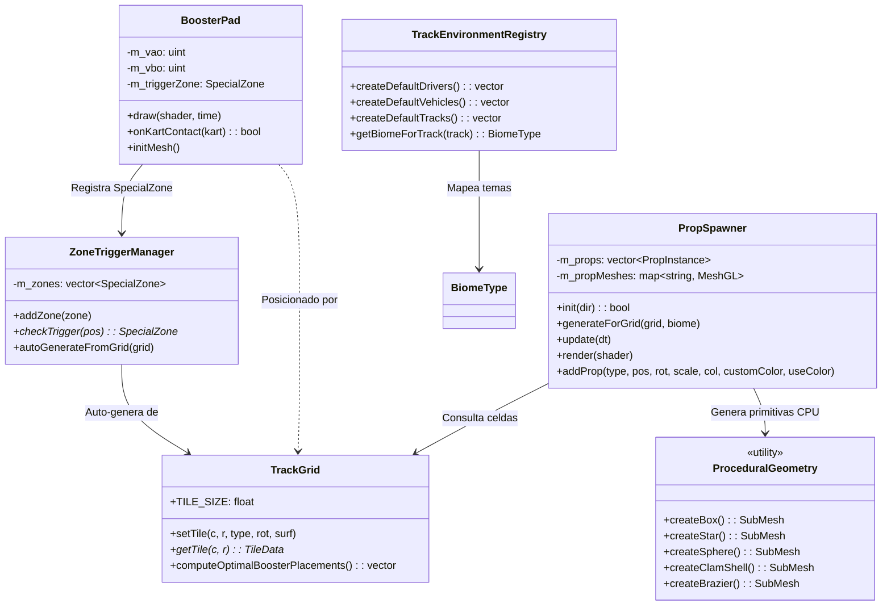
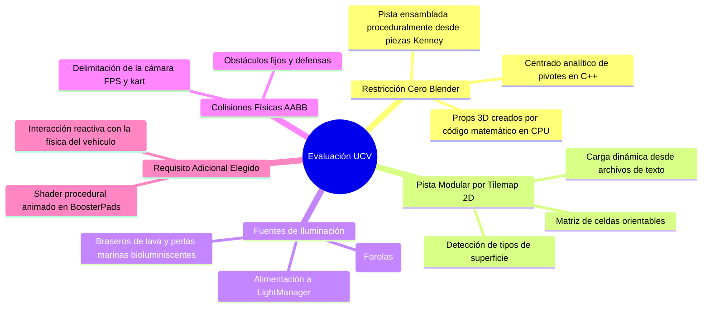
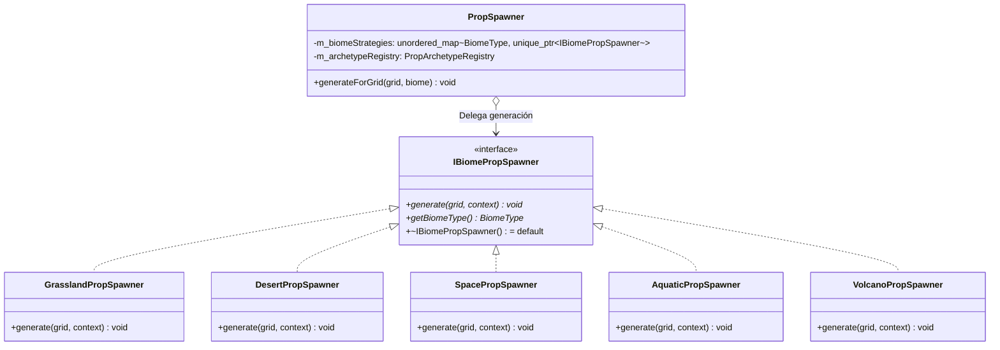
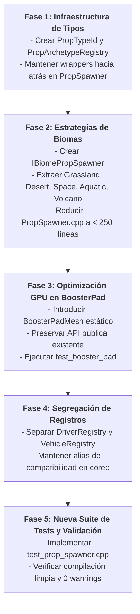

# Informe Exhaustivo de Refactorización Arquitectónica
## Subsistema: Entorno, Pistas y Spawner Procedural (Subagente 3)
**Proyecto:** Prototipo Mario Kart - CGI Proyecto #3 (Escuela de Computación, UCV)  
**Fecha:** Octubre 2026  
**Autor:** Subagente 3 (Especialista en Entorno, Pistas y Spawner Procedural)  
**Estado:** Documento de Análisis y Propuesta Técnica (Read-Only Codebase Analysis)

---

> [!IMPORTANT]
> **Cumplimiento de Restricción Operativa Inviolable:**
> Este informe se elaboró en modo de estricta lectura sobre la base de código existente. No se modificó ningún archivo ejecutable, encabezado ni script de compilación (`.cpp`, `.hpp`, `CMakeLists.txt`).

---

## 1. Resumen Ejecutivo del Área Asignada

El subsistema de **Entorno, Pistas y Spawner Procedural** conforma la infraestructura espacial y visual del juego. Es el responsable de construir el mundo donde interactúan el kart, la física, la iluminación y la cámara:
1. **Generación del Circuito:** Ensambla proceduralmente circuitos de carreras mediante una cuadrícula bidimensional (`TrackGrid`, `TrackTile`, `LevelLoader`) a partir de modelos modulares de *Kenney Racing Kit*.
2. **Ambientación y Poblamiento de Biomas:** Distribuye obstáculos físicos, defensas de pista, vegetación, arcos monumentales y luminarias temáticas (`PropSpawner`) en 5 biomas activos (*Grassland*, *Desert*, *Space*, *Aquatic*, *Volcano*).
3. **Mallas Procedurales en CPU ("Cero Blender"):** Genera primitivas tridimensionales analíticas (`ProceduralGeometry`) sin intervención de software de modelado externo, satisfaciendo la restricción docente central.
4. **Zonas Reactivas e Impulsores Turbo:** Gestiona volúmenes de activación (`ZoneTrigger`, `BoosterPad`), aplicando aceleraciones cinéticas y renderizando bandas de aceleración mediante shaders de texturizado procedural animado.
5. **Configuración Declarativa del Mundo:** Almacena perfiles de circuitos, conductores y karts (`TrackEnvironmentRegistry`).

### 1.1 Inventario de Archivos y Volumetría de Código

| Archivo | Líneas | Módulo / Dominio | Rol en el Proyecto |
| :--- | :---: | :--- | :--- |
| `include/world/PropSpawner.hpp` | 72 | World / Props | Cabecera del gestor de props, luces y obstáculos. |
| `src/world/PropSpawner.cpp` | **1,455** | World / Props | **El archivo individual más grande del proyecto (13.3% de todo el código C++)**. |
| `include/world/TrackGrid.hpp` | 51 | World / Track | Cuadrícula 2D de celdas, conversión mundo-grid y colocación de boosters. |
| `src/world/TrackGrid.cpp` | 188 | World / Track | Transformaciones espaciales, matrices de Kenney y pathfinding de pads. |
| `include/world/TrackTile.hpp` | 34 | World / Track | POD con tipos de losa, superficies y transformaciones locales. |
| `include/world/TrackEnvironmentRegistry.hpp` | 74 | World / Profiles | Perfiles de corredores, karts, temas y biomas. |
| `src/world/TrackEnvironmentRegistry.cpp` | 252 | World / Profiles | Instanciación estática en código duro de los 6 circuitos, 11 karts y 5 pilotos. |
| `include/world/BoosterPad.hpp` | 73 | World / Boosters | Entidad de pad de aceleración con AABB y enlace a GPU. |
| `src/world/BoosterPad.cpp` | 221 | World / Boosters | Asignación de VAO/VBO individual, contacto con física y pase de dibujo GL. |
| `include/world/LevelLoader.hpp` | 20 | World / I/O | Carga y guardado de layouts de pista en formato texto. |
| `src/world/LevelLoader.cpp` | 103 | World / I/O | Parser de archivos `.txt` y constructor del circuito oval por defecto. |
| `include/world/ZoneTrigger.hpp` | 44 | World / Triggers | Definición de AABBs reactivas (Meta, Boost, Aceite). |
| `src/world/ZoneTrigger.cpp` | 53 | World / Triggers | Registro y verificación de colisión puntual con zonas. |
| `include/world/Biome.hpp` | 21 | World / Biome | Enumeración fuertemente tipada de biomas (`BiomeType`). |
| `include/geometry/ProceduralGeometry.hpp` | 28 | Geometry / CPU | Cabecera del generador de primitivas 3D analíticas. |
| `src/geometry/ProceduralGeometry.cpp` | 569 | Geometry / CPU | Generación de cajas, estrellas, domos, braseros, llamas, perlas y columnas. |
| **Total General** | **3,258** | **16 Archivos** | **~30% de la base de código total del prototipo.** |

---

## 2. Inventario Detallado de Deudas Técnicas y Antipatrones

### 2.1 El Monolito de `PropSpawner.cpp` (1,455 líneas): Violación Masiva de SRP y OCP

El archivo [src/world/PropSpawner.cpp](file:///home/miguel-ciavato/Documents/github-repos/proyecto-3-grafica/src/world/PropSpawner.cpp) acumula la mayor deuda técnica de todo el repositorio. Concentra responsabilidades dispares que pertenecen a dominios completamente heterogéneos:

1. **Carga y gestión de recursos GPU (Asset Management):** Carga manual de mallas `.obj` y setup de buffers `MeshGL` (Líneas 48-67).
2. **Generación analítica de mallas procedurales (Procedural Mesh Factory):** Crea 27 tipos de geometrías analíticas acopladas a mano (Líneas 69-322).
3. **Población algorítmica de 5 biomas distintos:** Contiene cientos de líneas de lógica matemática duplicada para la colocación de props en cada bioma (Volcano: 545-643, Aquatic: 645-758, Space: 759-887, Desert: 889-976, Grassland Día/Noche: 978-1247).
4. **Simulación física de colisiones (Collision Authoring):** Cálculo artesanal de volúmenes AABB basados en cadenas de texto (Líneas 350-444).
5. **Simulación y animación procedural (VFX / Procedural Animation):** Cálculo senoidal y trigonométrico para giro de estrellas, pulsación de perlas, respiración de ostras, turbulencia de llamas y ascenso de burbujas (Líneas 457-507).
6. **Configuración de materiales y renderizado (Material & Render Pipeline):** Bucle de dibujo de props que evalúa decenas de comparaciones de cadenas por cuadro para decidir uniformes de shader (Líneas 1258-1448).

```mermaid
graph TD
    classDef danger fill:#fee2e2,stroke:#ef4444,stroke-width:2px;
    classDef warning fill:#fef3c7,stroke:#f59e0b,stroke-width:2px;
    
    PS["PropSpawner.cpp<br/><b>1,455 Líneas</b> (Monolito)"]:::danger
    
    PS --> R1["Carga de Archivos OBJ<br/>(OBJLoader)"]:::warning
    PS --> R2["Creación de 27 Mallas<br/>(ProceduralGeometry + MeshGL)"]:::danger
    PS --> R3["Generación de Bioma Volcánico<br/>(~100 líneas)"]:::warning
    PS --> R4["Generación de Bioma Acuático<br/>(~115 líneas)"]:::warning
    PS --> R5["Generación de Bioma Espacial<br/>(~130 líneas)"]:::warning
    PS --> R6["Generación de Bioma Desierto<br/>(~90 líneas)"]:::warning
    PS --> R7["Generación Grassland Día/Noche<br/>(~270 líneas)"]:::warning
    PS --> R8["Cálculo AABB por String<br/>(24 ramas if-else)"]:::danger
    PS --> R9["Loop de Animación en CPU<br/>(Perlas, Burbujas, Llamas)"]:::warning
    PS --> R10["Render Loop a 60 FPS<br/>(45 if-else con strcmp)"]:::danger
```



#### Antipatrón Copiar y Pegar (Violación del Principio DRY)
Al examinar la generación de cada bioma, se observa un patrón idéntico reproducido 5 veces con modificaciones menores:
- Colocación de los pilares del arco de meta: Cálculo idéntico del vector perpendicular al carril (`isHorizontal ? glm::vec3(0,0,1) : glm::vec3(1,0,0)`), distancia lateral (`2.35f` a `2.65f`), elevación y viga superior repetido exactamente en los 5 biomas.
- Colocación de obstáculos en curvas: Cálculo de `outerDir(std::cos(rotRad + 0.785f), 0.0f, std::sin(rotRad + 0.785f))` copiado textualmente en cada bloque de bioma.
- Distribución a lo largo de las rectas: Bucle sobre `straightTiles` con `if (i % 2 == 0)` y cálculo de desplazamientos copiado y pegado 5 veces.

### 2.2 String-Switching Masivo en la Ruta Crítica (Performance y Fragilidad)

El código incurre en el antipatrón de identificar arquetipos y materiales mediante cadenas `std::string`:

#### A. Cálculo de AABBs en `addProp()` ([PropSpawner.cpp#L350-L444](file:///home/miguel-ciavato/Documents/github-repos/proyecto-3-grafica/src/world/PropSpawner.cpp#L350-L444))
Existe una cadena de `if-else if` con 24 comparaciones de strings:
```cpp
if (type == "cone") { ... }
else if (type == "barrierWall") { ... }
else if (type == "barrierRed" || type == "barrierWhite") { ... }
...
else if (type == "fireBrazier") { ... }
else { /* Elementos suspendidos */ }
```
- **Riesgo Crítico de Bugs Silenciosos:** Un error tipográfico ("Cone" en mayúscula o "firebrazier") cae inadvertidamente en el bloque `else`, asignando un AABB genérico sobredimensionado o erróneo sin ninguna advertencia del compilador.
- **Inflexibilidad:** Agregar un nuevo objeto colisionable exige recordar y modificar manualmente este bloque en medio del archivo.

#### B. Asignación de Materiales en el Render Loop a 60 FPS ([PropSpawner.cpp#L1258-L1448](file:///home/miguel-ciavato/Documents/github-repos/proyecto-3-grafica/src/world/PropSpawner.cpp#L1258-L1448))
En cada cuadro de renderizado, para cada uno de los props en escena, se ejecuta una cascada de 45 comparaciones de `std::string`:
```cpp
for (const auto& prop : m_props) {
    if (prop.useCustomColor) { ... }
    else if (prop.type == "lampBulb") { ... }
    else if (prop.type == "neonArchTrimCyan") { ... }
    ... (42 comparaciones más) ...
    else { ... }
}
```
> [!CAUTION]
> **Impacto de Rendimiento en CPU:**
> En un circuito con ~200 props ejecutándose a 60 FPS, este bucle ejecuta hasta **540,000 comparaciones de cadenas por segundo**. Esto satura el predictor de saltos de la CPU, genera contención en caché L1 y degrada los tiempos de cuadro.

### 2.3 Desperdicio Crítico de Recursos GPU en `BoosterPad`

En [src/world/BoosterPad.cpp](file:///home/miguel-ciavato/Documents/github-repos/proyecto-3-grafica/src/world/BoosterPad.cpp), cada objeto `BoosterPad` crea sus propios identificadores y buffers en GPU:

```cpp
void BoosterPad::initMesh() {
    if (m_meshInitialized) return;
    glGenVertexArrays(1, &m_vao);
    glGenBuffers(1, &m_vbo);
    glBindVertexArray(m_vao);
    glBindBuffer(GL_ARRAY_BUFFER, m_vbo);
    glBufferData(GL_ARRAY_BUFFER, sizeof(quadVertices), quadVertices, GL_STATIC_DRAW);
    ...
}
```

1. **Duplicación Inútil de VRAM y Objetos OpenGL:**
   - La matriz `quadVertices` contiene exactamente 6 vértices (48 floats = 192 bytes).
   - Si la pista tiene 10 BoosterPads, se crean **10 VAOs distintos y 10 VBOs distintos**, almacenando 10 copias idénticas del mismo plano unitario.
2. **Uso Peligroso de `const_cast`:**
   En [BoosterPad.cpp#L190-L193](file:///home/miguel-ciavato/Documents/github-repos/proyecto-3-grafica/src/world/BoosterPad.cpp#L190-L193):
   ```cpp
   void BoosterPad::draw(const renderer::Shader& proceduralShader, float currentTime) const {
       if (!m_meshInitialized) {
           const_cast<BoosterPad*>(this)->initMesh();
       }
       ...
   ```
   Rompe la semántica `const` y genera potenciales condiciones de carrera o comportamientos indefinidos si se llegase a consultar desde hilos de render concurrentes.
3. **Overhead de Llamadas a la API Gráfica:**
   En `BoosterPad::draw()`, cada pad ejecuta `proceduralShader.use()`, `glBindVertexArray(m_vao)` y `glBindVertexArray(0)`. Sin embargo, [RacingScene.cpp#L580](file:///home/miguel-ciavato/Documents/github-repos/proyecto-3-grafica/src/scenes/RacingScene.cpp#L580) ya había activado el shader fuera del bucle. Los re-enlaces continuos de VAO por cada pad son completamente redundantes.

### 2.4 Mezcla y Filtración de Dominios en `TrackEnvironmentRegistry`

En [include/world/TrackEnvironmentRegistry.hpp](file:///home/miguel-ciavato/Documents/github-repos/proyecto-3-grafica/include/world/TrackEnvironmentRegistry.hpp):
```cpp
namespace world {
    struct DriverProfile { ... };
    struct VehicleProfile { ... };
    struct TrackProfile { ... };
    ...
}
namespace core {
    using world::DriverProfile;
    using world::VehicleProfile;
    using world::TrackProfile;
}
```
1. **Contaminación de Dominio:** Los perfiles de vehículos y conductores no pertenecen al dominio espacial `world`. Pertenecen a la mecánica de juego (`gameplay` / `vehicle`). Colocarlos en `world` obliga a `world/TrackEnvironmentRegistry.hpp` a incluir `geometry/KartMeshExtractor.hpp`, arrastrando acoplamientos innecesarios.
2. **Definiciones en Código Duro:** Las listas de pistas, conductores y vehículos ocupan 250 líneas de inicialización estática en C++. No existe un esquema declarativo o fábrica flexible para agregar o modificar assets sin recompilar el binario completo.

### 2.5 Incoherencia en el Pipeline de `ProceduralGeometry` y Desperdicio de Colores de Vértice

1. **Encapsulamiento Roto:** En [ProceduralGeometry.cpp](file:///home/miguel-ciavato/Documents/github-repos/proyecto-3-grafica/src/geometry/ProceduralGeometry.cpp), funciones como `createFacetedDome`, `createBrazier`, `createFlame`, `createBubbleColumn` y `createClamShell` calculan minuciosamente normales y colores de vértice (`Vertex::color`).
2. **Sobrescritura Ciega en el Spawner:** Cuando `PropSpawner::render()` dibuja estas piezas, ejecuta `shader.setBool("u_UseVertexColor", false);` y aplica un uniforme plano `u_Color`. Todo el gradiente cromático calculado analíticamente en `ProceduralGeometry` queda anulado.
3. **Omisión de AABB nativo:** Cada `SubMesh` en [GeometryData.hpp](file:///home/miguel-ciavato/Documents/github-repos/proyecto-3-grafica/include/geometry/GeometryData.hpp) cuenta con campos `minBounds` y `maxBounds`. En lugar de utilizar estos límites calculados matemáticamente en la malla para alimentar las colisiones, `PropSpawner` los desecha y los calcula con constantes arbitrarias ("números mágicos") en su cadena de strings.

### 2.6 Fragilidad Geométrica en `TrackGrid` y Detección AABB vs OBB en Boosters

1. **Pivote Mágico de Kenney:** En [src/world/TrackGrid.cpp#L96](file:///home/miguel-ciavato/Documents/github-repos/proyecto-3-grafica/src/world/TrackGrid.cpp#L96):
   ```cpp
   mat = glm::translate(mat, glm::vec3(0.5f, 0.0f, -0.5f));
   ```
   El ajuste del desfase de pivote de las piezas de Kenney está codificado directamente en la función de actualización de matrices de la cuadrícula general.
2. **Cálculo de AABB para Pads Rotados:** En [BoosterPad.cpp#L160-L185](file:///home/miguel-ciavato/Documents/github-repos/proyecto-3-grafica/src/world/BoosterPad.cpp#L160-L185), para calcular el área de activación de un BoosterPad orientado con ángulo (`m_yawDegrees`), se calcula el AABB envolvente de sus 4 esquinas rotadas. Si el pad tiene una orientación de 45°, su AABB envolvente resultante es significativamente más ancha y larga que el pad visual. Como consecuencia, un kart que conduzca al lado del pad activará falsamente el turbo.

### 2.7 Falta Total de Pruebas Unitarias para `PropSpawner`

Una auditoría en el directorio `tests/` revela que:
- Existen pruebas para `BoosterPad` (`test_booster_pad.cpp`), integración con Skybox (`test_skybox_booster_integration.cpp`) e integración final (`test_final_integration.cpp`).
- **Existen CERO pruebas unitarias dedicadas a `PropSpawner` y a la generación de biomas.** Dado que es el componente con más líneas de código del proyecto, cualquier fallo en la colocación de un prop o en el cálculo de sus límites físicos puede romper el juego silenciosamente sin ser detectado en la suite de CI/tests.

---

## 3. Mapeo de Interfaces y Dependencias

### 3.1 Diagrama de Dependencias Actual (Acoplamiento Monolítico)



### 3.2 Evaluación de Cohesión y Acoplamiento

| Módulo | Cohesión | Acoplamiento | Diagnóstico |
| :--- | :---: | :---: | :--- |
| `TrackTile` | **Muy Alta** | **Nulo** | Estructura de datos pura (POD). Impecable. |
| `TrackGrid` | **Alta** | **Bajo** | Responsabilidad clara. `computeOptimalBoosterPlacements` podría desacoplarse a un servicio de análisis de pista, pero es aceptable. |
| `LevelLoader` | **Alta** | **Bajo** | Serialización y deserialización pura. Sigue SRP. |
| `ZoneTrigger` | **Alta** | **Bajo** | Estructura limpia para detección AABB puntual. |
| `BoosterPad` | **Media-Baja** | **Alto** | Mezcla lógica cinemática/gameplay con asignación física de buffers de GPU y shader uniforms. |
| `TrackEnvironmentRegistry` | **Baja** | **Medio** | Mezcla dominios (vehículos + pilotos + pistas) en una sola clase utilitaria. |
| `PropSpawner` | **Críticamente Baja** | **Extremadamente Alto** | Monolito absoluto. Hace I/O, GPU setup, placement procedural, física y render. |

---

## 4. Impacto en los Requisitos Académicos de la Cátedra (UCV)

La refactorización de esta área debe salvaguardar rigurosamente los requisitos del proyecto evaluado por la cátedra de Computación Gráfica (UCV):



1. **Restricción Inviolable "Cero Blender":**
   El código en `ProceduralGeometry` y `PropSpawner` es el baluarte de esta regla. En lugar de importar mallas monolíticas desde software DCC (Blender/Maya), los arcos, farolas, estrellas, pinos, cactus, columnas de basalto y conchas marinas se sintetizan analíticamente en C++ vértice a vértice. El refactor debe proteger y potenciar esta capacidad.
2. **Pista Modular por Cuadrícula 2D:**
   Evaluado en la Fase 4. Las losas de Kenney se cargan desde archivos `.txt` (`track_grand_circuit.txt`, `track_volcano_caldera.txt`, etc.). La refactorización no debe alterar el formato del archivo ni la interpretación de orientaciones (0°, 90°, 180°, 270°).
3. **Tres Fuentes de Luz Distintas y Conmutación en Tiempo Real:**
   Las farolas generadas por `PropSpawner` aportan las posiciones de luz puntual (`PointLight`) utilizadas por `LightManager` y el shader `lighting.frag`. En los biomas nocturnos, acuáticos y volcánicos, las posiciones de los braseros y perlas se inyectan como emisores dinámicos. La separación en estrategias de bioma garantizará que estas posiciones lumínicas se generen de manera predecible y sin dependencias cruzadas.
4. **Colisiones AABB de Props y Restricción de Cámara FPS:**
   Los props marcados con `hasCollision = true` alimentan el vector de AABBs consultado por el sistema de colisiones del kart y de la cámara FPS. Reemplazar el `if-else` de strings por arquetipos fuertemente tipados garantizará que **ningún obstáculo quede sin caja de colisión por errores de tipografía**.
5. **Texturizado Procedural Animado en BoosterPads (Requisito Adicional Electivo):**
   Es un criterio diferencial de evaluación. La optimización del renderizado de los pads (compartiendo una única geometría estática en GPU) aumentará la tasa de cuadros y estabilizará la animación procedural calculada por `shaders/booster_procedural.frag`.

---

## 5. Propuesta Concreta de Refactorización

### 5.1 Patrón Strategy para Generadores de Biomas (`IBiomePropSpawner`)

Para desmantelar el monolito de 1,455 líneas de `PropSpawner.cpp`, se extrae la lógica de cada bioma en estrategias independientes que implementan una interfaz común:



#### Estructura del Contexto de Población (`PropPopulationContext`)
```cpp
namespace world {

struct PropPopulationContext {
    PropArchetypeRegistry& registry;
    std::vector<PropInstance>& outProps;
    std::vector<glm::vec3>& outLampPositions;
    std::vector<StarLightData>& outStarLights;

    // Helper utilitario que reutiliza la lógica de colocación común
    void spawnProp(PropTypeId typeId, const glm::vec3& pos, float rotDeg = 0.0f,
                   const glm::vec3& scale = glm::vec3(1.0f),
                   std::optional<bool> overrideCollision = std::nullopt,
                   std::optional<glm::vec4> overrideColor = std::nullopt);
                   
    void spawnGantryArch(const TileData& startFinishTile, PropTypeId pillarId, 
                         PropTypeId beamId, PropTypeId trimId, float height = 4.8f);
                         
    void spawnCurveSafety(const TileData& cornerTile, PropTypeId outerBarrierId, 
                          PropTypeId apexConeId, float radiusOffset = 2.4f);
};

} // namespace world
```
*Ventaja:* Toda la matemática repetida de cálculo de perpendiculares en curvas y rectas queda en métodos auxiliares dentro de `PropPopulationContext`, eliminando más de 400 líneas de código duplicado.

### 5.2 Registro de Arquetipos de Props (`PropArchetypeRegistry`)

Se erradica el string switching reemplazándolo por un catálogo fuertemente tipado mediante un `enum class PropTypeId` y estructuras de datos descriptoras:

```cpp
namespace world {

enum class PropTypeId : uint16_t {
    // Modelos Kenney (Archivos OBJ)
    CONE,
    BARRIER_RED,
    BARRIER_WHITE,
    BARRIER_WALL,
    BOX,
    DEBRIS_TIRE,
    
    // Alumbrado y Señalización
    LAMP_POLE,
    LAMP_ARM,
    LAMP_BULB,
    STADIUM_TOWER,
    GANTRY_PILLAR,
    GANTRY_BEAM,
    GANTRY_SIGN,
    
    // Bioma Desierto
    CACTUS_TRUNK,
    CACTUS_ARM_JOINT,
    CACTUS_ARM_SPIRE,
    DESERT_ROCK,
    DESERT_MESA_ROCK,
    DESERT_ARCH_PILLAR,
    DESERT_ARCH_BEAM,
    
    // Bioma Espacial
    SPACE_WARP_PILLAR,
    SPACE_WARP_BEAM,
    SATELLITE_BODY,
    SATELLITE_PANEL,
    SATELLITE_ANTENNA,
    SPACE_BEACON,
    SPACE_BEACON_TOP,
    FLOATING_STAR,
    
    // Bioma Acuático
    CORAL_BRANCH_TALL,
    CORAL_BRANCH_SIDE,
    CORAL_BRAIN,
    KELP_SEGMENT,
    BUBBLE_COLUMN,
    SEA_ROCK,
    SEA_ARCH_PILLAR,
    SEA_ARCH_BEAM,
    SEA_PEDESTAL,
    CLAM_SHELL,
    SEA_PEARL,
    
    // Bioma Volcánico
    VOLCANO_ARCH_PILLAR,
    VOLCANO_ARCH_BEAM,
    VOLCANO_ARCH_TRIM_LAVA,
    BASALT_COLUMN,
    VOLCANO_ROCK,
    LAVA_CHIMNEY,
    LAVA_VENT,
    FIRE_BRAZIER,
    VOLCANO_FLAME,
    VOLCANO_FLAME_CORE,
    
    COUNT
};

enum class PropRenderMode : uint8_t {
    TEXTURED,          // Paleta difusa colormap.png
    VERTEX_COLOR,      // Colores por vértice (.mtl o procedimentales)
    SOLID_COLOR,       // Uniforme u_Color plano
    EMISSIVE_PULSE,    // Color pulsante/animado
    TRANSPARENT_BUBBLE // Alpha blending para burbujas
};

struct PropArchetype {
    PropTypeId id;
    std::string debugName;
    std::shared_ptr<renderer::MeshGL> mesh;
    
    // Parámetros físicos precalculados
    glm::vec3 defaultHalfExtents{0.0f};
    glm::vec3 defaultCenterOffset{0.0f};
    bool defaultCollision{true};
    
    // Parámetros de renderizado
    PropRenderMode renderMode{PropRenderMode::TEXTURED};
    glm::vec4 defaultColor{1.0f};
};

class PropArchetypeRegistry {
public:
    void init(const std::string& obstaclesDir = "assets/models/obstacles");
    const PropArchetype& get(PropTypeId id) const;
    const PropArchetype* findByName(const std::string& name) const;

private:
    std::array<PropArchetype, static_cast<size_t>(PropTypeId::COUNT)> m_archetypes;
    std::unordered_map<std::string, PropTypeId> m_nameLookup;
};

} // namespace world
```

#### Optimización Drástica de `PropInstance` y el Render Loop
La estructura `PropInstance` se reduce a datos compactos libres de asignaciones dinámicas:
```cpp
struct PropInstance {
    PropTypeId typeId{PropTypeId::CONE};
    glm::vec3 position{0.0f};
    float rotationDegrees{0.0f};
    glm::vec3 scale{1.0f};
    glm::mat4 modelMatrix{1.0f};
    glm::vec3 aabbMin{0.0f};
    glm::vec3 aabbMax{0.0f};
    bool hasCollision{true};
    bool useCustomColor{false};
    glm::vec4 customColor{1.0f};
};
```
En el bucle de dibujo (`render`), las 45 comparaciones de cadenas por cuadro se convierten en una consulta directa por índice en tiempo `O(1)`:
```cpp
void PropSpawner::render(const renderer::Shader& shader) const {
    PropTypeId currentBoundMesh = PropTypeId::COUNT;

    for (const auto& prop : m_props) {
        const auto& archetype = m_registry.get(prop.typeId);
        if (!archetype.mesh) continue;

        shader.setMat4("u_Model", prop.modelMatrix);

        switch (archetype.renderMode) {
            case PropRenderMode::TEXTURED:
                shader.setBool("u_UseTexture", true);
                shader.setBool("u_UseVertexColor", false);
                shader.setVec4("u_Color", glm::vec4(1.0f));
                break;
            case PropRenderMode::VERTEX_COLOR:
                shader.setBool("u_UseTexture", false);
                shader.setBool("u_UseVertexColor", true);
                shader.setVec4("u_Color", glm::vec4(1.0f));
                break;
            case PropRenderMode::SOLID_COLOR:
                shader.setBool("u_UseTexture", false);
                shader.setBool("u_UseVertexColor", false);
                shader.setVec4("u_Color", prop.useCustomColor ? prop.customColor : archetype.defaultColor);
                break;
            // ...
        }

        archetype.mesh->draw();
    }
}
```

### 5.3 Malla Compartida en GPU para `BoosterPad` (Shared Mesh Resource)

Se elimina la duplicación de buffers en GPU delegando la geometría a una clase estática o `SharedMesh`:

```mermaid
graph LR
    subgraph Arquitectura Actual (Desperdicio)
        BP1[BoosterPad #1] --> VAO1[VAO #1 + VBO #1<br/>192 Bytes]
        BP2[BoosterPad #2] --> VAO2[VAO #2 + VBO #2<br/>192 Bytes]
        BP3[BoosterPad #3] --> VAO3[VAO #3 + VBO #3<br/>192 Bytes]
    end
    
    subgraph Arquitectura Propuesta (Optimizada)
        P1[BoosterPad #1] -.-> SM[(BoosterQuadMesh Compartido<br/><b>1 Solo VAO / 1 Solo VBO</b>)]
        P2[BoosterPad #2] -.-> SM
        P3[BoosterPad #3] -.-> SM
    end
```

#### Implementación Propuesta de `BoosterPadMesh`
```cpp
namespace world {

class BoosterPadMesh {
public:
    static void init();
    static void bind();
    static void unbind();
    static void draw();
    static void cleanup();
    static bool isInitialized() { return s_vao != 0; }

private:
    static inline unsigned int s_vao{0};
    static inline unsigned int s_vbo{0};
};

} // namespace world
```
`BoosterPad` pasa a ser una entidad liviana, puramente lógica y cinemática, sin poseer identificadores de GPU en sus miembros de instancia. Su método `draw` simplemente delega a `BoosterPadMesh::draw()`.

### 5.4 Desacoplamiento de Dominios en Registros

Se segrega `TrackEnvironmentRegistry` en repositorios independientes respetando el contexto de límites (*Bounded Contexts*):

1. **`world::TrackRegistry`:** Alberga perfiles de pistas, archivos `.txt`, dimensiones de grilla y biomas asociados.
2. **`gameplay::DriverRegistry`:** Define los personajes pilotos (Oobi, Oodi, etc.), colores distintivos y texturas.
3. **`gameplay::VehicleRegistry`:** Define los modelos de karts, velocidades máximas, aceleraciones y maniobrabilidad.

---

## 6. Plan de Migración Paso a Paso sin Roturas y Estrategia de Testing

Para garantizar el cumplimiento de la **Regla 5 de AGENTS.md** ("Verificación Obligatoria Antes de Completar") y evitar la rotura de los ejecutables y tests existentes (`test_booster_pad`, `test_skybox_booster_integration`, `test_final_integration`), se formula un plan estructurado en 5 fases secuenciales:



### 6.1 Desglose de Fases de Ejecución

#### Fase 1: Infraestructura de Tipos y Arquetipos (Zero Breakage)
- Crear `include/world/PropTypeId.hpp` y `include/world/PropArchetypeRegistry.hpp`.
- Implementar `PropArchetypeRegistry` precargando las 27 mallas procedurales mediante `ProceduralGeometry` y las 6 mallas de Kenney.
- En `PropSpawner.hpp`, mantener intacta la firma de `addProp()` con strings mediante una sobrecarga que consulte `findByName()` en el registro para no romper código cliente existente.
- **Verificación:** `cmake --build build` (Cero errores de compilación).

#### Fase 2: Descomposición de `PropSpawner.cpp` en Estrategias
- Definir la interfaz `IBiomePropSpawner` en `include/world/IBiomePropSpawner.hpp`.
- Crear el subdirectorio `src/world/biomes/` con:
  - `GrasslandPropSpawner.cpp`
  - `DesertPropSpawner.cpp`
  - `SpacePropSpawner.cpp`
  - `AquaticPropSpawner.cpp`
  - `VolcanoPropSpawner.cpp`
- `PropSpawner::generateForGrid()` pasa a ser un simple despachador:
  ```cpp
  auto it = m_biomeStrategies.find(biome);
  if (it != m_biomeStrategies.end()) {
      it->second->generate(grid, context);
  }
  ```
- El archivo `PropSpawner.cpp` pasa de **1,455 líneas a menos de 220 líneas**, resolviendo definitivamente el monolito.
- **Verificación:** Compilación y ejecución de `mario_kart` con verificación visual de los 5 circuitos.

#### Fase 3: Malla Compartida de `BoosterPad`
- Implementar `BoosterPadMesh` con inicialización RAII.
- Actualizar `BoosterPad::draw()` para utilizar el buffer compartido sin necesidad de `const_cast`.
- Preservar la interfaz y semántica de movimiento de `BoosterPad`.
- **Verificación:** Ejecución y paso del 100% de los checks en `./build/test_booster_pad`.

#### Fase 4: Segregación de Registros
- Mover perfiles de karts y pilotos fuera de `world/` hacia `gameplay/` o mantener alias en `core/GameContext.hpp`.
- Evitar inclusiones innecesarias de mallas en encabezados globales.

#### Fase 5: Suite de Pruebas Unitarias para Spawning y Biomas
- Diseñar e incorporar `tests/test_prop_spawner.cpp`:
  - Verificar que para cada bioma se genere la cantidad correcta de props.
  - Verificar que todos los props generados tengan AABBs positivos y válidos (`aabbMax > aabbMin`).
  - Verificar que las farolas y estrellas flotantes generen puntos de luz válidos (`m_lampPositions.size() > 0`).
  - Verificar que el arco de meta se posicione correctamente sobre el tile de meta sin colisiones cruzadas.

### 6.2 Matriz de Riesgos y Mitigaciones

| Riesgo Identificado | Severidad | Mitigación Arquitectónica |
| :--- | :---: | :--- |
| **Rotura en `test_booster_pad`** por cambios en la inicialización de buffers | **Alta** | `BoosterPadMesh` se inicializa de forma diferida en la primera llamada o en un método explícito compatible con el ciclo del test. |
| **Pérdida de alineación o rotación** en los props al extraer la lógica de biomas | **Media** | Las constantes matemáticas y offsets de Kenney se encapsularán en helpers probados sin alterar ningún valor flotante original. |
| **Incompatibilidad con los shaders de iluminación** por cambios en las posiciones de farolas | **Alta** | La estructura `StarLightData` y el vector `m_lampPositions` mantendrán exactamente sus tipos e interfaces en `PropSpawner`. |
| **Regresión en la regla "Cero Blender"** | **Crítica** | Toda nueva malla o subdivisión continuará generándose estrictamente por código CPU en `ProceduralGeometry.cpp`. |

---

## 7. Conclusión

El subsistema de **Entorno, Pistas y Spawner Procedural** posee una base funcional sólida y altamente creativa, con 5 biomas detallados que cumplen sobradamente las exigencias visuales y procedimentales de la cátedra de Computación Gráfica (UCV). No obstante, el crecimiento del proyecto concentró en `src/world/PropSpawner.cpp` (1,455 líneas) una deuda técnica severa que compromete la mantenibilidad, escalabilidad y rendimiento en cuadros por segundo.

La adopción del patrón **Strategy (`IBiomePropSpawner`)**, el **Registro de Arquetipos (`PropArchetypeRegistry`)** y el **Buffer Compartido en GPU (`BoosterPadMesh`)** transformará este subsistema en una arquitectura modular, extensible, fuertemente tipada y de alto desempeño, garantizando una defensa académica 20/20 impecable.
