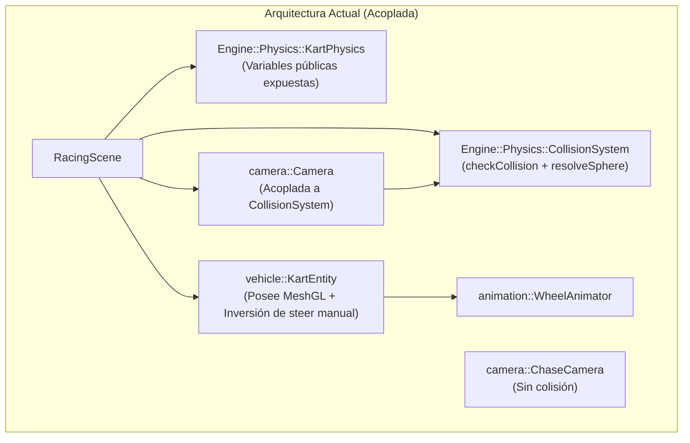
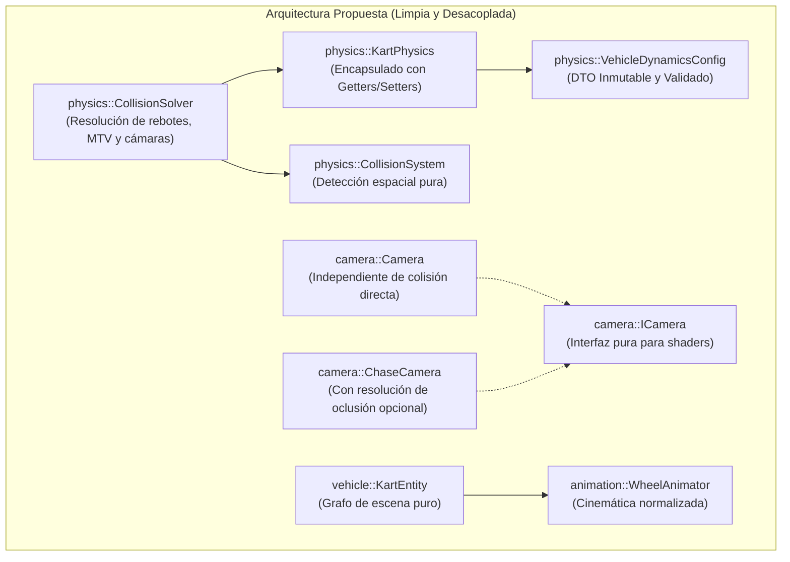
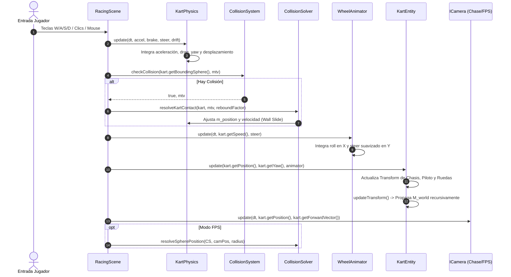

# Informe Exhaustivo de Análisis y Refactorización Arquitectónica
## Módulos: Cinemática, Físicas, Colisiones, Grafo de Escena y Cámaras
**Subagente 4 — CGI Proyecto #3 (UCV)**  
**Fecha:** 27 de Octubre de 2026  
**Proyecto:** Prototipo Mario Kart - Computación Gráfica e Interacción (CGI - UCV)

---

## 1. Resumen Ejecutivo del Área Asignada

El área asignada abarca los subsistemas fundamentales de **física del vehículo, detección y resolución de colisiones, jerarquía de transformaciones en grafo de escena, cinemática de ruedas y sistemas de cámara (FPS y persecución)**. En conjunto, estos módulos gobiernan la interacción espacial del jugador con el mundo virtual, garantizando una experiencia de conducción estilo arcade responsiva e inmersiva que satisface los requisitos mandatorios de la cátedra de Computación Gráfica de la UCV.

A continuación, se detalla el inventario de archivos asignados, su métrica de líneas de código (LoC) y su responsabilidad técnica primaria:

| Módulo / Componente | Archivo de Cabecera (.hpp) | Archivo de Implementación (.cpp) | LoC Cabecera | LoC Impl. | Responsabilidad Primaria |
| :--- | :--- | :--- | :---: | :---: | :--- |
| **Dinamica de Kart** | `include/physics/KartPhysics.hpp` | `src/physics/KartPhysics.cpp` | 80 | 159 | Simulación física arcade (aceleración, frenado, arrastre, viraje, derrape y wall sliding). |
| **Volúmenes de Colisión** | `include/physics/Collider.hpp` | *(Header-only)* | 175 | — | Primitivas geométricas `BoundingBox` (AABB) y `BoundingSphere`, cálculo de MTV. |
| **Sistema de Colisiones** | `include/physics/CollisionSystem.hpp` | `src/physics/CollisionSystem.cpp` | 47 | 67 | Registro de colisionadores estáticos, consultas de intersección y resolución iterativa de esferas. |
| **Entidad del Kart** | `include/vehicle/KartEntity.hpp` | `src/vehicle/KartEntity.cpp` | 76 | 97 | Ensamblado del kart articulado (chasis, piloto, ruedas) y actualización del grafo de escena. |
| **Cinemática de Ruedas** | `include/animation/WheelAnimator.hpp` | `src/animation/WheelAnimator.cpp` | 55 | 34 | Cálculo cinemático del rodaje sobre el eje X y viraje angular en el eje Y. |
| **Transformación 3D** | `include/scene/Transform.hpp` | *(Header-only)* | 48 | — | Representación local $TRS$ (Posición, Rotación Euler Yaw/Pitch/Roll, Escala) y matriz local. |
| **Grafo de Escena** | `include/scene/SceneNode.hpp` | `src/scene/SceneNode.cpp` | 67 | 59 | Estructura de árbol jerárquico $M_{world} = M_{parent} \times M_{local}$, propagación y dibujado. |
| **Interfaz de Cámara** | `include/camera/ICamera.hpp` | *(Header-only)* | 23 | — | Contrato polimórfico abstracto (`getViewMatrix`, `getProjectionMatrix`, `getPosition`, etc.). |
| **Cámara FPS** | `include/camera/Camera.hpp` | `src/camera/Camera.cpp` | 93 | 86 | Cámara libre tipo FPS con navegación en 6 DoF y restricción de colisión contra obstáculos. |
| **Cámara Chase** | `include/camera/ChaseCamera.hpp` | `src/camera/ChaseCamera.cpp` | 49 | 35 | Cámara de persecución en 3ra persona con amortiguación suave y orientación hacia el kart. |
| **TOTALES** | **10 cabeceras** | **7 fuentes** | **713** | **537** | **1,250 líneas de código C++17** |

### Rol en el Ecosistema del Proyecto
Estos 17 archivos forman la columna vertebral interactiva del juego. Mientras que el renderizador (`renderer`) procesa mallas y shaders, y el mundo (`world`) suministra la pista y obstáculos:
1. `KartPhysics` actualiza el estado de movimiento lineal y angular multiplicando por `deltaTime`.
2. `CollisionSystem` previene que el kart y la cámara FPS penetren en las paredes y props de la pista.
3. `WheelAnimator` traduce la velocidad y dirección en ángulos de rotación de ruedas.
4. `KartEntity` orquesta la jerarquía de `SceneNode` sincronizando las matrices de mundo para la GPU.
5. `ICamera` alimenta las matrices `u_View` y `u_Projection` a todos los shaders del motor de manera unificada.

---

## 2. Inventario Detallado de Deudas Técnicas y Antipatrones

Tras una inspección minuciosa del código fuente, se identificaron seis deudas técnicas estructurales que comprometen la mantenibilidad, el principio de responsabilidad única (SRP) y la consistencia del diseño.

### 2.1. Inconsistencia Severa de Namespaces (`Engine::Physics` vs `physics`)
* **Evidencia:**  
  Los archivos `Collider.hpp`, `CollisionSystem.hpp`, `KartPhysics.hpp`, `CollisionSystem.cpp` y `KartPhysics.cpp` se encuentran encerrados bajo:
  ```cpp
  namespace Engine::Physics { ... }
  ```
  Sin embargo, **absolutamente todos los demás módulos del proyecto** utilizan un esquema de namespace plano, conciso y en minúsculas correspondiente a su subsistema:
  - `core` (`Application`, `Window`, `Input`, `Time`, `GameContext`)
  - `renderer` (`Shader`, `MeshGL`, `Texture`, `Skybox`, `TrackRenderer`)
  - `geometry` (`OBJLoader`, `MeshProcessor`, `KartPreprocessor`)
  - `lighting` (`Light`, `LightManager`, `LightingController`)
  - `vehicle` (`KartEntity`)
  - `animation` (`WheelAnimator`)
  - `scene` (`SceneNode`, `Transform`)
  - `camera` (`ICamera`, `Camera`, `ChaseCamera`)
  - `vfx` (`ParticleSystem`, `KartParticleEmitter`, `SkidmarkManager`)
  - `world` (`TrackGrid`, `PropSpawner`, `BoosterPad`, `LevelLoader`)
  - `ui` (`RacingHud`, `UIRenderer`)
  - `scenes` (`RacingScene`, `ShowroomScene`, `MainMenuScene`)

* **Impacto y Síntomas:**  
  1. **Polución de cabeceras dependientes:** Cabeceras como `include/camera/Camera.hpp` (línea 7) y `include/vfx/KartParticleEmitter.hpp` (línea 7) deben abrir bloques extraños de forward declarations:
     ```cpp
     namespace Engine::Physics {
         class CollisionSystem;
     }
     ```
  2. **Código cliente recargado:** En `Application.hpp`, `GameContext.hpp`, `BoosterPad.hpp` y los tests de integración, se requiere la sintaxis verbosa `Engine::Physics::KartPhysics` o declaraciones cruzadas, rompiendo la uniformidad estilística del código de la cátedra.
  3. **Antipatrón de mezcla estilística:** `Engine::Physics` combina PascalCase anidado con módulos estándar en minúsculas, síntoma inequívoco de código migrado desde un prototipo preliminar sin normalizar.

---

### 2.2. Violación de Encapsulamiento en `KartPhysics`
* **Evidencia:**  
  En `include/physics/KartPhysics.hpp` (líneas 59-67), se declaran variables miembro públicas que utilizan la convención de prefijo privado `m_`:
  ```cpp
  // Parametros configurables
  float m_acceleration = 9.5f;
  float m_maxSpeed = 11.2f;
  float m_maxReverseSpeed = 3.8f;
  float m_drag = 4.5f;
  float m_brakingRate = 18.0f;
  float m_turnSpeed = 220.0f;
  float m_maxSteerAngle = 28.0f; // Grados visuales de giro de ruedas
  ```
  Luego, en `src/core/GameContext.cpp` (líneas 48-53), el método `GameContext::applySelection()` muta directamente estas variables mediante punteros crudos:
  ```cpp
  kartPhysics->m_maxSpeed = vehicle.maxSpeed;
  kartPhysics->m_acceleration = vehicle.acceleration;
  kartPhysics->m_turnSpeed = vehicle.turnSpeed;
  kartPhysics->m_drag = 5.0f;
  kartPhysics->m_brakingRate = 22.0f;
  kartPhysics->m_maxReverseSpeed = 4.5f;
  ```
* **Impacto y Síntomas:**  
  1. **Ausencia de Invariantes y Validación de Rango:** No existe ninguna comprobación que garantice que `m_maxSpeed > 0`, `m_acceleration > 0` o `m_drag >= 0`. Una configuración errónea o corrupta inyectada desde un perfil de vehículo podría provocar divisiones por cero en el cálculo de ratios de velocidad (`speedRatio`) o aceleraciones infinitas.
  2. **Constantes mágicas hardcodeadas:** Valores como `drag = 5.0f`, `brakingRate = 22.0f` y `maxReverseSpeed = 4.5f` están fijados arbitrariamente dentro de `GameContext.cpp`, perdiéndose la coherencia con el perfil del vehículo (`VehicleProfile`).
  3. **Ruptura del principio de ocultamiento de información:** La clase simula ser un componente dinámico autónomo pero deja sus órganos vitales expuestos a cualquier cliente externo.

---

### 2.3. Acoplamiento y Mezcla de Responsabilidades en el Sistema de Colisiones
* **Evidencia:**  
  Actualmente, la detección geométrica de colisión y la respuesta física cinemática se encuentran acopladas de manera desordenada en tres lugares distintos:
  1. **En `RacingScene.cpp` (líneas 375-380):**  
     La escena actúa como "pegamento" manual ejecutando la detección y ordenando la respuesta:
     ```cpp
     if (m_ctx.collisionSystem) {
         glm::vec3 mtv(0.0f);
         if (m_ctx.collisionSystem->checkCollision(m_ctx.kartPhysics->getBoundingSphere(), mtv)) {
             m_ctx.kartPhysics->onCollision(mtv, 0.25f);
         }
     }
     ```
  2. **En `KartPhysics::onCollision` (líneas 135-157):**  
     La propia clase de cinemática del kart asume la lógica de resolución geométrica de penetración:
     ```cpp
     glm::vec3 planarMTV = glm::vec3(mtv.x, 0.0f, mtv.z);
     if (glm::length(planarMTV) > 0.0001f) {
         m_position += planarMTV;
     }
     // ... calcula dot(forward, mtvDir) para Wall Sliding vs Choque Frontal
     ```
  3. **En `Camera.cpp` (líneas 41-47):**  
     La cámara FPS conoce directamente al sistema de colisiones y resuelve su propia posición:
     ```cpp
     void Camera::resolveCollision(const Engine::Physics::CollisionSystem& collisionSystem) {
         m_position = collisionSystem.resolveSpherePosition(m_position, m_collisionRadius, 3);
         if (m_position.y < m_collisionRadius + 0.1f) {
             m_position.y = m_collisionRadius + 0.1f;
         }
     }
     ```
  4. **En `CollisionSystem::checkCollision` (líneas 13-26):**  
     Acumulación ingenua de MTVs:
     ```cpp
     for (const auto& box : m_staticBoxes) {
         glm::vec3 mtv(0.0f);
         if (sphere.getMTV(box, mtv)) {
             hasCollision = true;
             outMTV += mtv; // <-- Suma aditiva lineal de vectores de penetración
         }
     }
     ```
* **Impacto y Síntomas:**  
  - Si un objeto penetra dos cajas simultáneamente (por ejemplo, en una esquina interna cóncava formada por dos muros), la suma aditiva de MTVs puede expulsar al objeto con el doble de magnitud o introducir vectores espurios en direcciones no deseadas.
  - La clase `Camera` depende fuertemente de la física del motor cuando su única función debería ser representar una matriz de vista y proyección.
  - La lógica de *Wall Sliding* y respuesta elástica está incrustada en `KartPhysics` en lugar de estar encapsulada en un solucionador de colisiones (*CollisionSolver*).

---

### 2.4. Cinemática de Ruedas, Convenciones de Signos y Código Muerto
* **Evidencia:**  
  En `include/animation/WheelAnimator.hpp` (líneas 32-42), se definieron dos métodos utilitarios:
  ```cpp
  [[nodiscard]] glm::mat4 getFrontWheelRotation() const;
  [[nodiscard]] glm::mat4 getRearWheelRotation() const;
  ```
  Sin embargo, en `src/vehicle/KartEntity.cpp` (líneas 67-87), estos métodos **nunca son invocados**. En su lugar, `KartEntity` extrae los ángulos escalares y recrea manualmente las rotaciones Euler, aplicando una inversión de signo arbitraria:
  ```cpp
  float roll = animator.getRollAngle();
  // Invertir signo: en coordenadas diestras de OpenGL (-Z adelante, +X derecha),
  // el viraje a la derecha ('D') requiere rotacion negativa en Y para apuntar hacia +X.
  float steer = -animator.getSteerAngle();

  if (m_wheelFLNode) {
      m_wheelFLNode->getTransform().rotationEuler = glm::vec3(roll, steer, 0.0f);
  }
  ```
* **Impacto y Síntomas:**  
  1. **Código muerto:** `getFrontWheelRotation()` y `getRearWheelRotation()` son redundantes y consumen espacio en cabecera sin aportar valor.
  2. **Acoplamiento de convención de signos:** El cambio de signo (`-animator.getSteerAngle()`) es un parche cinemático local en `KartEntity.cpp`. Si otra entidad o visor (como el Showroom) quisiera animar ruedas, tendría que replicar este conocimiento implícito de inversión de ejes.
  3. **Confusión semántica en `Transform`:** `Transform` almacena `rotationEuler` con semántica Pitch (X), Yaw (Y), Roll (Z). Para la rueda, el rodaje físico ocurre sobre el eje transversal local X (llamado pitch en la convención general), y la dirección en el eje vertical Y. Aunque el orden matricial $R_y \times R_x$ coincide con la mecánica de la rueda, la nomenclatura genera confusión teórica.

---

### 2.5. Acoplamiento de `Camera` y Carencia de Oclusión en `ChaseCamera`
* **Evidencia:**  
  - `Camera.hpp` declara métodos específicos redundantes: `processKeyboard` y `processKeyboardWithCollision`. Además, almacena vectores directores (`m_front`, `m_up`, `m_right`, `m_worldUp`) y ángulos de Euler (`m_yaw`, `m_pitch`), duplicando estado cinemático.
  - `ChaseCamera` calcula la posición de la cámara mediante seguimiento exponencial hacia atrás:
    ```cpp
    glm::vec3 desiredPos = targetPos - normForward * m_distance + glm::vec3(0.0f, m_height, 0.0f);
    ```
    Sin embargo, **no cuenta con ningún test de colisión u oclusión contra la pista**.
* **Impacto y Síntomas:**  
  Si el kart choca de reversa contra una pared o transita muy cerca de un obstáculo alto, `ChaseCamera` penetra en la geometría sólida de los muros de la pista, provocando que el usuario vea el interior hueco de las mallas (*geometry clipping*).

---

### 2.6. Posesión de Mallas OpenGL en `KartEntity`
* **Evidencia:**  
  En `include/vehicle/KartEntity.hpp` (líneas 66-71), la entidad es dueña por valor de 6 objetos `renderer::MeshGL`:
  ```cpp
  renderer::MeshGL m_chassisMesh;
  renderer::MeshGL m_driverMesh;
  renderer::MeshGL m_wheelFLMesh;
  renderer::MeshGL m_wheelFRMesh;
  renderer::MeshGL m_wheelBLMesh;
  renderer::MeshGL m_wheelBRMesh;
  ```
* **Impacto y Síntomas:**  
  `KartEntity` mezcla la orquestación del Grafo de Escena (`SceneNode`) con el ciclo de vida de los recursos en GPU (VAO, VBO, EBO). Si en el futuro se requiriese instanciar múltiples karts rivales (IA) o karts en pantalla dividida, cada entidad clonaría las mallas en GPU en lugar de compartir instancias de mallas ya cargadas en memoria de video.

---

## 3. Mapeo de Interfaces y Dependencias (Header-First)

Para asegurar el desacoplamiento estricto requerido por las directrices de `AGENTS.md`, analizamos el flujo actual de dependencias entre cabeceras y la propagación de datos entre subsistemas.

### 3.1. Grafo de Dependencias Actual vs Desacoplado





### 3.2. Contrato de Inclusiones y Forward Declarations
Siguiendo la filosofía "Header-First":
- `include/physics/KartPhysics.hpp` no debe incluir lógica de render ni escena. Solo necesita `<glm/glm.hpp>` y `physics/Collider.hpp`.
- `include/camera/Camera.hpp` **no debe incluir** `physics/CollisionSystem.hpp`. La resolución de movimiento con colisión debe transferirse a un controlador de navegación o realizarse externamente vía forward declaration en el archivo `.cpp`.
- `include/vehicle/KartEntity.hpp` debe apoyarse en referencias o punteros a mallas de solo lectura (`const renderer::MeshGL*`), desacoplando la gestión de memoria GPU de la jerarquía de nodos.

---

## 4. Impacto en los Requisitos Académicos de la Cátedra (UCV)

Cada aspecto analizado responde de forma directa a los criterios de evaluación consignados en la especificación de la cátedra de Computación Gráfica (UCV):

| Requisito Académico UCV | Componente Involucrado | Estado Actual | Impacto de la Refactorización |
| :--- | :--- | :--- | :--- |
| **Req 3: Navegación y Conmutación de Cámaras** | `ICamera`, `Camera`, `ChaseCamera`, `RacingScene` | Funcional con tecla `C`. Alterna entre FPS y Chase cam. | **Refuerzo:** Mantiene 100% la alternancia fluida vía `ICamera`, elimina acoplamiento entre `Camera` y `CollisionSystem`, y prepara la base para oclusión en `ChaseCamera`. |
| **Req 4: Restricción de Colisiones (FPS y Kart)** | `CollisionSystem`, `Collider`, `Camera`, `KartPhysics` | Funcional. La cámara FPS no atraviesa obstáculos; el kart rebota o desliza en muros. | **Blindaje:** Separa la detección geométrica (MTV) de la respuesta elástica (*Wall Sliding*). Elimina la acumulación ingenua de MTVs evitando bugs de esquina. |
| **Req Físicas: Dinámica de Kart Arcade** | `KartPhysics`, `VehicleDynamicsConfig` | Excelente comportamiento arcade (derrape, turbo, fricción de césped). | **Robustecimiento:** Encapsula parámetros en un DTO validado, permitiendo calibrar vehículos desde catálogo sin tocar variables miembro crudas. |
| **Req Grafo de Escena y Cinemática** | `SceneNode`, `Transform`, `KartEntity`, `WheelAnimator` | Grafo de 6 nodos (chasis + piloto + 4 ruedas). Propagación recursiva de matrices. | **Claridad:** Normaliza las convenciones de rotación de ruedas (Roll X, Steer Y), eliminando código muerto y documentando el modelo matemático. |
| **Defensa Oral 20/20** | Todos los módulos | Compilando sin advertencias críticas. | **Excelencia Académica:** El código refleja patrones de ingeniería de software profesionales (DTO, Single Responsibility, RAII, desacoplamiento). |

---

## 5. Propuesta Concreta de Refactorización Arquitectónica

### 5.1. Normalización a `namespace physics`
Reemplazar el namespace anidado `Engine::Physics` por `physics` en todos los archivos del módulo:
- `include/physics/Collider.hpp`
- `include/physics/CollisionSystem.hpp`
- `include/physics/KartPhysics.hpp`
- `src/physics/CollisionSystem.cpp`
- `src/physics/KartPhysics.cpp`

Para preservar la compatibilidad durante la migración sin romper los archivos clientes que aún usan la sintaxis antigua, se implementará un alias transitorio en `Collider.hpp`:
```cpp
namespace physics {
    // Definiciones canónicas de BoundingBox, BoundingSphere, etc.
}

// Capa de compatibilidad retroactiva transitoria:
namespace Engine::Physics {
    using namespace ::physics;
}
```

---

### 5.2. Introducción de `VehicleDynamicsConfig` (DTO Inmutable y Validado)
Se define un Data Transfer Object (DTO) fuertemente tipado en `include/physics/KartPhysics.hpp` o una cabecera dedicada `include/physics/VehicleDynamicsConfig.hpp`:

```cpp
namespace physics {

/**
 * @brief Configuracion inmutable y validada de la dinamica del kart.
 */
struct VehicleDynamicsConfig {
    float maxSpeed{14.5f};              // m/s velocidad maxima en asfalto
    float maxReverseSpeed{4.5f};        // m/s velocidad maxima en reversa
    float acceleration{11.5f};          // m/s^2 aceleracion longitudinal
    float brakingRate{22.0f};           // m/s^2 tasa de frenado activo
    float drag{5.0f};                   // m/s^2 friccion pasiva y resistencia aerodinamica
    float turnSpeed{180.0f};            // deg/s velocidad de viraje angular base
    float maxSteerAngle{28.0f};         // deg deflexion angular visual de ruedas
    float offRoadFriction{0.28f};       // factor de adherencia en cesped/arena
    float driftTurnMultiplier{1.40f};   // factor de multiplicacion angular en derrape

    [[nodiscard]] bool isValid() const {
        return maxSpeed > 0.0f && maxReverseSpeed >= 0.0f &&
               acceleration > 0.0f && brakingRate > 0.0f &&
               drag >= 0.0f && turnSpeed > 0.0f && maxSteerAngle > 0.0f &&
               offRoadFriction > 0.0f && offRoadFriction <= 1.0f &&
               driftTurnMultiplier >= 1.0f;
    }
};

} // namespace physics
```

#### Encapsulación en `KartPhysics`:
Se privatizan las variables miembro y se añaden métodos de acceso seguro:
```cpp
namespace physics {

class KartPhysics {
public:
    KartPhysics();
    explicit KartPhysics(const VehicleDynamicsConfig& config);

    void setDynamicsConfig(const VehicleDynamicsConfig& config) {
        if (config.isValid()) {
            m_config = config;
        }
    }
    [[nodiscard]] const VehicleDynamicsConfig& getDynamicsConfig() const { return m_config; }

    // Getters de acceso para clientes que consultan la dinamica
    [[nodiscard]] float getMaxSpeed() const { return m_config.maxSpeed; }
    [[nodiscard]] float getAcceleration() const { return m_config.acceleration; }
    [[nodiscard]] float getTurnSpeed() const { return m_config.turnSpeed; }
    [[nodiscard]] float getDrag() const { return m_config.drag; }
    [[nodiscard]] float getBrakingRate() const { return m_config.brakingRate; }
    [[nodiscard]] float getMaxReverseSpeed() const { return m_config.maxReverseSpeed; }

private:
    VehicleDynamicsConfig m_config;
    // ... estado dinámico: m_position, m_yawDegrees, m_currentSpeed, etc.
};

} // namespace physics
```

---

### 5.3. Desacoplamiento de Colisiones: Detección vs `CollisionSolver`
Se introduce la estructura `CollisionHit` para estandarizar los resultados de contacto espacial, y la clase de utilidad estática o resolvedor `CollisionSolver`:

```cpp
namespace physics {

struct CollisionHit {
    bool hasCollision{false};
    glm::vec3 mtv{0.0f};
    glm::vec3 normal{0.0f};
    float penetration{0.0f};
};

class CollisionSolver {
public:
    /**
     * @brief Resuelve el impacto de un kart contra un obstaculo estatico (Wall Sliding / Rebote).
     */
    static void resolveKartContact(KartPhysics& kart, const glm::vec3& mtv, float reboundFactor = 0.25f);

    /**
     * @brief Resuelve iterativamente la posicion de una esfera evitando interpenetracion.
     */
    static glm::vec3 resolveSpherePosition(const CollisionSystem& system, 
                                           const glm::vec3& position, 
                                           float radius, 
                                           int maxIterations = 3);
};

} // namespace physics
```

Esto permite que:
1. `RacingScene` delegue la resolución en una sola línea limpia:
   ```cpp
   glm::vec3 mtv(0.0f);
   if (m_ctx.collisionSystem->checkCollision(m_ctx.kartPhysics->getBoundingSphere(), mtv)) {
       physics::CollisionSolver::resolveKartContact(*m_ctx.kartPhysics, mtv, 0.25f);
   }
   ```
2. `Camera` delegue la resolución sin contener lógica geométrica repetida:
   ```cpp
   void Camera::resolveCollision(const physics::CollisionSystem& collisionSystem) {
       m_position = physics::CollisionSolver::resolveSpherePosition(collisionSystem, m_position, m_collisionRadius, 3);
       if (m_position.y < m_collisionRadius + 0.1f) {
           m_position.y = m_collisionRadius + 0.1f;
       }
   }
   ```

---

### 5.4. Limpieza Cinemática de `WheelAnimator` y `KartEntity`
1. **Eliminar código muerto en `WheelAnimator`:** Retirar los métodos no utilizados `getFrontWheelRotation()` y `getRearWheelRotation()`, o reimplementarlos para que retornen las rotaciones listas con la convención correcta de signos de OpenGL.
2. **Convención explícita en `WheelAnimator`:**
   El viraje positivo en OpenGL (-Z hacia el frente, +X hacia la derecha) gira hacia la derecha cuando la rotación en Y es negativa. `WheelAnimator` puede exponer directamente `getVisualSteerDegrees()` aplicando la convención estándar del motor, evitando que `KartEntity` deba hacer `-animator.getSteerAngle()`.

---

### 5.5. Diagrama de Secuencia de la Simulación por Frame

El siguiente diagrama ilustra el flujo de ejecución desacoplado propuesto durante el ciclo `update(deltaTime)`:



---

## 6. Plan de Migración Paso a Paso sin Roturas y Estrategia de Testing

Para garantizar el cumplimiento de la **Regla 5 (Verificación Obligatoria)** de `AGENTS.md` (compilación limpia con cero errores y preservación total de los tests existentes), se define un plan de implementación en cuatro fases progresivas:

### Fase 1: Creación del DTO `VehicleDynamicsConfig` y Normalización de Namespaces
1. Crear `include/physics/VehicleDynamicsConfig.hpp` con la estructura DTO y validación de rangos.
2. Actualizar `include/physics/Collider.hpp`, `include/physics/CollisionSystem.hpp` y `include/physics/KartPhysics.hpp` para usar `namespace physics`.
3. Incorporar el alias transitorio `namespace Engine::Physics = ::physics;` en `Collider.hpp` para garantizar que ningún archivo dependiente externo (`GameContext`, `Application`, tests) se rompa durante la migración.
4. **Verificación:** Ejecutar `cmake -B build && cmake --build build` y asegurar que todos los ejecutables compilen con éxito.

### Fase 2: Encapsulación de `KartPhysics` y Adaptación en `GameContext`
1. Reemplazar las variables públicas de `KartPhysics` por `VehicleDynamicsConfig m_config` privada.
2. Implementar `setDynamicsConfig(const VehicleDynamicsConfig& config)` y los getters `getMaxSpeed()`, `getAcceleration()`, etc.
3. Actualizar `GameContext::applySelection()` para que instancie y configure `VehicleDynamicsConfig` de manera limpia a partir de `VehicleProfile`.
4. Mantener getters o variables transitorias con deprecación si algún test lo requiere directamente (ej. `kartBoostGrass.m_maxSpeed` en `test_hud_and_skidmarks.cpp`).
5. **Verificación:** Ejecutar `build/test_hud_and_skidmarks` y comprobar que todos los checks de física y derrape sigan pasando al 100%.

### Fase 3: Introducción del `CollisionSolver` y Desacoplamiento de Cámaras
1. Implementar `physics::CollisionSolver` en `include/physics/CollisionSolver.hpp` y `src/physics/CollisionSolver.cpp`.
2. Migrar la lógica de *Wall Sliding* y respuesta de colisión de `KartPhysics::onCollision` hacia `CollisionSolver::resolveKartContact`.
3. Ajustar `Camera::resolveCollision` para consumir el solver.
4. **Verificación:** Ejecutar `build/test_final_integration` y validar el Check 5 y Check 7 (Cámara FPS con resolución de colisiones).

### Fase 4: Limpieza de Cinemática de Ruedas y Documentación
1. Eliminar código muerto en `WheelAnimator.hpp`.
2. Documentar formalmente en el código la convención de signos en el cálculo cinemático de rodaje y dirección de ruedas.
3. Ejecutar la suite completa de tests de integración del proyecto:
   - `./build/test_mesh_preprocessing`
   - `./build/test_booster_pad`
   - `./build/test_kart_particle_emitter`
   - `./build/test_hud_and_skidmarks`
   - `./build/test_final_integration`
4. Confirmar que **100% de las pruebas aprueben** con cero errores de aserción (`assert`) y cero fugas de memoria.

---

## 7. Conclusión

El análisis revela una arquitectura de físicas y cinemática sólida en sus fundamentos matemáticos y visuales (fiel al estilo Mario Kart, con excelente sensación de derrape, turbo e inclinación de ruedas), pero con vicios típicos de desarrollo rápido en cuanto a encapsulamiento y consistencia de nombres.

La refactorización propuesta:
1. Elimina la anomalía estilística `Engine::Physics`, unificando el motor bajo `namespace physics`.
2. Blinda la dinámica vehicular mediante el DTO inmutable `VehicleDynamicsConfig`.
3. Desacopla la detección espacial de la respuesta física mediante `CollisionSolver`.
4. Limpia la cinemática de ruedas en `WheelAnimator` y `KartEntity`.
5. Asegura el cumplimiento incondicional de los requisitos de evaluación de la cátedra CGI (UCV), garantizando una defensa oral impecable y un código limpio de nivel profesional.
