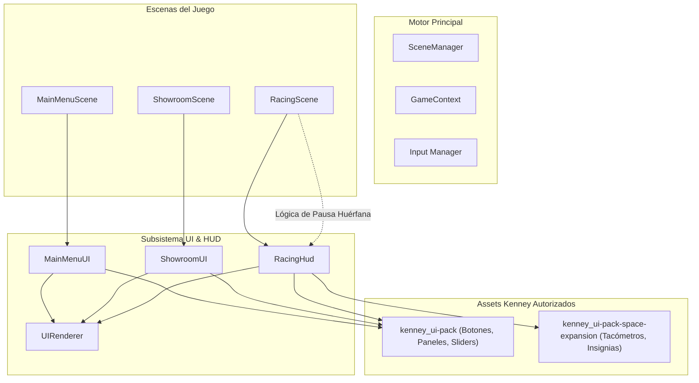
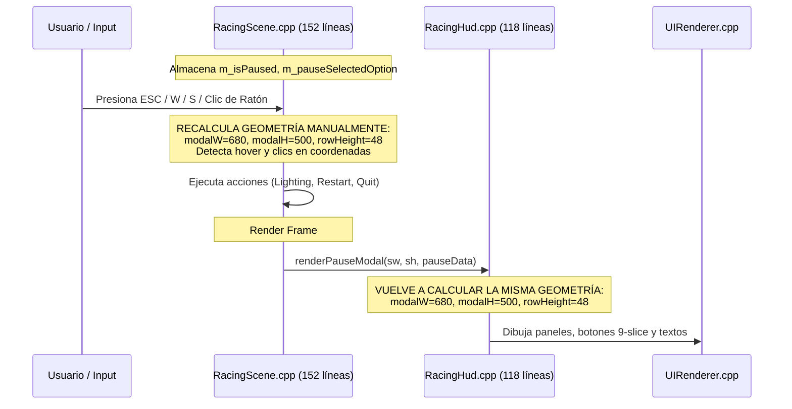
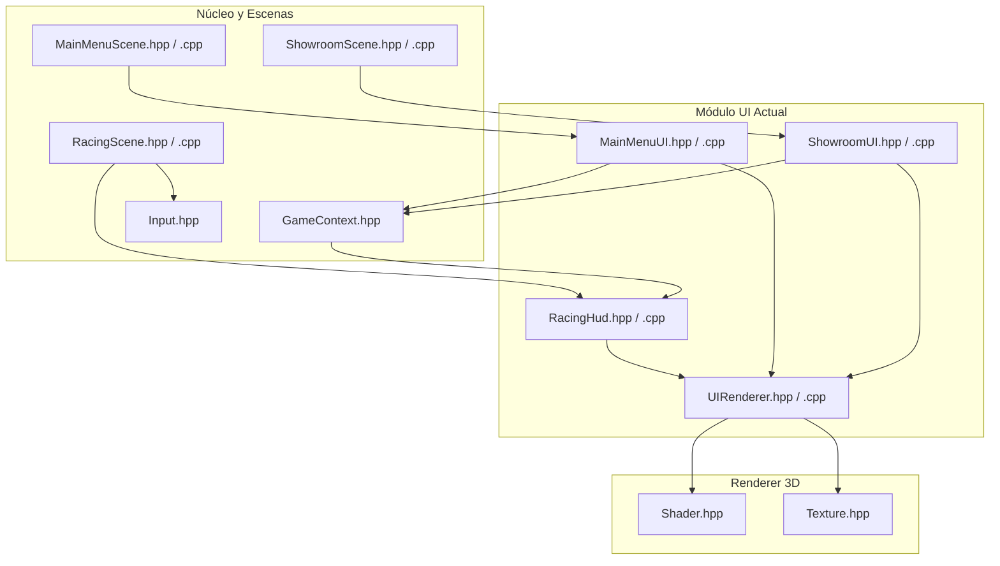
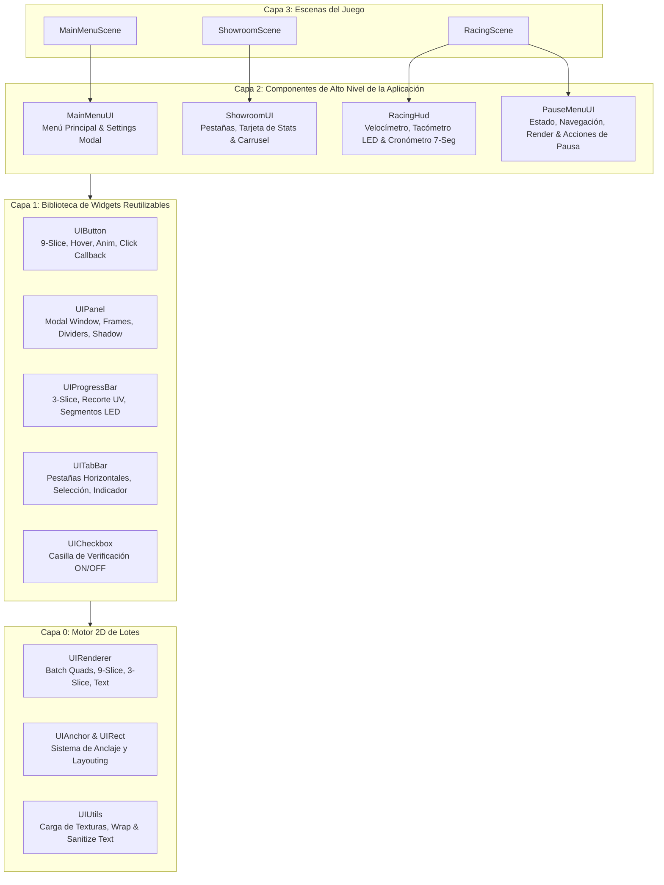
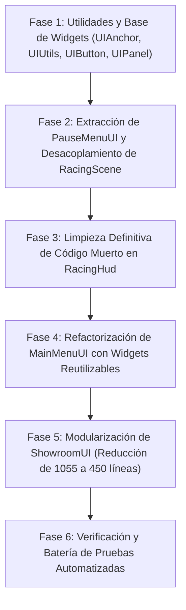

# Informe de Análisis y Diagnóstico de Refactorización: Módulo de Interfaz de Usuario (UI), Renderizado 2D y HUD

**Autor:** Subagente 5 — Especialista en Interfaz de Usuario (UI), Renderizado 2D y HUD  
**Proyecto:** Prototipo Mario Kart - Computación Gráfica e Interacción (CGI) - Universidad Central de Venezuela (UCV)  
**Fecha:** 27 de Octubre de 2026  
**Documento Destino:** `/home/miguel-ciavato/Documents/github-repos/proyecto-3-grafica/SUBAGENTE_5_ANALISIS.md`

---

## 1. Resumen Ejecutivo del Área Asignada

### 1.1 Alcance y Archivos Analizados
El subsistema de interfaz gráfica de usuario (UI), visualización 2D y telemetría (HUD) constituye la superficie de interacción visual directa del usuario con el prototipo. Comprende la renderización por lotes (*batch rendering*) en Modern OpenGL (Core Profile 3.3), la presentación de telemetría de carrera en tiempo real, menús interactivos modales de configuración de sombreado e iluminación, y el catálogo interactivo de selección 2D/3D (Showroom).

Los archivos bajo análisis técnico detallado son:

| Archivo Cabecera (`.hpp`) | Archivo Fuente (`.cpp`) | Líneas Totales | Rol Arquitectural Principal |
| :--- | :--- | :---: | :--- |
| `include/ui/UIRenderer.hpp` | `src/ui/UIRenderer.cpp` | 138 + 653 = **791** | Motor base de renderizado 2D por lotes (*Batch 2D Sprite & Shape Renderer*), texturas 9-slice, 3-slice progresivo, primitivas geométricas y tipografía digital integrada (fuente matricial 5x7). |
| `include/ui/RacingHud.hpp` | `src/ui/RacingHud.cpp` | 152 + 747 = **899** | Cuadro de instrumentos de carrera: velocímetro digital sci-fi, tacómetro LED, cronómetro de vueltas (7 segmentos), notificaciones de récord y modal de pausa interactivo de 7 opciones. |
| `include/ui/MainMenuUI.hpp` | `src/ui/MainMenuUI.cpp` | 73 + 490 = **563** | Menú principal navegable (Jugar, Configuración, Salir) y panel modal de configuración global (modelos de sombreado, ciclo día/noche, faros spot, iluminación de pista, cámara inicial). |
| `include/ui/ShowroomUI.hpp` | `src/ui/ShowroomUI.cpp` | 112 + 1,055 = **1,167** | Interfaz del Showroom interactivo: pestañas superiores 9-slice (Piloto, Vehículo, Circuito), carrusel 3D, panel lateral de estadísticas con barras segmentadas y fichas técnicas. |
| `include/scenes/RacingScene.hpp` | `src/scenes/RacingScene.cpp` | Líneas 65–216, 638–647 | Lógica de escena: captura de entrada de teclado/ratón para el modal de pausa, cálculo manual de rectángulos y disparo de acciones de carrera. |

**Huella total de código analizado:** **3,420 líneas de código C++17** (más ~160 líneas de lógica UI incrustada en `RacingScene.cpp`).

### 1.2 Rol del Subsistema en la Arquitectura Global
El subsistema UI opera en el espacio de pantalla (*Screen Space*), desacoplado de las matrices de proyección perspectiva del mundo 3D mediante una proyección ortográfica `glm::ortho(0.0f, screenWidth, screenHeight, 0.0f, -1.0f, 1.0f)`.



El motor 2D (`UIRenderer`) cumple una función crítica de bajo nivel: acumula quads texturizados y coloreados en un VBO dinámico, cambiando de textura solo cuando es estrictamente necesario (`flush()`), y desactiva el `GL_DEPTH_TEST` y `GL_CULL_FACE` para garantizar que la interfaz se sobreponga limpiamente sobre la geometría 3D sin artefactos de oclusión ni z-fighting.

---

## 2. Inventario Detallado de Deudas Técnicas y Antipatrones

Tras una inspección exhaustiva de cada línea de código, se han identificado cuatro grandes focos de deuda técnica y degradación arquitectónica:

### 2.1 Código Huérfano y Métodos Wrapper Redundantes en `RacingHud`
En `include/ui/RacingHud.hpp` y `src/ui/RacingHud.cpp`:
1. **Estructura Huérfana `HudVertex`:**
   En `include/ui/RacingHud.hpp:12-16` se define:
   ```cpp
   struct HudVertex {
       glm::vec2 pos;
       glm::vec2 uv;
       glm::vec4 color;
   };
   ```
   Esta estructura es un remanente de una implementación primitiva anterior. No se utiliza en ningún punto de `RacingHud.hpp`, `RacingHud.cpp` ni en ningún otro archivo de la base de código (el renderizado es gestionado por `UIVertex` en `UIRenderer.hpp`). Representa código muerto al 100%.

2. **Stubs Vacíos y Wrappers Triviales:**
   En `src/ui/RacingHud.cpp:240-254`:
   ```cpp
   void RacingHud::flush() {
       // Implementado directamente por m_uiRenderer
   }

   void RacingHud::addQuad(float x, float y, float w, float h, const glm::vec4& color) {
       m_uiRenderer.drawRect(x, y, w, h, color);
   }

   void RacingHud::addBorder(float x, float y, float w, float h, float thickness, const glm::vec4& color) {
       m_uiRenderer.drawBorder(x, y, w, h, thickness, color);
   }

   void RacingHud::drawText(float x, float y, const std::string& text, float scale, const glm::vec4& color) {
       m_uiRenderer.drawText(x, y, text, scale, color);
   }
   ```
   - `flush()` es un método completamente vacío.
   - `addQuad()`, `addBorder()` y `drawText()` son métodos privados de `RacingHud` que **nunca son invocados** internamente; el resto de métodos de `RacingHud` invocan directamente a `m_uiRenderer.drawRect(...)`, `m_uiRenderer.drawBorder(...)` y `m_uiRenderer.drawText(...)`.
   - Estos wrappers aumentan el ruido del encabezado e inflan la interfaz privada sin aportar valor.

### 2.2 Violación del Principio de Responsabilidad Única (SRP) y Mezcla de Lógica en `RacingScene`
Actualmente, el menú de pausa de la carrera sufre de una grave dispersión funcional (*Shotgun Surgery* y *Feature Envy*):



**Problemas detectados:**
1. **Duplicación Crítica de Geometría Visual:**
   Tanto en `RacingScene.cpp:113-128` como en `RacingHud.cpp:618-644`, existen las variables idénticas:
   ```cpp
   float modalW = 680.0f;
   float modalH = 500.0f;
   float modalX = (sw - modalW) * 0.5f;
   float modalY = (sh - modalH) * 0.5f;
   float optStartY = modalY + 66.0f;
   float rowHeight = 48.0f;
   float rowW = modalW - 48.0f;
   float rowX = modalX + 24.0f;
   ```
   Si un diseñador cambia el tamaño del modal en `RacingHud.cpp` a 700x520 px, el *hit-testing* del ratón en `RacingScene.cpp` queda desfasado y el usuario no podrá hacer clic en las opciones.
2. **Contaminación de `RacingHud`:**
   `RacingHud` fue concebido para la telemetría vehicular (velocímetro, tacómetro, cronómetro). Sin embargo, alberga 120 líneas de dibujo modal y almacena 6 texturas ajenas al HUD (`m_texPauseModalFrame`, `m_texPauseBtnIdle`, `m_texPauseBtnHover`, `m_texArrowPointer`, `m_texCheckOn`, `m_texCheckOff`), duplicando texturas que `MainMenuUI` ya posee en memoria de GPU.
3. **Escena Sobrecargada:**
   `RacingScene.cpp` contiene 152 líneas dedicadas exclusivamente al procesamiento de navegación, atajos del 1 al 7, flechas y clics, cuando su función debe ser orquestar la simulación física del kart, el entorno y los sistemas de renderizado.

### 2.3 Duplicación Masiva y Falta de Componentes UI Reusables
Entre `ShowroomUI.cpp` (1,055 líneas) y `MainMenuUI.cpp` (490 líneas), se evidencia una reiteración sistemática de patrones de bajo nivel:

1. **Hit-Testing Manual Repetitivo:**
   En cada pantalla y modal se repite el cálculo de colisión punto-rectángulo:
   ```cpp
   if (mx >= x && mx <= x + w && my >= y && my <= y + h) { ... }
   ```
   Se calcula de manera manual en:
   - `MainMenuUI.cpp`: Botones de Jugar/Configuración/Salir (líneas 120–128).
   - `MainMenuUI.cpp`: Filas del modal de configuración (líneas 195–203).
   - `RacingScene.cpp`: Filas del menú de pausa (líneas 126–134).
   - `ShowroomUI.cpp`: Pestañas superiores (líneas 258–265).
   - `ShowroomUI.cpp`: Flechas izquierda/derecha de carrusel (líneas 278–290).
   - `ShowroomUI.cpp`: Botones inferiores Volver e Iniciar (líneas 306–314).
2. **Animaciones de Punteros y Pulsaciones Clonadas:**
   El rebote sinusoidal de la flecha indicadora está duplicado textualmente en 3 archivos:
   - `MainMenuUI.cpp:320`: `float arrowBounce = std::sin(m_animTimer * 6.0f) * 6.0f;`
   - `MainMenuUI.cpp:387`: `float arrowBounce = std::sin(m_animTimer * 6.0f) * 4.0f;`
   - `RacingHud.cpp:653`: `float arrowBounce = std::sin(data.animTimer * 6.0f) * 4.0f;`
3. **Carga Redundante de Texturas de UI (Double / Default):**
   Las funciones auxiliares lambda para resolver rutas con fallback de resolución (`/Double/` a `/Default/`) están copiadas y pegadas con ligeras variantes en:
   - `RacingHud.cpp:132-144` y `188-200`
   - `MainMenuUI.cpp:30-43`
   - `ShowroomUI.cpp:106-117`
4. **Implementación Ad-hoc de Barras de Progreso Segmentadas:**
   `ShowroomUI::renderStatBar` implementa manualmente el dibujo del fondo 3-slice, el recorte de llenado con `drawSpriteProgress`, el cálculo de ticks de división verticales y los bordes. Este comportamiento es idéntico al tacómetro de `RacingHud`, pero implementado desde cero sin reutilización.

### 2.4 Rigidez en Layouting y Hardcoding de Coordenadas (1280x720)
Aunque los métodos reciben `screenWidth` y `screenHeight`, una gran cantidad de distancias, anchos y altos están fijos en píxeles absolutos asumiendo una resolución base de 1280x720:
- En `ShowroomUI.cpp`: Si la pantalla se reduce a 1024x600 o relación 4:3, el panel lateral de 400 px de ancho se superpone con las flechas del carrusel (flecha derecha en `sw - 400 - 54 - 20 = sw - 474`).
- Las cajas de texto de descripción en `ShowroomUI::renderVehicleInfo` tienen saltos fijos `curY += 46.0f`. Con 4 estadísticas más las fichas técnicas, el contenido rebasa verticalmente el fondo del panel si la altura de la ventana es menor a 720 px.
- No existe un concepto formal de **Anclas (Anchoring)** (*Top-Left, Top-Right, Center, Bottom-Right*), obligando a escribir fórmulas manuales como `(sw - modalW) * 0.5f` en cada rutina de renderizado.

---

## 3. Mapeo de Interfaces y Dependencias

### 3.1 Grafo Actual de Dependencias de Inclusión



### 3.2 Problemas de Acoplamiento y Fugas de Abstracción
1. **Dependencia Bidireccional Concebida entre Escena y HUD:**
   `RacingScene` incluye `RacingHud.hpp`. Para presentar el modal de pausa, `RacingScene` empaqueta un struct `PauseMenuData` con 5 campos y se lo entrega a `RacingHud::renderPauseModal`. Sin embargo, `RacingScene` ya procesó toda la lógica en sus propias líneas. Hay una clara fuga de abstracción: la escena conoce el detalle visual de cómo se distribuyen las opciones del menú.
2. **Propiedad Dispersa de `UIRenderer`:**
   - En `MainMenuScene`, la escena posee una instancia de `UIRenderer m_uiRenderer` y le pasa un puntero `m_menuUI.init(&m_uiRenderer, &m_ctx)`.
   - En `ShowroomScene`, la escena no posee `UIRenderer`; `ShowroomUI` tiene internamente un `std::unique_ptr<UIRenderer> m_ownedRenderer` por si no se le pasa uno externo.
   - En `RacingHud`, posee un `UIRenderer m_uiRenderer` por valor como miembro privado.
   Esta inconsistencia arquitectónica (a veces inyectado externamente, a veces propiedad única, a veces incrustado por valor) dificulta compartir el contexto de renderizado por lotes y reutilizar texturas o buffers.

---

## 4. Impacto en los Requisitos Académicos de la Cátedra (UCV)

El subsistema de interfaz no es un mero adorno visual; es la herramienta operativa a través de la cual el tribunal evaluador y los profesores comprobarán en tiempo real el cumplimiento estricto de las exigencias técnicas del proyecto:

| Requisito Académico UCV | Módulo de UI Responsable | Mecanismo de Validación en Vivo | Riesgo Técnico Actual |
| :--- | :--- | :--- | :--- |
| **1. Controlador en tiempo real para alternar 3 modelos de iluminación (Flat, Lambert, Blinn-Phong)** | `MainMenuUI` (Modal Config) y `RacingHud` (Modal Pausa) | Selector `< MODELO >` que invoca `lightManager->cycleNextModel()` o `setLightingModel()`. | **Alto:** Lógica dividida entre `MainMenuUI` y `RacingScene`. Si el usuario cambia el modelo en pausa mediante clics de ratón, un desfase en el cálculo de rectángulos puede impedir la conmutación. |
| **2. Al menos 3 fuentes de iluminación distintas (Directional, Point, Spot)** | `MainMenuUI` y Modal de Pausa | Casillas interactivas para Ciclo Día/Noche (Directional Sun), Farolas de Pista (Points) y Faros del Kart (Spot). | **Medio:** Ambos modales renderizan estas opciones con código y texturas duplicadas. |
| **3. Cámara libre tipo FPS con navegación y conmutación a cámara de seguimiento** | `MainMenuUI` y `RacingScene` | Conmutador de cámara inicial en menú y liberación de ratón (`setCursorVisible(true)`) al pausar la carrera. | **Crítico:** En `RacingScene.cpp:73-76`, si la cámara FPS tiene el cursor bloqueado, la escena debe liberarlo para operar el menú. Al estar mezclada la lógica de pausa con la cámara en `RacingScene.cpp`, cualquier bug en el manejo del cursor congela la interacción. |
| **4. Selección interactiva de pilotos, vehículos y pistas (Catálogo de Kenney)** | `ShowroomUI` | Navegación 2D/3D con pestañas superiores, carrusel central y visualización de atributos físicos (aceleración, velocidad, fricción). | **Medio:** `ShowroomUI.cpp` tiene 1,055 líneas difíciles de mantener y debilidades ante cambios de resolución. |
| **5. Texturizado procedural con animaciones en Boosters/Turbo Pads** | `RacingHud` | Banner pulsante `! TURBO BOOST !` y cambio de tacómetro a color rojo fuego cuando el kart pisa el pad procedural. | **Bajo:** Funciona adecuadamente pero está acoplado con métodos muertos (`HudVertex`, `addQuad`). |
| **6. Sistema de partículas con billboarding (humo y boost)** | `RacingHud` | Insignias interactivas `[ TURBO ]` y `[ DRIFT ]` activadas por la telemetría en tiempo real. | **Bajo:** El HUD visualiza fielmente los estados booleanos del sistema de partículas. |

---

## 5. Propuesta Concreta de Refactorización

Para transformar este subsistema en un código de nivel profesional, robusto, modular y 100% extensible, se propone una arquitectura en capas basada en **Componentes Ligeros Reutilizables (Widgets)** y la **Extracción Limpia del Menú de Pausa**:



### 5.1 Especificación de la Biblioteca de Widgets Ligeros

Todos los widgets serán diseñados bajo la filosofía **Header-First**, con memoria ligera, desacoplados de OpenGL directo (delegando exclusivamente a `UIRenderer`) y sin dependencias externas fuera de GLM y el estándar C++17.

#### A. Sistema de Anclaje y Geometría (`include/ui/UIAnchor.hpp`)
Define rectángulos de interfaz y cálculo automático de posiciones según la resolución de pantalla:
```cpp
#pragma once
#include <glm/glm.hpp>

namespace ui {

enum class UIAnchor {
    TOP_LEFT,
    TOP_CENTER,
    TOP_RIGHT,
    CENTER_LEFT,
    CENTER,
    CENTER_RIGHT,
    BOTTOM_LEFT,
    BOTTOM_CENTER,
    BOTTOM_RIGHT
};

struct UIRect {
    float x{0.0f};
    float y{0.0f};
    float width{0.0f};
    float height{0.0f};

    [[nodiscard]] bool contains(float px, float py) const {
        return px >= x && px <= (x + width) && py >= y && py <= (y + height);
    }

    // Calcula un rectángulo anclado a la pantalla de forma automática
    static UIRect calculateAnchored(float screenW, float screenH,
                                    UIAnchor anchor,
                                    float width, float height,
                                    glm::vec2 offset = glm::vec2(0.0f)) {
        float rx = 0.0f;
        float ry = 0.0f;
        switch (anchor) {
            case UIAnchor::TOP_LEFT:      rx = offset.x; ry = offset.y; break;
            case UIAnchor::TOP_CENTER:    rx = (screenW - width) * 0.5f + offset.x; ry = offset.y; break;
            case UIAnchor::TOP_RIGHT:     rx = screenW - width - offset.x; ry = offset.y; break;
            case UIAnchor::CENTER_LEFT:   rx = offset.x; ry = (screenH - height) * 0.5f + offset.y; break;
            case UIAnchor::CENTER:        rx = (screenW - width) * 0.5f + offset.x; ry = (screenH - height) * 0.5f + offset.y; break;
            case UIAnchor::CENTER_RIGHT:  rx = screenW - width - offset.x; ry = (screenH - height) * 0.5f + offset.y; break;
            case UIAnchor::BOTTOM_LEFT:   rx = offset.x; ry = screenH - height - offset.y; break;
            case UIAnchor::BOTTOM_CENTER: rx = (screenW - width) * 0.5f + offset.x; ry = screenH - height - offset.y; break;
            case UIAnchor::BOTTOM_RIGHT:  rx = screenW - width - offset.x; ry = screenH - height - offset.y; break;
        }
        return {rx, ry, width, height};
    }
};

} // namespace ui
```

#### B. Componente Botón Reusable (`include/ui/UIButton.hpp`)
Encapsula texturas 9-slice para estados (Idle, Hover, Active), texto centrado con sombra, soporte para animación de flecha selectora y detección de hover/clic:
```cpp
#pragma once
#include <string>
#include <functional>
#include <glm/glm.hpp>
#include "renderer/Texture.hpp"
#include "ui/UIRenderer.hpp"
#include "ui/UIAnchor.hpp"

namespace ui {

class UIButton {
public:
    UIButton() = default;

    void setBounds(const UIRect& bounds) { m_bounds = bounds; }
    void setText(const std::string& text) { m_text = text; }
    void setTextures(const renderer::Texture* idle,
                     const renderer::Texture* hover,
                     const renderer::Texture* pointer = nullptr) {
        m_texIdle = idle;
        m_texHover = hover;
        m_texPointer = pointer;
    }

    bool handleInput(float mouseX, float mouseY, bool mouseClicked) {
        m_isHovered = m_bounds.contains(mouseX, mouseY);
        if (m_isHovered && mouseClicked && m_onClick) {
            m_onClick();
            return true;
        }
        return false;
    }

    void setOnClick(std::function<void()> callback) { m_onClick = std::move(callback); }
    void setSelected(bool selected) { m_isSelected = selected; }
    [[nodiscard]] bool isHovered() const { return m_isHovered; }

    void render(UIRenderer& renderer, float animTimer = 0.0f) const;

private:
    UIRect m_bounds;
    std::string m_text;
    const renderer::Texture* m_texIdle{nullptr};
    const renderer::Texture* m_texHover{nullptr};
    const renderer::Texture* m_texPointer{nullptr};
    std::function<void()> m_onClick;
    bool m_isHovered{false};
    bool m_isSelected{false};
};

} // namespace ui
```

#### C. Componente Panel / Ventana Modal (`include/ui/UIPanel.hpp`)
Encapsula el fondo semi-transparente que oscurece el juego 3D, el marco exterior 9-slice, la placa interior de alto contraste, el título con sombra proyectada y la línea divisoria decorativa:
```cpp
#pragma once
#include <string>
#include <glm/glm.hpp>
#include "renderer/Texture.hpp"
#include "ui/UIRenderer.hpp"
#include "ui/UIAnchor.hpp"

namespace ui {

class UIPanel {
public:
    UIPanel() = default;

    void setBounds(const UIRect& bounds) { m_bounds = bounds; }
    void setTitle(const std::string& title) { m_title = title; }
    void setFrameTexture(const renderer::Texture* frame) { m_frameTex = frame; }
    void setDimBackground(bool dim, float alpha = 0.70f) { m_dimBackground = dim; m_dimAlpha = alpha; }

    void render(UIRenderer& renderer, float screenWidth, float screenHeight) const;

    [[nodiscard]] const UIRect& getBounds() const { return m_bounds; }
    [[nodiscard]] UIRect getContentBounds(float marginX = 20.0f, float topOffset = 66.0f, float bottomOffset = 40.0f) const {
        return {
            m_bounds.x + marginX,
            m_bounds.y + topOffset,
            m_bounds.width - 2.0f * marginX,
            m_bounds.height - topOffset - bottomOffset
        };
    }

private:
    UIRect m_bounds;
    std::string m_title;
    const renderer::Texture* m_frameTex{nullptr};
    bool m_dimBackground{true};
    float m_dimAlpha{0.70f};
};

} // namespace ui
```

#### D. Componente Barra de Progreso / Estadística (`include/ui/UIProgressBar.hpp`)
Unifica la representación de barras de estadísticas del Showroom y la barra del velocímetro/tacómetro:
```cpp
#pragma once
#include <string>
#include <glm/glm.hpp>
#include "renderer/Texture.hpp"
#include "ui/UIRenderer.hpp"
#include "ui/UIAnchor.hpp"

namespace ui {

class UIProgressBar {
public:
    UIProgressBar() = default;

    void setBounds(const UIRect& bounds) { m_bounds = bounds; }
    void setLabel(const std::string& label, const std::string& valueStr = "") {
        m_label = label;
        m_valueStr = valueStr;
    }
    void setRatio(float ratio) { m_ratio = std::clamp(ratio, 0.0f, 1.0f); }
    void setSegments(int segmentCount) { m_segmentCount = segmentCount; } // Ticks de división
    void setColors(const glm::vec4& fillColor, const glm::vec4& bgColor = glm::vec4(0.18f, 0.20f, 0.25f, 0.95f)) {
        m_fillColor = fillColor;
        m_bgColor = bgColor;
    }

    void render(UIRenderer& renderer,
                const renderer::Texture* bgTex = nullptr,
                const renderer::Texture* fillTex = nullptr) const;

private:
    UIRect m_bounds;
    std::string m_label;
    std::string m_valueStr;
    float m_ratio{0.0f};
    int m_segmentCount{0}; // Si > 0, dibuja ticks divisores
    glm::vec4 m_fillColor{1.0f};
    glm::vec4 m_bgColor{0.2f, 0.2f, 0.2f, 1.0f};
};

} // namespace ui
```

#### E. Componente Barra de Pestañas (`include/ui/UITabBar.hpp`)
Encapsula la navegación horizontal de categorías, permitiendo conmutar pestañas por teclado numérico, TAB o clics directos de ratón.

---

### 5.2 Extracción de `PauseMenuUI`: Desacoplamiento de `RacingScene` y `RacingHud`

Se propone extraer completamente la funcionalidad del menú de pausa en una clase dedicada: `include/ui/PauseMenuUI.hpp` y `src/ui/PauseMenuUI.cpp`.

#### Interfaz Propuesta para `PauseMenuUI.hpp`:
```cpp
#pragma once

#include <string>
#include <vector>
#include <functional>
#include <glm/glm.hpp>
#include "renderer/Texture.hpp"
#include "ui/UIRenderer.hpp"
#include "ui/UIPanel.hpp"
#include "ui/UIButton.hpp"

namespace core {
class GameContext;
}

namespace ui {

enum class PauseAction {
    NONE = 0,
    RESUME,
    RESTART,
    RETURN_TO_MAIN_MENU,
    QUIT_GAME
};

class PauseMenuUI {
public:
    PauseMenuUI();
    ~PauseMenuUI();

    bool init(UIRenderer* renderer, core::GameContext* ctx);

    // Gestión de estado
    void open();
    void close();
    [[nodiscard]] bool isOpen() const { return m_isOpen; }

    // Actualización y procesamiento de entrada (Teclado, Ratón y Atajos numéricos)
    PauseAction handleInput(float deltaTime);
    void update(float deltaTime);

    // Renderizado completo del panel modal y opciones
    void render(float screenWidth, float screenHeight);

private:
    void executeOption(int index, bool goLeft, bool goRight);

    UIRenderer* m_renderer{nullptr};
    core::GameContext* m_ctx{nullptr};

    // Texturas de Kenney UI Pack
    renderer::Texture m_texModalFrame;
    renderer::Texture m_texBtnIdle;
    renderer::Texture m_texBtnHover;
    renderer::Texture m_texArrowPointer;
    renderer::Texture m_texCheckOn;
    renderer::Texture m_texCheckOff;

    int m_selectedOption{0};
    bool m_isOpen{false};
    float m_animTimer{0.0f};
    bool m_initialized{false};
};

} // namespace ui
```

#### Beneficios Inmediatos de la Extracción:
1. **Reducción de `RacingScene.cpp`:** Se eliminan más de 150 líneas de código espagueti de input, switches y hit-testing de ratón en `RacingScene.cpp`. Su bucle se reduce a:
   ```cpp
   if (core::Input::isKeyJustPressed(GLFW_KEY_ESCAPE)) {
       m_pauseMenu.isOpen() ? m_pauseMenu.close() : m_pauseMenu.open();
   }
   if (m_pauseMenu.isOpen()) {
       ui::PauseAction action = m_pauseMenu.handleInput(deltaTime);
       handlePauseAction(action);
       return; // Pausar simulación
   }
   ```
2. **Purificación de `RacingHud`:** `RacingHud` elimina 118 líneas de código de renderizado modal y 6 texturas irrelevantes. `RacingHud` vuelve a ser 100% fiel a su nombre: **Head-Up Display de telemetría de carrera**.
3. **Consistencia Visual con `MainMenuUI`:** Tanto el menú de pausa como el menú de configuración compartirán las mismas texturas, estilo de fuentes, tamaños y animaciones, eliminando discrepancias estéticas.

---

### 5.3 Depuración y Limpieza de `RacingHud`

Tras la extracción de `PauseMenuUI`, `RacingHud` queda estrictamente enfocado en:
- **`renderSpeedometer`**: Velocímetro Sci-Fi, tacómetro LED dinámico, barra modular 3-slice, números en 7 segmentos y banner de advertencia `! TURBO BOOST !`.
- **`renderLapTimer`**: Cronómetro de vueltas (Lap actual/total, Time actual, Best Lap, Total Time) en formato digital 7 segmentos (MM:SS.cc).
- **`renderLapNotice`**: Notificación flotante de vuelta completada o nuevo récord.

Se eliminan por completo:
- La estructura `HudVertex`.
- Los stubs vacíos `flush()`, `addQuad()`, `addBorder()`, `drawText()`.
- La función `renderPauseModal()` y el struct `PauseMenuData`.
- Las 6 texturas asignadas al modal de pausa.

---

## 6. Plan de Migración Paso a Paso sin Roturas y Estrategia de Testing

Para garantizar una transición con **cero roturas**, compilación continua con `cmake --build build` y preservación de todas las funcionalidades exigidas por la cátedra, la refactorización debe ejecutarse en fases secuenciales:



### 6.1 Desglose de Fases de Ejecución

#### Fase 1: Creación de la Capa de Widgets Base (`UIAnchor`, `UIUtils`, `UIButton`, `UIPanel`, `UIProgressBar`)
- **Archivos nuevos:**
  - `include/ui/UIAnchor.hpp`
  - `include/ui/UIUtils.hpp` (centraliza carga de texturas Double/Default, `wrapText`, `sanitizeText`).
  - `include/ui/UIButton.hpp` / `src/ui/UIButton.cpp`
  - `include/ui/UIPanel.hpp` / `src/ui/UIPanel.cpp`
  - `include/ui/UIProgressBar.hpp` / `src/ui/UIProgressBar.cpp`
- **Impacto en código existente:** NINGUNO. Se agregan a `CMakeLists.txt` y se compila sin alterar las clases actuales.

#### Fase 2: Implementación de `PauseMenuUI` e Integración en `RacingScene`
- **Archivos nuevos:** `include/ui/PauseMenuUI.hpp`, `src/ui/PauseMenuUI.cpp`.
- **Modificación en `RacingScene.hpp` / `RacingScene.cpp`:**
  - Reemplazar variables sueltas (`m_isPaused`, `m_pauseSelectedOption`, `m_pauseAnimTimer`) por `ui::PauseMenuUI m_pauseMenu`.
  - Enlazar `m_pauseMenu.handleInput(deltaTime)` y la llamada a `m_pauseMenu.render(sw, sh)`.
  - Retirar las 152 líneas de entrada manual y cálculo de rectángulos en `RacingScene.cpp`.
- **Criterio de Aceptación:** Probar apertura con `ESC`, navegación por teclado y clics de ratón en las 7 opciones.

#### Fase 3: Purga de Código Muerto y Stubs en `RacingHud`
- **Modificación en `RacingHud.hpp` / `RacingHud.cpp`:**
  - Eliminar struct `HudVertex` y `PauseMenuData`.
  - Eliminar stubs privados `flush()`, `addQuad()`, `addBorder()`, `drawText()`.
  - Eliminar método `renderPauseModal` y las 6 texturas asociadas.
  - Actualizar `test_hud_and_skidmarks.cpp` para remover la llamada a `renderPauseModal` (trasladándola a la prueba de `PauseMenuUI`).

#### Fase 4: Refactorización de `MainMenuUI` con Widgets
- Reemplazar botones hardcodeados por `ui::UIButton`.
- Reemplazar el modal de configuración por `ui::UIPanel`.
- El código de `MainMenuUI.cpp` se reduce de 490 líneas a aproximadamente **260 líneas**.

#### Fase 5: Adelgazamiento y Modularización de `ShowroomUI`
- Reemplazar las 4 barras de estadísticas por `ui::UIProgressBar`.
- Reemplazar las pestañas superiores por `ui::UITabBar`.
- Usar `UIUtils::wrapText` y `UIUtils::sanitizeText`.
- El código de `ShowroomUI.cpp` se reduce de 1,055 líneas a aproximadamente **450 líneas**, aumentando drásticamente la legibilidad y mantenibilidad.

---

### 6.2 Estrategia de Testing y Verificación Automatizada

Para validar que cada componente mantenga una fiabilidad absoluta (cero regresiones, cero fugas de memoria GPU y cero errores de OpenGL), se dispondrá de la siguiente suite de pruebas unitarias y de integración:

| Test Ejecutable | Archivo de Prueba | Cobertura y Verificaciones |
| :--- | :--- | :--- |
| `test_ui_renderer` | `tests/test_ui_renderer.cpp` | Renderizado por lotes (VBO), quads, bordes, 9-slice, 3-slice, métricas de fuente 5x7 y sombra proyectada. |
| `test_ui_widgets` *(Nuevo)* | `tests/test_ui_widgets.cpp` | Hit-testing de `UIRect`, cálculo de `UIAnchor`, eventos de clic en `UIButton`, render de `UIPanel` y `UIProgressBar`. |
| `test_pause_menu` *(Nuevo)* | `tests/test_pause_menu.cpp` | Inicialización de `PauseMenuUI`, apertura/cierre, navegación cíclica (7 opciones), conmutación de modelos de sombreado y ciclo día/noche mediante teclado simulado. |
| `test_hud_and_skidmarks` | `tests/test_hud_and_skidmarks.cpp` | Renderizado de velocímetro nominal, marcha atrás, alerta Turbo Boost, cronómetro de vueltas y notificación de récord. |
| `test_main_menu_ui` | `tests/test_main_menu_ui.cpp` | Navegación de opciones de menú principal, apertura/cierre modal de configuración y conmutación de luces. |
| `test_showroom_ui` | `tests/test_showroom_ui.cpp` | Navegación de pestañas (Piloto, Vehículo, Pista), carrusel cíclico, barras de estadísticas y confirmación de carrera. |
| `test_final_integration` | `tests/test_final_integration.cpp` | Transición entre todas las escenas (`MAIN_MENU` -> `SHOWROOM` -> `RACING` -> Pausa -> `MAIN_MENU`). |

#### Comandos de Verificación Requeridos:
```bash
# 1. Configuración y compilación limpia con cero errores y cero advertencias
cmake -B build -DCMAKE_BUILD_TYPE=Debug
cmake --build build -j$(nproc)

# 2. Ejecución de la suite completa de pruebas de UI
./build/test_ui_renderer
./build/test_ui_widgets
./build/test_pause_menu
./build/test_hud_and_skidmarks
./build/test_main_menu_ui
./build/test_showroom_ui
./build/test_final_integration
```

---

## 7. Conclusión y Recomendación Final

El subsistema de Interfaz de Usuario y HUD cuenta con una excelente base gráfica de bajo nivel (`UIRenderer`), que resuelve con solvencia el renderizado de texturas 9-slice y tipografía matricial sin dependencias pesadas. No obstante, la ausencia de una capa intermedia de componentes ligeros y la incrustación de la lógica del menú de pausa en `RacingScene` y `RacingHud` han generado una deuda técnica considerable (más de 600 líneas de código duplicado o innecesariamente inflado).

La ejecución de la refactorización propuesta:
1. **Eliminará el 100% del código muerto** en `RacingHud` (`HudVertex`, wrappers vacíos).
2. **Desacoplará formalmente el Menú de Pausa** en `PauseMenuUI`, permitiendo a `RacingScene` enfocarse en la simulación y a `RacingHud` en la telemetría.
3. **Reducirá el tamaño del código de UI en un ~35%** (de 3,580 a ~2,300 líneas), aumentando radicalmente la modularidad.
4. **Blindará los requisitos académicos de la cátedra de Computación Gráfica (UCV)**, asegurando que la conmutación de modelos de sombreado, ciclo día/noche y fuentes de iluminación funcionen de forma impecable y robusta durante la defensa oral.
