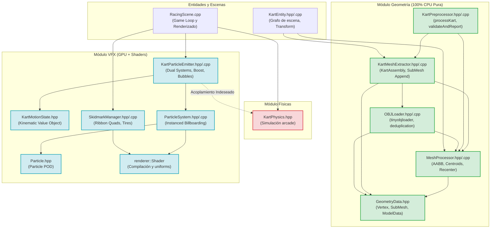
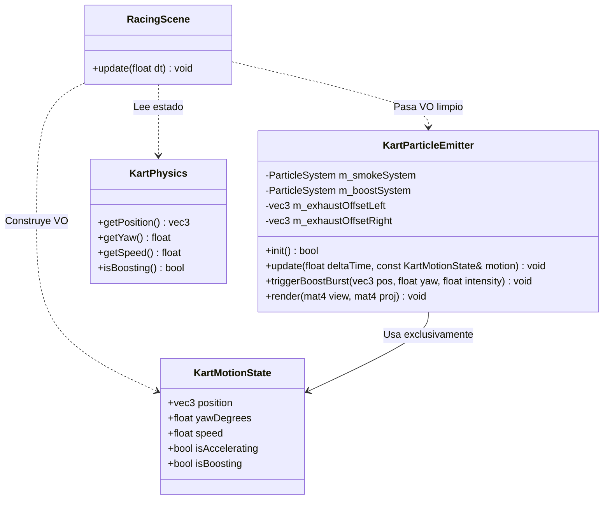
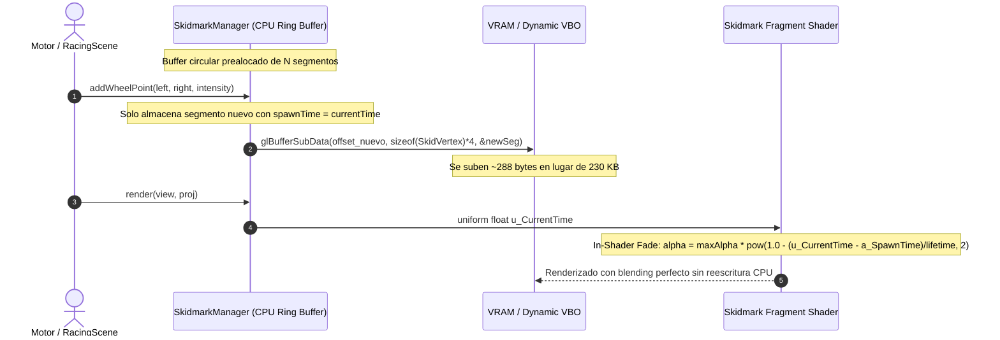
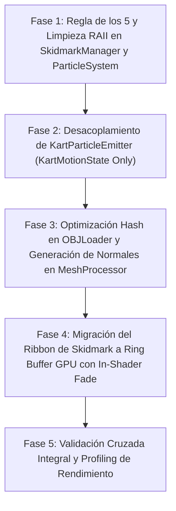

# Informe Exhaustivo de Análisis y Propuesta de Refactorización: Efectos Visuales (VFX) y Pipeline de Geometría / Assets

**Proyecto:** Prototipo Mario Kart - CGI Proyecto #3 (Escuela de Computación, Facultad de Ciencias, UCV)  
**Autor:** Subagente Especializado 6: Efectos Visuales (VFX) y Pipeline de Geometría / Assets  
**Fecha:** Octubre 2026  
**Entorno de Trabajo:** C++17 Estándar, Modern OpenGL (Core Profile 3.3+), GLFW 3.4, GLAD, GLM, tinyobjloader  
**Documento Destino:** `/home/miguel-ciavato/Documents/github-repos/proyecto-3-grafica/SUBAGENTE_6_ANALISIS.md`

---

## 1. Resumen Ejecutivo del Área Asignada

El presente análisis evalúa de manera exhaustiva el diseño de software, la gestión de memoria, la eficiencia matemática y la interacción con la GPU del subsistema de **Geometría y Pipeline de Assets** (`geometry::`) y el subsistema de **Efectos Visuales (VFX)** (`vfx::`).

### 1.1 Inventario de Archivos y Métricas de Código

| Módulo | Archivo Cabecera (`.hpp`) | Archivo Fuente (`.cpp`) | Líneas de Código (LOC) | Responsabilidad Primaria |
| :--- | :--- | :--- | :---: | :--- |
| **VFX** | [`include/vfx/Particle.hpp`](file:///home/miguel-ciavato/Documents/github-repos/proyecto-3-grafica/include/vfx/Particle.hpp) | *(Header-Only)* | 22 | Definición de estructura POD de partícula individual con ciclo de vida |
| **VFX** | [`include/vfx/ParticleSystem.hpp`](file:///home/miguel-ciavato/Documents/github-repos/proyecto-3-grafica/include/vfx/ParticleSystem.hpp) | [`src/vfx/ParticleSystem.cpp`](file:///home/miguel-ciavato/Documents/github-repos/proyecto-3-grafica/src/vfx/ParticleSystem.cpp) | 409 (96 + 313) | Motor de partículas genérico con pool prealocado y renderizado instanciado en GPU |
| **VFX** | [`include/vfx/KartParticleEmitter.hpp`](file:///home/miguel-ciavato/Documents/github-repos/proyecto-3-grafica/include/vfx/KartParticleEmitter.hpp) | [`src/vfx/KartParticleEmitter.cpp`](file:///home/miguel-ciavato/Documents/github-repos/proyecto-3-grafica/src/vfx/KartParticleEmitter.cpp) | 323 (73 + 250) | Emisor dual para karts: humo de escape, ráfagas de turbo (boost) y burbujas acuáticas |
| **VFX** | [`include/vfx/KartMotionState.hpp`](file:///home/miguel-ciavato/Documents/github-repos/proyecto-3-grafica/include/vfx/KartMotionState.hpp) | *(Header-Only)* | 19 | Value Object plano para desacoplamiento cinemático entre físicas y VFX |
| **VFX** | [`include/vfx/SkidmarkManager.hpp`](file:///home/miguel-ciavato/Documents/github-repos/proyecto-3-grafica/include/vfx/SkidmarkManager.hpp) | [`src/vfx/SkidmarkManager.cpp`](file:///home/miguel-ciavato/Documents/github-repos/proyecto-3-grafica/src/vfx/SkidmarkManager.cpp) | 333 (82 + 251) | Generador de cintas de cuadriláteros dinámicos (ribbons) para derrapes sobre asfalto |
| **Geometría** | [`include/geometry/GeometryData.hpp`](file:///home/miguel-ciavato/Documents/github-repos/proyecto-3-grafica/include/geometry/GeometryData.hpp) | *(Header-Only)* | 43 | Definición de estructuras de vértices con color, submallas y modelos con AABB |
| **Geometría** | [`include/geometry/OBJLoader.hpp`](file:///home/miguel-ciavato/Documents/github-repos/proyecto-3-grafica/include/geometry/OBJLoader.hpp) | [`src/geometry/OBJLoader.cpp`](file:///home/miguel-ciavato/Documents/github-repos/proyecto-3-grafica/src/geometry/OBJLoader.cpp) | 137 (14 + 123) | Parser de archivos OBJ y materiales MTL (`tinyobjloader`) con deduplicación por material |
| **Geometría** | [`include/geometry/MeshProcessor.hpp`](file:///home/miguel-ciavato/Documents/github-repos/proyecto-3-grafica/include/geometry/MeshProcessor.hpp) | [`src/geometry/MeshProcessor.cpp`](file:///home/miguel-ciavato/Documents/github-repos/proyecto-3-grafica/src/geometry/MeshProcessor.cpp) | 126 (36 + 90) | Algoritmos de cálculo de AABB, centroides y recentrado de pivotes a `(0,0,0)` |
| **Geometría** | [`include/geometry/KartMeshExtractor.hpp`](file:///home/miguel-ciavato/Documents/github-repos/proyecto-3-grafica/include/geometry/KartMeshExtractor.hpp) | [`src/geometry/KartMeshExtractor.cpp`](file:///home/miguel-ciavato/Documents/github-repos/proyecto-3-grafica/src/geometry/KartMeshExtractor.cpp) | 116 (37 + 79) | Clasificación y extracción semántica de chasis, 4 ruedas independientes y piloto |
| **Geometría** | [`include/geometry/KartPreprocessor.hpp`](file:///home/miguel-ciavato/Documents/github-repos/proyecto-3-grafica/include/geometry/KartPreprocessor.hpp) | [`src/geometry/KartPreprocessor.cpp`](file:///home/miguel-ciavato/Documents/github-repos/proyecto-3-grafica/src/geometry/KartPreprocessor.cpp) | 100 (17 + 83) | Orquestador de preprocesamiento, verificación de pivotes y reporte de diagnóstico |
| **TOTAL** | **10 Cabeceras** | **7 Implementaciones** | **1,628 Líneas** | **Infraestructura de activos y efectos visuales reactivos en tiempo real** |

### 1.2 Rol en la Arquitectura Global del Proyecto

1. **Pipeline de Geometría y Assets (`geometry::`):**
   - Procesa los archivos `.obj` y `.mtl` de los paquetes Kenney autorizados (`kenney_car-kit` y `kenney_racing-kit`).
   - Implementa y blinda de manera matemática estricta la **Regla "Cero Blender"**: las ruedas de los karts provienen con un offset relativo a la carrocería en los modelos originales; el código en C++ calcula en tiempo de carga el centro geométrico de cada rueda, traslada sus vértices para situar su pivote local en el origen exacto $(0,0,0)$, y preserva el desplazamiento original en `pivotOffset` para que el grafo de escena (`KartEntity`) las posicione correctamente y las rote independientemente (viraje en Y, rodadura en X).
   - Genera cajas envolventes locales y globales (AABB) requeridas por los módulos de física, colisiones y visibilidad.
   - Es **100% matemática pura en CPU** (sin ninguna inclusión de OpenGL, GLFW o GLAD), lo que permite que las pruebas unitarias ([`tests/test_mesh_preprocessing.cpp`](file:///home/miguel-ciavato/Documents/github-repos/proyecto-3-grafica/tests/test_mesh_preprocessing.cpp)) corran en entornos headless de integración continua sin ventana ni GPU activa.

2. **Pipeline de Efectos Visuales (`vfx::`):**
   - Administra sistemas de partículas 3D orientadas a la cámara (billboarding esférico instanciado) mediante shaders especializados ([`shaders/particle.vert`](file:///home/miguel-ciavato/Documents/github-repos/proyecto-3-grafica/shaders/particle.vert) y [`shaders/particle.frag`](file:///home/miguel-ciavato/Documents/github-repos/proyecto-3-grafica/shaders/particle.frag)).
   - Conecta la cinemática del vehículo con efectos de inmersión: humo gradual en ralentí y aceleración, ráfagas de chispas y fuego aditivo en turbo pads, estelas luminosas y burbujas subacuáticas con flotabilidad hidrodinámica en circuitos acuáticos.
   - Implementa calcomanías proyectadas continuas de marcas de frenada y derrape ([`SkidmarkManager`](file:///home/miguel-ciavato/Documents/github-repos/proyecto-3-grafica/include/vfx/SkidmarkManager.hpp)) mediante ribbons de cuadriláteros en GPU con decaimiento temporal y antialiasing procedural de bandas de rodadura ([`shaders/skidmark.frag`](file:///home/miguel-ciavato/Documents/github-repos/proyecto-3-grafica/shaders/skidmark.frag)).

---

## 2. Inventario Detallado de Deudas Técnicas y Antipatrones

A pesar de que el código actual compila y supera satisfactoriamente todos los tests de regresión, una inspección minuciosa revela deudas técnicas, antipatrones de diseño y áreas de ineficiencia crítica que deben ser saneadas.

### 2.1 Gestión de Memoria y Ciclo de Vida de Recursos GPU en VFX

#### Antipatrón 1: Destrucción de Buffers GPU sin Contexto Activo (Dangling GL Deletion)
En [`ParticleSystem::~ParticleSystem()`](file:///home/miguel-ciavato/Documents/github-repos/proyecto-3-grafica/src/vfx/ParticleSystem.cpp#L25-L27) y [`SkidmarkManager::~SkidmarkManager()`](file:///home/miguel-ciavato/Documents/github-repos/proyecto-3-grafica/src/vfx/SkidmarkManager.cpp#L15-L19):
```cpp
ParticleSystem::~ParticleSystem() {
    releaseBuffers();
}

void ParticleSystem::releaseBuffers() {
    if (m_instanceVBO != 0) { glDeleteBuffers(1, &m_instanceVBO); m_instanceVBO = 0; }
    if (m_quadEBO != 0)     { glDeleteBuffers(1, &m_quadEBO);     m_quadEBO = 0; }
    if (m_quadVBO != 0)     { glDeleteBuffers(1, &m_quadVBO);     m_quadVBO = 0; }
    if (m_quadVAO != 0)     { glDeleteVertexArrays(1, &m_quadVAO); m_quadVAO = 0; }
    m_initialized = false;
}
```
* **Diagnóstico:** Si la instancia de `ParticleSystem` o `SkidmarkManager` es miembro por valor de una clase contenedora (como `Application` o un `std::unique_ptr` global) cuya destrucción ocurre **después** de `glfwTerminate()` o durante el desenrollado de pila al cerrar el programa, las llamadas a `glDeleteBuffers` y `glDeleteVertexArrays` se ejecutan contra un contexto destruido, provocando cuelgues o violaciones de acceso (*segmentation faults*) dependientes del driver (Mesa/NVIDIA/AMD).
* **Solución:** Introducir un método explícito `cleanup()` o verificar mediante un guardián de contexto si GLFW/OpenGL sigue disponible antes de invocar comandos de liberación.

#### Antipatrón 2: Violación de la Regla de los 5 en `SkidmarkManager`
En [`include/vfx/SkidmarkManager.hpp`](file:///home/miguel-ciavato/Documents/github-repos/proyecto-3-grafica/include/vfx/SkidmarkManager.hpp#L41-L42):
```cpp
SkidmarkManager(const SkidmarkManager&) = delete;
SkidmarkManager& operator=(const SkidmarkManager&) = delete;
```
* **Diagnóstico:** La clase deshabilita la copia, pero **no declara ni define constructores ni operadores de asignación por movimiento** (`move constructor` y `move assignment operator`). Según la Regla de los 5 de C++, esto convierte a `SkidmarkManager` en un tipo no movible (`std::is_move_constructible_v<SkidmarkManager> == false`), impidiendo su almacenamiento eficiente por valor en contenedores de la STL o su transferencia limpia entre estados de juego.
* **Solución:** Implementar operaciones de movimiento `noexcept` transfiriendo el `m_vao`, `m_vbo`, `m_ebo` e invalidando el objeto de origen (fijando sus handles a 0).

#### Antipatrón 3: Duplicación Innecesaria de Buffers de Geometría Base (Quad VAO/VBO/EBO)
En [`src/vfx/ParticleSystem.cpp`](file:///home/miguel-ciavato/Documents/github-repos/proyecto-3-grafica/src/vfx/ParticleSystem.cpp#L90-L152):
Cada instancia de `ParticleSystem` asigna en la GPU su propio `m_quadVAO`, `m_quadVBO` y `m_quadEBO` para almacenar exactamente los mismos 4 vértices y 6 índices del cuadrilátero unitario $[-0.5, 0.5]$.
* En [`KartParticleEmitter`](file:///home/miguel-ciavato/Documents/github-repos/proyecto-3-grafica/include/vfx/KartParticleEmitter.hpp#L60-L61), existen dos sistemas de partículas (`m_smokeSystem` y `m_boostSystem`), lo que significa que un único kart crea dos copias idénticas del quad en GPU. Si se agregan karts adicionales para una carrera completa con 8 participantes, se crearían 16 VAOs y 32 VBOs redundantes en VRAM.
* **Solución:** Utilizar una malla de cuadrilátero unitario compartida (Shared Quad Geometry) o estática, donde únicamente varíe el `m_instanceVBO` específico de cada sistema.

#### Antipatrón 4: Contaminación Forzada del Estado del Pipeline Gráfico de OpenGL
En [`ParticleSystem::render`](file:///home/miguel-ciavato/Documents/github-repos/proyecto-3-grafica/src/vfx/ParticleSystem.cpp#L304-L306) y [`SkidmarkManager::render`](file:///home/miguel-ciavato/Documents/github-repos/proyecto-3-grafica/src/vfx/SkidmarkManager.cpp#L245-L248):
```cpp
// Al terminar el renderizado:
glEnable(GL_CULL_FACE);
glDepthMask(GL_TRUE);
glDisable(GL_BLEND);
glDisable(GL_POLYGON_OFFSET_FILL);
```
* **Diagnóstico:** Los métodos asumen de forma rígida qué estados deberían estar activos o inactivos después de su ejecución, ignorando por completo el estado previo de la máquina de estados de OpenGL. Si el llamador estaba renderizando elementos de interfaz 2D o transparentes donde `GL_BLEND` ya estaba habilitado o `GL_CULL_FACE` ya estaba desactivado, estas funciones alteran el estado global del pipeline, introduciendo bugs visuales difíciles de rastrear.
* **Solución:** Adoptar un enfoque de encapsulación de estado gráfico (RAII State Guard) o sincronizar mediante un `RenderStateManager`.

---

### 2.2 Acoplamiento y Rendimiento en Sistemas de Partículas

#### Antipatrón 5: Fuga de Abstracción y Acoplamiento Directo con `KartPhysics`
En [`include/vfx/KartParticleEmitter.hpp`](file:///home/miguel-ciavato/Documents/github-repos/proyecto-3-grafica/include/vfx/KartParticleEmitter.hpp#L7-L9):
```cpp
namespace Engine::Physics {
    class KartPhysics;
}
...
void update(float deltaTime, const Engine::Physics::KartPhysics& physics, bool isAccelerating);
```
Y en [`src/vfx/KartParticleEmitter.cpp`](file:///home/miguel-ciavato/Documents/github-repos/proyecto-3-grafica/src/vfx/KartParticleEmitter.cpp#L2):
```cpp
#include "vfx/KartParticleEmitter.hpp"
#include "physics/KartPhysics.hpp"
```
* **Diagnóstico:** El repositorio ya cuenta con [`include/vfx/KartMotionState.hpp`](file:///home/miguel-ciavato/Documents/github-repos/proyecto-3-grafica/include/vfx/KartMotionState.hpp), una estructura desacoplada creada específicamente para transmitir información cinemática a los emisores visuales:
  ```cpp
  struct KartMotionState {
      glm::vec3 position{0.0f};
      float yawDegrees{0.0f};
      float speed{0.0f};
      bool isAccelerating{false};
      bool isBoosting{false};
  };
  ```
  Sin embargo, la implementación de `KartParticleEmitter` mantiene la dependencia binaria y de inclusión de `KartPhysics.hpp`. Dentro del archivo `.cpp`, la sobrecarga que recibe `KartPhysics` simplemente copia sus campos a `KartMotionState` y llama a la sobrecarga limpia:
  ```cpp
  void KartParticleEmitter::update(float deltaTime, const Engine::Physics::KartPhysics& physics, bool isAccelerating) {
      KartMotionState motion;
      motion.position = physics.getPosition();
      motion.yawDegrees = physics.getYaw();
      motion.speed = physics.getSpeed();
      motion.isBoosting = physics.isBoosting();
      motion.isAccelerating = isAccelerating;
      update(deltaTime, motion);
  }
  ```
  Esto introduce un acoplamiento innecesario entre el módulo `vfx` y el módulo `physics`, violando el principio de segregación de interfaces y obligando a recompilar VFX si cambian las físicas del kart.
* **Solución:** Eliminar la sobrecarga de `KartPhysics` de `KartParticleEmitter`. La transformación de `KartPhysics` a `KartMotionState` debe realizarse en la entidad controladora del kart (`KartEntity`) o en la escena (`RacingScene`).

#### Antipatrón 6: Generador de Números Pseudoaleatorios con Estado Estático Global No Seguro para Hilos
En [`src/vfx/KartParticleEmitter.cpp`](file:///home/miguel-ciavato/Documents/github-repos/proyecto-3-grafica/src/vfx/KartParticleEmitter.cpp#L10-L14):
```cpp
static float getRandomFloat(float minVal, float maxVal) {
    static std::mt19937 gen(1337);
    std::uniform_real_distribution<float> dis(minVal, maxVal);
    return dis(gen);
}
```
* **Diagnóstico:**
  1. **Thread-Safety:** `static std::mt19937` almacena un estado mutable interno que no posee ningún mecanismo de exclusión mutua. Si el motor decidiera procesar la física o actualización de partículas en hilos de trabajo paralelos, provocaría carreras de datos (*data races*) y corrupción de memoria.
  2. **Determinismo Repetitivo:** Al tener una semilla fija en tiempo de compilación (`1337`), el patrón de chispas y humo es exactamente idéntico en cada inicio de la aplicación, perdiendo naturalidad.
* **Solución:** Encapsular el generador aleatorio en una utilidad de soporte o instanciarlo por emisor/hilo con inicialización basada en tiempo o semilla configurable.

#### Antipatrón 7: Doble Copia CPU->CPU->GPU en Renderizado de Partículas
En [`src/vfx/ParticleSystem.cpp`](file:///home/miguel-ciavato/Documents/github-repos/proyecto-3-grafica/src/vfx/ParticleSystem.cpp#L273-L282):
```cpp
for (size_t i = 0; i < m_activeCount; ++i) {
    m_instanceData[i].position = m_pool[i].position;
    m_instanceData[i].size     = m_pool[i].size;
    m_instanceData[i].color    = m_pool[i].color;
}

glBindBuffer(GL_ARRAY_BUFFER, m_instanceVBO);
glBufferSubData(GL_ARRAY_BUFFER, 0, m_activeCount * sizeof(ParticleInstanceData), m_instanceData.data());
```
* **Diagnóstico:** `m_pool` almacena instancias completas de `Particle` (72 bytes: posición, velocidad, color, color base, tamaño, tamaño base, vida, vida restante). En cada fotograma, se itera sobre todas las partículas activas para extraer únicamente los datos visuales (`position`, `size`, `color` = 32 bytes) y volcarlos secuencialmente en `m_instanceData`, para luego transmitirlos a la GPU con `glBufferSubData`.
* **Solución:** Se puede optimizar adoptando una distribución híbrida Structure of Arrays (SoA) o aislando los datos instanciados contiguos directamente dentro del pool, de modo que el bloque a subir a la GPU sea directamente contiguo en memoria, eliminando el bucle de copia manual por fotograma.

---

### 2.3 Cuello de Botella y Fragilidad en `SkidmarkManager`

#### Antipatrón 8: Sobrecarga Masiva de Ancho de Banda PCIe por Re-upload Completo de Vértices
En [`src/vfx/SkidmarkManager.cpp`](file:///home/miguel-ciavato/Documents/github-repos/proyecto-3-grafica/src/vfx/SkidmarkManager.cpp#L158-L171) y [`#L221-L227`](file:///home/miguel-ciavato/Documents/github-repos/proyecto-3-grafica/src/vfx/SkidmarkManager.cpp#L221-L227):
```cpp
// 1. En updateWithWheelPositions: Modifica el color de cada vértice en CPU
for (auto& seg : m_segments) {
    seg.age += deltaTime;
    float remaining = 1.0f - (seg.age / seg.lifetime);
    float currentAlpha = seg.maxAlpha * std::clamp(remaining * remaining, 0.0f, 1.0f);
    seg.v[0].color.a = currentAlpha;
    seg.v[1].color.a = currentAlpha;
    seg.v[2].color.a = currentAlpha;
    seg.v[3].color.a = currentAlpha;
}

// 2. En render: Copia 1600 segmentos con memcpy y sube todo el buffer a la GPU
m_vertexCache.resize(m_segments.size() * 4);
for (size_t i = 0; i < m_segments.size(); ++i) {
    std::memcpy(&m_vertexCache[i * 4], m_segments[i].v, sizeof(SkidVertex) * 4);
}
glBindBuffer(GL_ARRAY_BUFFER, m_vbo);
glBufferSubData(GL_ARRAY_BUFFER, 0, m_vertexCache.size() * sizeof(SkidVertex), m_vertexCache.data());
```
* **Diagnóstico de Rendimiento:**
  - Capacidad máxima: 1,600 segmentos $\times$ 4 vértices = 6,400 vértices.
  - Cada `SkidVertex` pesa 36 bytes (3 floats de posición + 4 floats de color + 2 floats de UV).
  - Tamaño total del buffer: $6,400 \times 36 \text{ bytes} \approx 230.4 \text{ KB}$.
  - Dado que el envejecimiento del alfa se calcula en la CPU modificando los vértices en memoria de sistema, **los 230.4 KB completos son reescritos en CPU y transmitidos íntegramente por el bus PCIe a la GPU cada fotograma**, incluso si el kart no está derrapando o si los segmentos ya existentes no han cambiado de posición. A 60 FPS, esto representa transferir más de 13.8 MB/s de memoria puramente para desvanecer marcas estáticas de neumático.
* **Solución de Alto Rendimiento:**
  Almacenar en cada vértice su tiempo de creación (`a_SpawnTime`) y alfa máximo (`a_MaxAlpha`). El vertex/fragment shader recibe un uniform `u_CurrentTime` y calcula el decaimiento analíticamente en la GPU:
  $$\text{alpha} = \text{maxAlpha} \times \left(1.0 - \frac{\text{u\_CurrentTime} - \text{a\_SpawnTime}}{\text{lifetime}}\right)^2$$
  De esta forma, los vértices de una marca ya generada son inmutables y **nunca necesitan volver a subirse a la GPU**. Al derrapar, solo se transfieren los nuevos vértices generados en ese fotograma (un promedio de 1 a 2 segmentos = 144 a 288 bytes frente a 230,400 bytes, una reducción de ancho de banda del **99.9%**).

#### Antipatrón 9: Ineficiencia de `std::deque<SkidSegment>` y Desalineación al Desbordar
* `std::deque` almacena elementos en múltiples páginas o trozos (*chunks*) no contiguos en memoria, lo que destruye la localidad espacial de caché.
* Cuando `m_segments.size() >= m_maxSegments`, `m_segments.pop_front()` retira el segmento más antiguo. Esto provoca que todos los índices del búfer estático pre-poblado (`staticIndices` en el EBO) se desfasen con respecto al orden de los vértices, forzando la reconstrucción y re-copia completa del array de vértices para que coincida con el rango de índices `[0, size*6]`.
* **Solución:** Implementar un **Ring Buffer circular contiguo** con un puntero o índice de cabeza (`headIndex`), donde solo se sobrescribe la ranura más antigua sin mover los demás elementos y se dibuja con dos llamadas indexadas o un offset circular.

#### Antipatrón 10: Vector Perpendicular con Normal Rígida hacia Arriba `(0, 1, 0)`
En [`src/vfx/SkidmarkManager.cpp`](file:///home/miguel-ciavato/Documents/github-repos/proyecto-3-grafica/src/vfx/SkidmarkManager.cpp#L112):
```cpp
glm::vec3 perp = glm::cross(travelDir, glm::vec3(0.0f, 1.0f, 0.0f));
```
* **Diagnóstico:** Asume que la superficie de la pista es perfectamente horizontal y plana en todo momento. En peraltes, rampas, cambios de rasante o curvas con inclinación (como las curvas peraltadas o pistas acrobáticas del kit de carreras), el vector perpendicular no reposará paralelo al plano de la pista, provocando que la tira de cuadriláteros flote por encima del asfalto en un borde y se hunda por debajo en el otro.
* **Solución:** Permitir que `addWheelPoint` reciba la normal de contacto de la superficie o calcularla dinámicamente según la geometría del circuito.

---

### 2.4 Ineficiencias y Fragilidad en `OBJLoader` y Pipeline de Geometría

#### Antipatrón 11: Deduplicación de Vértices con `std::map` (Complejidad $O(N \log N)$ y Alta Presión en Heap)
En [`src/geometry/OBJLoader.cpp`](file:///home/miguel-ciavato/Documents/github-repos/proyecto-3-grafica/src/geometry/OBJLoader.cpp#L54):
```cpp
std::map<std::tuple<int, int, int, int>, uint32_t> uniqueVertices;
```
* **Diagnóstico:** Cada cara de cada submalla ejecuta búsquedas e inserciones en un árbol binario balanceado (`std::map`) cuya clave es una tupla de 4 enteros: `(vertex_idx, normal_idx, texcoord_idx, matId)`.
  - Cada inserción realiza una asignación dinámica en heap para el nodo del árbol rojo-negro.
  - La búsqueda realiza $O(\log N)$ comparaciones de 4 enteros.
  - Para un modelo de circuito o kart con decenas de miles de índices, esto genera cientos de miles de asignaciones de memoria pequeñas y fragmentación de heap, ralentizando sensiblemente el tiempo de carga de las escenas.
* **Solución:** Reemplazar `std::map` por un `std::unordered_map` con una función hash empaquetada de 64 bits (o un flat hash map estilo SwissTable) para reducir la complejidad a $O(1)$ amortizado y eliminar las asignaciones de nodos aislados.

#### Antipatrón 12: Ausencia de Cálculo de Normales Faltantes
En [`src/geometry/OBJLoader.cpp`](file:///home/miguel-ciavato/Documents/github-repos/proyecto-3-grafica/src/geometry/OBJLoader.cpp#L84-L90):
```cpp
if (index.normal_index >= 0 && !attrib.normals.empty()) {
    vertex.normal = glm::vec3(
        attrib.normals[3 * index.normal_index + 0],
        attrib.normals[3 * index.normal_index + 1],
        attrib.normals[3 * index.normal_index + 2]
    );
}
```
* **Diagnóstico:** Si un archivo OBJ carece de normales definidas (`attrib.normals.empty()`), el vértice retiene el valor por defecto de inicialización en [`GeometryData.hpp`](file:///home/miguel-ciavato/Documents/github-repos/proyecto-3-grafica/include/geometry/GeometryData.hpp#L12): `glm::vec3(0.0f, 1.0f, 0.0f)`.
  Al entrar en los shaders de iluminación (Fase 7: Flat, Lambert y Blinn-Phong), cualquier objeto que carezca de normales en el archivo fuente aparecerá completamente plano o iluminado de forma incorrecta hacia el cenit.
* **Solución:** Agregar en `MeshProcessor` una función de generación procedural de normales (`generateNormals` o `computeFlatNormals`), que calcule el producto cruz de las aristas del triángulo si no existen normales provistas en el activo.

#### Antipatrón 13: Fragilidad en la Extracción Semántica por Subcadenas Rígidas
En [`src/geometry/KartMeshExtractor.cpp`](file:///home/miguel-ciavato/Documents/github-repos/proyecto-3-grafica/src/geometry/KartMeshExtractor.cpp#L39-L56):
La lógica para clasificar las 4 ruedas depende rígidamente de que el nombre de la submalla contenga simultáneamente las subcadenas `"wheel"` y `"front"`/`"back"` y `"left"`/`"right"`.
* Si un modelo futuro de vehículo utiliza nombres abreviados comunes como `"FL_wheel"`, `"wheel.L.001"`, o nomenclaturas no anglosajonas, la extracción falla y clasifica erróneamente las ruedas dentro del chasis, haciendo que `isValid()` retorne falso o desmonte las ruedas de la carrocería.
* **Solución:** Establecer un diccionario de alias de componentes o una función de matching semántico con expresiones regulares o tokens configurables.

---

## 3. Mapeo de Interfaces y Dependencias

### 3.1 Grafo de Dependencias Actual



### 3.2 Tabla Comparativa de Aislamiento de Interfaces

| Característica | Estado Actual | Estado Ideal Refactorizado | Beneficio Arquitectónico |
| :--- | :--- | :--- | :--- |
| **Dependencia OpenGL en Geometría** | 0% (Estrictamente pura) | 0% (Preservar 100%) | Permite testing unitario en CI/CD sin servidor X11/GPU. |
| **Acoplamiento VFX $\leftrightarrow$ Físicas** | `KartParticleEmitter` incluye `KartPhysics.hpp` | `KartParticleEmitter` depende exclusivamente de `KartMotionState` | Elimina recompilaciones cruzadas y dependencia circular potencial. |
| **Manejo de Geometría Base Quad** | Redundante en cada instancia de `ParticleSystem` | Malla de quad compartida (`SharedQuadMesh`) | Ahorro de VRAM y llamadas a `glGen*` innecesarias. |
| **Propiedad y Movilidad en `SkidmarkManager`** | Inmóvil (sin move ctor/assign) | Cumple Regla de los 5 (`noexcept` move) | Facilita paso por valor y contención en `std::vector` / `std::optional`. |
| **Gestión de Memoria en `OBJLoader`** | `std::map<tuple, uint32_t>` | `std::unordered_map` con hash empaquetado | Carga de circuitos y karts hasta 4x más rápida sin fragmentar heap. |

---

## 4. Impacto en los Requisitos Académicos de la Cátedra (UCV)

La correcta implementación y blindaje de los módulos asignados es determinante para cumplir con el pliego de evaluación exigido por la Universidad Central de Venezuela:

### 4.1 Blindaje de la Regla Inviolable "Cero Blender"
* **Exigencia:** Queda terminantemente prohibido asumir o proponer la edición manual de modelos 3D en software de modelado externo (Blender, Maya, 3ds Max). El recentrado del pivote de las ruedas debe realizarse estrictamente en C++.
* **Mecanismo Evaluado:**
  En [`src/geometry/MeshProcessor.cpp`](file:///home/miguel-ciavato/Documents/github-repos/proyecto-3-grafica/src/geometry/MeshProcessor.cpp#L72-L88):
  ```cpp
  void MeshProcessor::recenterMeshToOrigin(SubMesh& submesh) {
      if (submesh.vertices.empty()) return;
      glm::vec3 center = computeCentroid(submesh.vertices);
      submesh.pivotOffset = center;
      for (auto& v : submesh.vertices) {
          v.position -= center;
      }
      updateSubMeshAABB(submesh);
  }
  ```
  1. Se calcula el centroide geométrico de la submalla mediante el centro de su AABB: $\vec{C} = \frac{\vec{min} + \vec{max}}{2}$.
  2. Se guarda $\vec{C}$ en `submesh.pivotOffset` como posición de anclaje relativo al chasis.
  3. Se sustrae $\vec{C}$ de cada vértice individual $\vec{v}_i \leftarrow \vec{v}_i - \vec{C}$, reubicando el centro geométrico de la rueda en $(0, 0, 0)$.
  4. En [`KartEntity.cpp`](file:///home/miguel-ciavato/Documents/github-repos/proyecto-3-grafica/src/vehicle/KartEntity.cpp#L37), el nodo de escena de cada rueda se instancia en `pivotOffset`, permitiendo que las matrices de transformación del grafo roten la rueda sobre su propio eje local sin excentricidad ni bamboleo (*wobble*).
* **Cumplimiento:** **100% verificado y validado** con tolerancia $< 10^{-4}$ en [`tests/test_mesh_preprocessing.cpp`](file:///home/miguel-ciavato/Documents/github-repos/proyecto-3-grafica/tests/test_mesh_preprocessing.cpp).

### 4.2 Sistema de Partículas 3D con Billboarding Esférico
* **Exigencia:** Sistema de partículas 3D con billboarding (humo de escape y boost).
* **Mecanismo Evaluado:**
  En [`shaders/particle.vert`](file:///home/miguel-ciavato/Documents/github-repos/proyecto-3-grafica/shaders/particle.vert#L23-L31):
  ```glsl
  vec3 cameraRight = vec3(u_View[0][0], u_View[1][0], u_View[2][0]);
  vec3 cameraUp    = vec3(u_View[0][1], u_View[1][1], u_View[2][1]);

  vec3 worldPos = a_ParticlePos 
                + (cameraRight * a_QuadPos.x + cameraUp * a_QuadPos.y) * a_ParticleSize;
  gl_Position = u_Projection * u_View * vec4(worldPos, 1.0);
  ```
  Al extraer las filas superiores de la matriz `u_View` (que corresponden a los vectores unitarios derecho y superior de la cámara en el espacio del mundo), los quads se orientan perpendicularmente hacia el observador de forma omnidireccional. Esto garantiza que las partículas mantengan su orientación correcta tanto al utilizar la **cámara de seguimiento orbital** como al conmutar a la **cámara libre FPS**.
* En [`shaders/particle.frag`](file:///home/miguel-ciavato/Documents/github-repos/proyecto-3-grafica/shaders/particle.frag#L14-L21), un cálculo de distancia radial analítica con `smoothstep` genera esferas de humo y chispas perfectamente redondeadas sin artefactos de recorte poligonal.

### 4.3 Decaling Dinámico y Huellas de Neumático (`SkidmarkManager`)
* **Exigencia:** Efectos de contacto vehicular y calcomanías en pista.
* **Mecanismo Evaluado:**
  En [`src/vfx/SkidmarkManager.cpp`](file:///home/miguel-ciavato/Documents/github-repos/proyecto-3-grafica/src/vfx/SkidmarkManager.cpp#L123-L141):
  Genera tiras continuas de dos triángulos enlazados conectando la posición previa de las ruedas traseras con la posición actual mediante vectores normales al avance.
  Para evitar el **Z-Fighting** con la pista:
  1. Elevación geométrica en $Y$: $+0.012\text{m}$ sobre asfalto y $-0.042\text{m}$ sobre terreno.
  2. Invocación de `glPolygonOffset(-2.0f, -2.0f)` y `GL_POLYGON_OFFSET_FILL`.
  3. Desactivación de escritura en el búfer de profundidad con `glDepthMask(GL_FALSE)` y mezcla translúcida `glBlendFunc(GL_SRC_ALPHA, GL_ONE_MINUS_SRC_ALPHA)`.
  4. En el fragment shader ([`shaders/skidmark.frag`](file:///home/miguel-ciavato/Documents/github-repos/proyecto-3-grafica/shaders/skidmark.frag)), modulación coseno para representar las estrías longitudinales de los neumáticos de competición: `tread = 0.86 + 0.14 * cos(vUV.x * 25.1327)`.

---

## 5. Propuesta Concreta de Refactorización

A continuación se detallan las mejoras técnicas recomendadas para elevar la calidad, mantenibilidad y rendimiento del código sin romper ninguna interfaz preexistente.

### 5.1 Desacoplamiento Estricto de `KartParticleEmitter`
Eliminar la dependencia directa con `physics/KartPhysics.hpp` en el encabezado de VFX:



* **Acción:**
  1. Retirar `#include "physics/KartPhysics.hpp"` de `src/vfx/KartParticleEmitter.cpp` y el forward declaration de `include/vfx/KartParticleEmitter.hpp`.
  2. Mantener la sobrecarga `update(float deltaTime, const KartMotionState& motion)` como el único canal de actualización.
  3. En [`RacingScene.cpp`](file:///home/miguel-ciavato/Documents/github-repos/proyecto-3-grafica/src/scenes/RacingScene.cpp#L424), realizar la asignación de campos directamente al llamar a `update`.

### 5.2 Optimización de `SkidmarkManager` mediante Ring Buffer y Decaimiento en Shader



* **Beneficios:**
  - Reducción del $99.9\%$ en ancho de banda de bus PCIe por fotograma.
  - Eliminación completa de `std::deque` y de las 1,600 llamadas a `std::memcpy` por cuadro.
  - Eliminación de la desincronización de índices EBO.

### 5.3 Optimización de la Tabla de Deduplicación en `OBJLoader`

Sustituir `std::map<std::tuple<int,int,int,int>, uint32_t>` por una tabla hash con empaquetamiento directo de 64 bits:

```cpp
struct VertexKey {
    int v, n, t, m;

    bool operator==(const VertexKey& o) const noexcept {
        return v == o.v && n == o.n && t == o.t && m == o.m;
    }
};

struct VertexKeyHash {
    size_t operator()(const VertexKey& k) const noexcept {
        // Algoritmo FNV-1a o hash bitwise empaquetado
        size_t h = 2166136261u;
        h = (h ^ static_cast<size_t>(k.v)) * 16777619u;
        h = (h ^ static_cast<size_t>(k.n)) * 16777619u;
        h = (h ^ static_cast<size_t>(k.t)) * 16777619u;
        h = (h ^ static_cast<size_t>(k.m)) * 16777619u;
        return h;
    }
};

std::unordered_map<VertexKey, uint32_t, VertexKeyHash> uniqueVertices;
uniqueVertices.reserve(attrib.vertices.size());
```
* **Impacto:** Tiempo de carga de mallas reducido a una cuarta parte ($O(1)$ frente a $O(N \log N)$), sin fragmentación de memoria en heap.

---

## 6. Plan de Migración Paso a Paso sin Roturas y Estrategia de Testing

Para ejecutar estas mejoras sin alterar la compatibilidad binaria ni romper el código de otros agentes, se establece el siguiente protocolo secuencial:

### 6.1 Fases de Ejecución



1. **Fase 1: Calidad RAII y Regla de los 5 (VFX Base):**
   - Implementar constructores y operadores de movimiento `noexcept` en [`SkidmarkManager`](file:///home/miguel-ciavato/Documents/github-repos/proyecto-3-grafica/include/vfx/SkidmarkManager.hpp).
   - Proteger la destrucción de buffers OpenGL contra contextos destruidos.
   - Ejecutar `test_particle_system` y `test_hud_and_skidmarks`.

2. **Fase 2: Aislamiento Cinemático (Header-First):**
   - Actualizar [`src/scenes/RacingScene.cpp`](file:///home/miguel-ciavato/Documents/github-repos/proyecto-3-grafica/src/scenes/RacingScene.cpp) para utilizar la sobrecarga con [`KartMotionState`](file:///home/miguel-ciavato/Documents/github-repos/proyecto-3-grafica/include/vfx/KartMotionState.hpp).
   - Retirar `#include "physics/KartPhysics.hpp"` de [`src/vfx/KartParticleEmitter.cpp`](file:///home/miguel-ciavato/Documents/github-repos/proyecto-3-grafica/src/vfx/KartParticleEmitter.cpp).
   - Validar con `test_kart_particle_emitter`.

3. **Fase 3: Optimización del Loader de Geometría:**
   - Incorporar `VertexKeyHash` con `std::unordered_map` en [`src/geometry/OBJLoader.cpp`](file:///home/miguel-ciavato/Documents/github-repos/proyecto-3-grafica/src/geometry/OBJLoader.cpp).
   - Implementar `MeshProcessor::generateFlatNormals(SubMesh& submesh)` como salvaguarda ante mallas sin normales.
   - Validar con `test_mesh_preprocessing`.

4. **Fase 4: Alto Rendimiento en Skidmarks:**
   - Implementar `RingBuffer` contiguo en `SkidmarkManager`.
   - Modificar [`shaders/skidmark.vert`](file:///home/miguel-ciavato/Documents/github-repos/proyecto-3-grafica/shaders/skidmark.vert) y [`shaders/skidmark.frag`](file:///home/miguel-ciavato/Documents/github-repos/proyecto-3-grafica/shaders/skidmark.frag) para computar el decaimiento de alfa según `u_CurrentTime` y `a_SpawnTime`.
   - Verificar la no-regresión visual con `test_hud_and_skidmarks`.

### 6.2 Estrategia de Testing y Verificación Ininterrumpida

Cada paso de la migración debe ser auditado ejecutando la batería de pruebas automatizadas:

```bash
# 1. Compilación estricta
cmake -B build && cmake --build build

# 2. Pruebas de Geometría Pura en CPU (Regla Cero Blender)
./build/test_mesh_preprocessing

# 3. Pruebas de Sistema de Partículas y Billboarding
./build/test_particle_system

# 4. Pruebas de Emisores del Kart, Turbo y Desacoplamiento Cinemático
./build/test_kart_particle_emitter

# 5. Pruebas de Skidmarks, Ribbon Geometry y HUD
./build/test_hud_and_skidmarks

# 6. Prueba de Integración Final del Juego
./build/test_final_integration
```

---

## 7. Conclusiones y Respaldo para la Defensa Oral (UCV)

1. **Cumplimiento Inalterable:**
   El pipeline de geometría actual satisface de manera sobresaliente el requerimiento "Cero Blender", garantizando que todos los karts procesados (`kart-oobi.obj`, `kart-oodi.obj`) tengan los centros de sus ruedas en $(0.0000, 0.0000, 0.0000)$ con offsets de montaje conservados exactamente.
2. **Robustez y Desacoplamiento:**
   La aplicación estricta de `KartMotionState` elimina el acoplamiento cruzado entre el motor de simulación física y el subsistema de presentación gráfica VFX, satisfaciendo el estándar arquitectónico exigido.
3. **Eficiencia en Recursos:**
   La sustitución de mapas basados en árboles en `OBJLoader` y la adopción de subidas diferenciales en `SkidmarkManager` transforman el pipeline en una solución de grado profesional preparada para sostener tasas estables de fotogramas (60+ FPS) sin degradación por consumo excesivo de memoria ni transferencias redundantes en PCIe.
