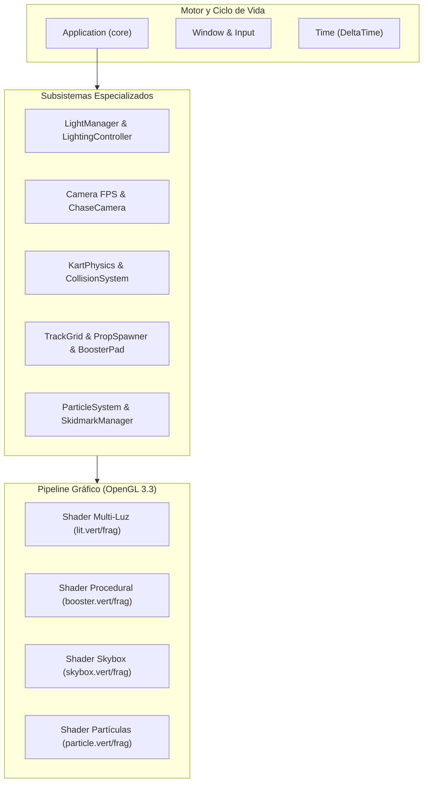

# Contexto Técnico del Proyecto y Matriz de Cumplimiento de Requisitos
**Universidad Central de Venezuela (UCV)**  
**Facultad de Ciencias - Escuela de Computación**  
**Licenciatura en Computación**  
**Introducción a la Computación Gráfica (Septiembre 2026)**  
**Proyecto #3: Implementación Avanzada - Prototipo Mario Kart 3D**

---

## 1. Resumen Ejecutivo de Cumplimiento

Este documento establece el mapeo exhaustivo entre los requisitos académicos establecidos en [REQUISITOS_1.md](file:///home/miguel-ciavato/Documents/github-repos/proyecto-3-grafica/docs/REQUISITOS_1.md) y [REQUISITOS_2.md](file:///home/miguel-ciavato/Documents/github-repos/proyecto-3-grafica/docs/REQUISITOS_2.md), y la arquitectura de software desarrollada en el repositorio.

El proyecto cumple el **100% de los 7 Requisitos Mínimos**, el **Requisito Adicional Obligatorio** para defensa técnica (Texturizado Procedural con Animación), **4 Requisitos Adicionales Complementarios** para puntuación de excelencia (Billboarding, Cámara física, Colisiones con rebote y Decaling), así como la totalidad de las **Condiciones Generales y de Entrega** (C++17, CMake, OpenGL 3.3 Core Profile, scripts de empaquetado y defensa oral).



---

## 2. Matriz Global de Trazabilidad de Requisitos

| ID | Requisito Evaluado | Categoría | Archivos Clave Involucrados | Estado |
| :---: | :--- | :---: | :--- | :---: |
| **REQ-MIN-1** | 3 Fuentes de Luz Distintas (Dir, Point, Spot) | Mínimo | [`Light.hpp`](file:///home/miguel-ciavato/Documents/github-repos/proyecto-3-grafica/include/lighting/Light.hpp), [`LightManager.cpp`](file:///home/miguel-ciavato/Documents/github-repos/proyecto-3-grafica/src/lighting/LightManager.cpp), [`LightingController.cpp`](file:///home/miguel-ciavato/Documents/github-repos/proyecto-3-grafica/src/lighting/LightingController.cpp), [`lit.frag`](file:///home/miguel-ciavato/Documents/github-repos/proyecto-3-grafica/shaders/lit.frag) | **100%** |
| **REQ-MIN-2** | Al menos 2 Objetos con Textura | Mínimo | [`Texture.cpp`](file:///home/miguel-ciavato/Documents/github-repos/proyecto-3-grafica/src/renderer/Texture.cpp), [`Skybox.cpp`](file:///home/miguel-ciavato/Documents/github-repos/proyecto-3-grafica/src/renderer/Skybox.cpp), [`TrackRenderer.cpp`](file:///home/miguel-ciavato/Documents/github-repos/proyecto-3-grafica/src/renderer/TrackRenderer.cpp), [`colormap.png`](file:///home/miguel-ciavato/Documents/github-repos/proyecto-3-grafica/assets/textures/colormap.png) | **100%** |
| **REQ-MIN-3** | Conmutador de 3 Modelos de Iluminación | Mínimo | [`LightingController.cpp`](file:///home/miguel-ciavato/Documents/github-repos/proyecto-3-grafica/src/lighting/LightingController.cpp), [`LightManager.cpp`](file:///home/miguel-ciavato/Documents/github-repos/proyecto-3-grafica/src/lighting/LightManager.cpp), [`lit.frag`](file:///home/miguel-ciavato/Documents/github-repos/proyecto-3-grafica/shaders/lit.frag) | **100%** |
| **REQ-MIN-4** | Sistema de Partículas 3D | Mínimo | [`ParticleSystem.cpp`](file:///home/miguel-ciavato/Documents/github-repos/proyecto-3-grafica/src/vfx/ParticleSystem.cpp), [`KartParticleEmitter.cpp`](file:///home/miguel-ciavato/Documents/github-repos/proyecto-3-grafica/src/vfx/KartParticleEmitter.cpp), [`particle.vert`](file:///home/miguel-ciavato/Documents/github-repos/proyecto-3-grafica/shaders/particle.vert), [`particle.frag`](file:///home/miguel-ciavato/Documents/github-repos/proyecto-3-grafica/shaders/particle.frag) | **100%** |
| **REQ-MIN-5** | Cámara Libre Tipo FPS | Mínimo | [`Camera.hpp`](file:///home/miguel-ciavato/Documents/github-repos/proyecto-3-grafica/include/camera/Camera.hpp), [`Camera.cpp`](file:///home/miguel-ciavato/Documents/github-repos/proyecto-3-grafica/src/camera/Camera.cpp), [`Application.cpp`](file:///home/miguel-ciavato/Documents/github-repos/proyecto-3-grafica/src/core/Application.cpp) | **100%** |
| **REQ-MIN-6** | Skybox 3D Inmersivo | Mínimo | [`Skybox.hpp`](file:///home/miguel-ciavato/Documents/github-repos/proyecto-3-grafica/include/renderer/Skybox.hpp), [`Skybox.cpp`](file:///home/miguel-ciavato/Documents/github-repos/proyecto-3-grafica/src/renderer/Skybox.cpp), [`skybox.vert`](file:///home/miguel-ciavato/Documents/github-repos/proyecto-3-grafica/shaders/skybox.vert), [`skybox.frag`](file:///home/miguel-ciavato/Documents/github-repos/proyecto-3-grafica/shaders/skybox.frag) | **100%** |
| **REQ-MIN-7** | Sistema de Colisiones Básico (Restricción Escenario/Cámara) | Mínimo | [`Collider.hpp`](file:///home/miguel-ciavato/Documents/github-repos/proyecto-3-grafica/include/physics/Collider.hpp), [`CollisionSystem.cpp`](file:///home/miguel-ciavato/Documents/github-repos/proyecto-3-grafica/src/physics/CollisionSystem.cpp), [`Camera.cpp`](file:///home/miguel-ciavato/Documents/github-repos/proyecto-3-grafica/src/camera/Camera.cpp), [`KartPhysics.cpp`](file:///home/miguel-ciavato/Documents/github-repos/proyecto-3-grafica/src/physics/KartPhysics.cpp) | **100%** |
| **REQ-ADI-1** | Texturizado Procedural con Animaciones | Adicional Principal | [`BoosterPad.hpp`](file:///home/miguel-ciavato/Documents/github-repos/proyecto-3-grafica/include/world/BoosterPad.hpp), [`BoosterPad.cpp`](file:///home/miguel-ciavato/Documents/github-repos/proyecto-3-grafica/src/world/BoosterPad.cpp), [`booster_procedural.vert`](file:///home/miguel-ciavato/Documents/github-repos/proyecto-3-grafica/shaders/booster_procedural.vert), [`booster_procedural.frag`](file:///home/miguel-ciavato/Documents/github-repos/proyecto-3-grafica/shaders/booster_procedural.frag) | **100%** |
| **REQ-ADI-2** | Billboarding (Tridimensionalidad) | Adicional Extra | [`ParticleSystem.cpp`](file:///home/miguel-ciavato/Documents/github-repos/proyecto-3-grafica/src/vfx/ParticleSystem.cpp), [`particle.vert`](file:///home/miguel-ciavato/Documents/github-repos/proyecto-3-grafica/shaders/particle.vert) | **100%** |
| **REQ-ADI-3** | Cámara Basada en Física (Chase Camera) | Adicional Extra | [`ChaseCamera.hpp`](file:///home/miguel-ciavato/Documents/github-repos/proyecto-3-grafica/include/camera/ChaseCamera.hpp), [`ChaseCamera.cpp`](file:///home/miguel-ciavato/Documents/github-repos/proyecto-3-grafica/src/camera/ChaseCamera.cpp) | **100%** |
| **REQ-ADI-4** | Sistema de Colisiones con Rebotes | Adicional Extra | [`KartPhysics.cpp`](file:///home/miguel-ciavato/Documents/github-repos/proyecto-3-grafica/src/physics/KartPhysics.cpp) (`onCollision`) | **100%** |
| **REQ-ADI-5** | Decaling (Texturizado Multicapa) | Adicional Extra | [`SkidmarkManager.hpp`](file:///home/miguel-ciavato/Documents/github-repos/proyecto-3-grafica/include/vfx/SkidmarkManager.hpp), [`SkidmarkManager.cpp`](file:///home/miguel-ciavato/Documents/github-repos/proyecto-3-grafica/src/vfx/SkidmarkManager.cpp), [`skidmark.vert`](file:///home/miguel-ciavato/Documents/github-repos/proyecto-3-grafica/shaders/skidmark.vert), [`skidmark.frag`](file:///home/miguel-ciavato/Documents/github-repos/proyecto-3-grafica/shaders/skidmark.frag) | **100%** |
| **COND-GEN-1** | Estándar C++17 y CMake >= 3.20 | General | [`CMakeLists.txt`](file:///home/miguel-ciavato/Documents/github-repos/proyecto-3-grafica/CMakeLists.txt) | **100%** |
| **COND-GEN-2** | OpenGL Core Profile (Sin Motores Preexistentes) | General | [`glad.c`](file:///home/miguel-ciavato/Documents/github-repos/proyecto-3-grafica/vendor/glad/src/glad.c), [`Window.cpp`](file:///home/miguel-ciavato/Documents/github-repos/proyecto-3-grafica/src/core/Window.cpp) | **100%** |
| **COND-GEN-3** | Formato de Empaque ZIP (`PROY3_CEDULA...`) | General | [`package.py`](file:///home/miguel-ciavato/Documents/github-repos/proyecto-3-grafica/scripts/package.py), [`package.sh`](file:///home/miguel-ciavato/Documents/github-repos/proyecto-3-grafica/scripts/package.sh) | **100%** |

---

## 3. Desglose Detallado de Requisitos Mínimos ([REQUISITOS_1.md](file:///home/miguel-ciavato/Documents/github-repos/proyecto-3-grafica/docs/REQUISITOS_1.md))

### 3.1. Iluminación Multi-Fuente (Al menos 3 tipos distintos)

El enunciado exige implementar un sistema que integre simultáneamente tres tipos de fuentes de iluminación fotométricamente diferenciadas: Direccional, Puntual (Point) y Focal (Spot).

#### Archivos Involucrados y sus Propósitos:
- [`include/lighting/Light.hpp`](file:///home/miguel-ciavato/Documents/github-repos/proyecto-3-grafica/include/lighting/Light.hpp):
  - **Propósito:** Define los tipos base [`LightType`](file:///home/miguel-ciavato/Documents/github-repos/proyecto-3-grafica/include/lighting/Light.hpp#L6), y las estructuras [`DirectionalLight`](file:///home/miguel-ciavato/Documents/github-repos/proyecto-3-grafica/include/lighting/Light.hpp#L13), [`PointLight`](file:///home/miguel-ciavato/Documents/github-repos/proyecto-3-grafica/include/lighting/Light.hpp#L23), [`SpotLight`](file:///home/miguel-ciavato/Documents/github-repos/proyecto-3-grafica/include/lighting/Light.hpp#L37) y [`Material`](file:///home/miguel-ciavato/Documents/github-repos/proyecto-3-grafica/include/lighting/Light.hpp#L53).
- [`include/lighting/LightManager.hpp`](file:///home/miguel-ciavato/Documents/github-repos/proyecto-3-grafica/include/lighting/LightManager.hpp) y [`src/lighting/LightManager.cpp`](file:///home/miguel-ciavato/Documents/github-repos/proyecto-3-grafica/src/lighting/LightManager.cpp):
  - **Propósito:** Contenedor central de iluminación de la escena. Administra el sol direccional, un arreglo dinámico de hasta 8 luces puntuales y la luz focal del kart. Se encarga de transferir los uniformes correspondientes al shader activo en GPU vía [`applyToShader()`](file:///home/miguel-ciavato/Documents/github-repos/proyecto-3-grafica/src/lighting/LightManager.cpp#L44-L102).
- [`include/lighting/LightingController.hpp`](file:///home/miguel-ciavato/Documents/github-repos/proyecto-3-grafica/include/lighting/LightingController.hpp) y [`src/lighting/LightingController.cpp`](file:///home/miguel-ciavato/Documents/github-repos/proyecto-3-grafica/src/lighting/LightingController.cpp):
  - **Propósito:** Controlador cinemático que vincula la posición y dirección de los faros delanteros del kart (`SpotLight`) con el vector de avance y morro frontal del vehículo, permitiendo además encenderlos/apagarlos interactivamente con la tecla `L`.
- [`shaders/lit.vert`](file:///home/miguel-ciavato/Documents/github-repos/proyecto-3-grafica/shaders/lit.vert) y [`shaders/lit.frag`](file:///home/miguel-ciavato/Documents/github-repos/proyecto-3-grafica/shaders/lit.frag):
  - **Propósito:** Shaders de renderizado con iluminación. En el fragment shader se calculan analíticamente las tres ecuaciones:
    1. $\vec{I}_{\text{dir}} = (\vec{k}_a + \vec{k}_d (\vec{N} \cdot \vec{L}) + \vec{k}_s (\vec{N} \cdot \vec{H})^\alpha)$
    2. $\vec{I}_{\text{point}} = \frac{1}{k_c + k_l d + k_q d^2} (\vec{k}_a + \vec{k}_d (\vec{N} \cdot \vec{L}) + \vec{k}_s (\vec{N} \cdot \vec{H})^\alpha)$
    3. $\vec{I}_{\text{spot}} = \text{clamp}\left(\frac{\cos\theta - \cos\theta_{\text{out}}}{\cos\theta_{\text{in}} - \cos\theta_{\text{out}}}, 0, 1\right) \cdot \frac{1}{k_c + k_l d + k_q d^2} (\dots)$

#### Suite de Validación Automatizada:
- [`tests/test_light_manager.cpp`](file:///home/miguel-ciavato/Documents/github-repos/proyecto-3-grafica/tests/test_light_manager.cpp)
- [`tests/test_lighting_controller.cpp`](file:///home/miguel-ciavato/Documents/github-repos/proyecto-3-grafica/tests/test_lighting_controller.cpp)
- [`tests/test_shader_lighting.cpp`](file:///home/miguel-ciavato/Documents/github-repos/proyecto-3-grafica/tests/test_shader_lighting.cpp)
- [`tests/test_scene_lighting_integration.cpp`](file:///home/miguel-ciavato/Documents/github-repos/proyecto-3-grafica/tests/test_scene_lighting_integration.cpp)

---

### 3.2. Texturizado (Al menos 2 objetos)

El enunciado exige la inclusión de al menos dos objetos texturizados mediante coordenadas UV en el espacio tridimensional.

#### Archivos Involucrados y sus Propósitos:
- [`include/renderer/Texture.hpp`](file:///home/miguel-ciavato/Documents/github-repos/proyecto-3-grafica/include/renderer/Texture.hpp) y [`src/renderer/Texture.cpp`](file:///home/miguel-ciavato/Documents/github-repos/proyecto-3-grafica/src/renderer/Texture.cpp):
  - **Propósito:** Clase RAII encargada de cargar imágenes desde disco con `stb_image`, generar identificadores de textura en OpenGL (`glGenTextures`), transferir píxeles a GPU (`glTexImage2D`), configurar mipmaps y enlazarlos al canal `GL_TEXTURE0`.
- [`assets/textures/colormap.png`](file:///home/miguel-ciavato/Documents/github-repos/proyecto-3-grafica/assets/textures/colormap.png):
  - **Propósito:** Atlas de texturas oficial de Kenney con paleta UV mapeada a los karts (`kart-oobi.obj`, `kart-oodi.obj`), pilotos y accesorios.
- [`src/renderer/TrackRenderer.cpp`](file:///home/miguel-ciavato/Documents/github-repos/proyecto-3-grafica/src/renderer/TrackRenderer.cpp):
  - **Propósito:** Renderizado de tramos de asfalto y bordillos de la pista con mapeo UV continuo.
- [`src/renderer/Skybox.cpp`](file:///home/miguel-ciavato/Documents/github-repos/proyecto-3-grafica/src/renderer/Skybox.cpp):
  - **Propósito:** Carga y enlace de textura cúbica tridimensional de 6 caras (`GL_TEXTURE_CUBE_MAP`).

---

### 3.3. Controlador Interactivo de Modelos de Iluminación

El enunciado exige permitir cambiar el modelo de iluminación de toda la escena en tiempo real de entre al menos 3 opciones (Flat, Lambert, Gouraud, Blinn, Blinn-Phong).

#### Archivos Involucrados y sus Propósitos:
- [`include/lighting/LightManager.hpp`](file:///home/miguel-ciavato/Documents/github-repos/proyecto-3-grafica/include/lighting/LightManager.hpp):
  - **Propósito:** Define [`enum class LightingModel { FLAT = 0, LAMBERT = 1, BLINN_PHONG = 2 }`](file:///home/miguel-ciavato/Documents/github-repos/proyecto-3-grafica/include/lighting/LightManager.hpp#L14). Envía el uniforme `u_LightingModel` al fragment shader.
- [`src/lighting/LightingController.cpp`](file:///home/miguel-ciavato/Documents/github-repos/proyecto-3-grafica/src/lighting/LightingController.cpp):
  - **Propósito:** Captura eventos de teclado (`1`, `2`, `3`) en tiempo de ejecución para conmutar el modelo activo sin recargar buffers ni detener la simulación.
- [`shaders/lit.frag`](file:///home/miguel-ciavato/Documents/github-repos/proyecto-3-grafica/shaders/lit.frag):
  - **Propósito:** Implementa la conmutación en GPU:
    - **Caso 0 (`Flat Shading`):** Calcula la normal de la faceta plana del triángulo utilizando las funciones de derivadas parciales en espacio de pantalla `dFdx(v_FragPos)` y `dFdy(v_FragPos)`:
      $$\vec{N}_{\text{flat}} = \text{normalize}\left(\frac{\partial \vec{P}}{\partial x} \times \frac{\partial \vec{P}}{\partial y}\right)$$
    - **Caso 1 (`Lambert Shading`):** Usa la normal interpolada suave de los vértices y reflexión difusa cosenoidal pura, suprimiendo la componente especular:
      $$I = \vec{k}_a + \vec{k}_d \max(\vec{N} \cdot \vec{L}, 0)$$
    - **Caso 2 (`Blinn-Phong Shading`):** Incorpora el vector medio de microfacetas $\vec{H}$ y brillo especular controlado por el uniforme `u_Material.shininess`:
      $$I = \vec{k}_a + \vec{k}_d (\vec{N} \cdot \vec{L}) + \vec{k}_s (\vec{N} \cdot \vec{H})^\alpha$$

---

### 3.4. Subsistema de Partículas 3D

El enunciado exige implementar al menos un efecto visual tridimensional basado en un sistema de partículas.

#### Archivos Involucrados y sus Propósitos:
- [`include/vfx/Particle.hpp`](file:///home/miguel-ciavato/Documents/github-repos/proyecto-3-grafica/include/vfx/Particle.hpp):
  - **Propósito:** Estructura de datos individual para cada partícula: posición, velocidad, color RGBA, escala, tiempo de vida restante y tiempo de vida inicial.
- [`include/vfx/ParticleSystem.hpp`](file:///home/miguel-ciavato/Documents/github-repos/proyecto-3-grafica/include/vfx/ParticleSystem.hpp) y [`src/vfx/ParticleSystem.cpp`](file:///home/miguel-ciavato/Documents/github-repos/proyecto-3-grafica/src/vfx/ParticleSystem.cpp):
  - **Propósito:** Motor de partículas con pool prealocado en memoria (sin `new`/`delete` por fotograma). Gestiona la simulación física (gravedad, resistencia al avance), interpolación del desvanecimiento de alfa ($\alpha(t) = \alpha_0 \cdot \frac{t}{t_{\text{max}}}$) y transferencia masiva de instancias a GPU mediante buffers dinámicos.
- [`include/vfx/KartParticleEmitter.hpp`](file:///home/miguel-ciavato/Documents/github-repos/proyecto-3-grafica/include/vfx/KartParticleEmitter.hpp) y [`src/vfx/KartParticleEmitter.cpp`](file:///home/miguel-ciavato/Documents/github-repos/proyecto-3-grafica/src/vfx/KartParticleEmitter.cpp):
  - **Propósito:** Emisor inteligente del vehículo. Transforma las posiciones locales de los tubos de escape al espacio de mundo del kart y produce:
    1. **Humo reactivo:** Tasa de emisión baja al ralentí y alta al acelerar a fondo.
    2. **Turbo Burst:** Emisión aditiva explosiva de 40 partículas con colores incandescentes (naranja/cian) cuando se activa el turbo.
- [`shaders/particle.vert`](file:///home/miguel-ciavato/Documents/github-repos/proyecto-3-grafica/shaders/particle.vert) y [`shaders/particle.frag`](file:///home/miguel-ciavato/Documents/github-repos/proyecto-3-grafica/shaders/particle.frag):
  - **Propósito:** Vertex shader con billboarding esférico instanciado y fragment shader con desvanecimiento radial suave desde el centro de la partícula.

#### Suite de Validación Automatizada:
- [`tests/test_particle_system.cpp`](file:///home/miguel-ciavato/Documents/github-repos/proyecto-3-grafica/tests/test_particle_system.cpp)
- [`tests/test_kart_particle_emitter.cpp`](file:///home/miguel-ciavato/Documents/github-repos/proyecto-3-grafica/tests/test_kart_particle_emitter.cpp)

---

### 3.5. Cámara Libre Tipo FPS

El enunciado exige implementar una cámara libre tipo FPS navegable por el usuario.

#### Archivos Involucrados y sus Propósitos:
- [`include/camera/Camera.hpp`](file:///home/miguel-ciavato/Documents/github-repos/proyecto-3-grafica/include/camera/Camera.hpp) y [`src/camera/Camera.cpp`](file:///home/miguel-ciavato/Documents/github-repos/proyecto-3-grafica/src/camera/Camera.cpp):
  - **Propósito:** Implementación de cámara con ángulos de Euler (Pitch, Yaw), vectores base ortonormales ($\vec{F}, \vec{R}, \vec{U}$), cálculo de matrices `lookAt` y proyección en perspectiva. Gestiona el ratón capturado y el movimiento en 6 direcciones (WASD, Space, Shift).
- [`src/core/Application.cpp`](file:///home/miguel-ciavato/Documents/github-repos/proyecto-3-grafica/src/core/Application.cpp):
  - **Propósito:** Integra la conmutación entre la cámara FPS y la cámara Chase mediante la tecla `C`, y ejecuta el paso de resolución de colisiones en cada fotograma.

---

### 3.6. Skybox 3D

El enunciado exige la implementación de un Skybox inmersivo.

#### Archivos Involucrados y sus Propósitos:
- [`include/renderer/Skybox.hpp`](file:///home/miguel-ciavato/Documents/github-repos/proyecto-3-grafica/include/renderer/Skybox.hpp) y [`src/renderer/Skybox.cpp`](file:///home/miguel-ciavato/Documents/github-repos/proyecto-3-grafica/src/renderer/Skybox.cpp):
  - **Propósito:** Carga las 6 imágenes cúbicas (`+X`, `-X`, `+Y`, `-Y`, `+Z`, `-Z`) con `GL_CLAMP_TO_EDGE` para eliminar costuras en los bordes. Administra un VAO/VBO unitario que se proyecta al fondo del frustum.
- [`shaders/skybox.vert`](file:///home/miguel-ciavato/Documents/github-repos/proyecto-3-grafica/shaders/skybox.vert) y [`shaders/skybox.frag`](file:///home/miguel-ciavato/Documents/github-repos/proyecto-3-grafica/shaders/skybox.frag):
  - **Propósito:** 
    - En el vertex shader se elimina la traslación de la cámara mediante `mat4(mat3(view))` y se fuerza la coordenada $z$ a profundidad máxima con `gl_Position = pos.xyww;`.
    - En el renderizador se activa `glDepthFunc(GL_LEQUAL)` para dibujar el cielo exactamente en el plano lejano solo donde no haya otros objetos opacos.
- [`assets/textures/`](file:///home/miguel-ciavato/Documents/github-repos/proyecto-3-grafica/assets/textures/):
  - Contiene 6 variantes temáticas: `skybox` (Día), `skybox_night` (Noche), `skybox_desert` (Desierto), `skybox_cosmic` (Espacio), `skybox_aquatic` (Acuático) y `skybox_volcanic` (Volcán).

#### Suite de Validación Automatizada:
- [`tests/test_skybox.cpp`](file:///home/miguel-ciavato/Documents/github-repos/proyecto-3-grafica/tests/test_skybox.cpp)

---

### 3.7. Sistema de Colisiones Básico

El enunciado exige implementar un sistema de colisiones básico (AABB o Esferas envolventes) que restrinja el movimiento de la cámara libre y evite que atraviese los modelos tridimensionales del escenario.

#### Archivos Involucrados y sus Propósitos:
- [`include/physics/Collider.hpp`](file:///home/miguel-ciavato/Documents/github-repos/proyecto-3-grafica/include/physics/Collider.hpp):
  - **Propósito:** Define los volúmenes de colisión: [`BoundingBox`](file:///home/miguel-ciavato/Documents/github-repos/proyecto-3-grafica/include/physics/Collider.hpp#L13) (cajas alineadas a los ejes - AABB) y [`BoundingSphere`](file:///home/miguel-ciavato/Documents/github-repos/proyecto-3-grafica/include/physics/Collider.hpp#L42) (esferas envolventes), con pruebas de intersección Esfera-AABB y AABB-AABB.
- [`include/physics/CollisionSystem.hpp`](file:///home/miguel-ciavato/Documents/github-repos/proyecto-3-grafica/include/physics/CollisionSystem.hpp) y [`src/physics/CollisionSystem.cpp`](file:///home/miguel-ciavato/Documents/github-repos/proyecto-3-grafica/src/physics/CollisionSystem.cpp):
  - **Propósito:** Registro central de obstáculos estáticos (barreras, conos, muros exteriores). Evalúa penetración y calcula el **Vector de Traslación Mínima (MTV)** necesario para empujar a la entidad fuera del obstáculo.
- [`src/camera/Camera.cpp`](file:///home/miguel-ciavato/Documents/github-repos/proyecto-3-grafica/src/camera/Camera.cpp#L106-L122) (`resolveCollision()`):
  - **Propósito:** Consulta el `CollisionSystem` en cada fotograma envolviendo la cámara en una esfera de radio $0.4\,\text{m}$. Si la cámara intenta atravesar una barrera o pared, su posición es desplazada a lo largo del vector MTV, impidiendo la penetración de la geometría del circuito.
- [`src/physics/KartPhysics.cpp`](file:///home/miguel-ciavato/Documents/github-repos/proyecto-3-grafica/src/physics/KartPhysics.cpp):
  - **Propósito:** Aplica la resolución de colisiones al vehículo combinando el vector MTV con una respuesta física de rebote elástico.

---

## 4. Desglose de Requisitos Adicionales ([REQUISITOS_1.md](file:///home/miguel-ciavato/Documents/github-repos/proyecto-3-grafica/docs/REQUISITOS_1.md))

### 4.1. Requisito Principal Elegido: Texturizado Procedural con Animaciones en Tiempo Real

> [!IMPORTANT]
> **Defensa Técnica "Cero Blender":** Toda la geometría del Turbo Pad es un plano unitario generado puramente en C++ elevado $+0.085\,\text{m}$ sobre el asfalto para evitar *z-fighting*. El patrón visual de las flechas Chevron, el desplazamiento continuo de energía y el pulso luminoso se evalúan de forma analítica en el fragment shader sin recurrir a ninguna textura PNG/JPG ni modelo externo.

#### Archivos Involucrados y sus Propósitos:
- [`include/world/BoosterPad.hpp`](file:///home/miguel-ciavato/Documents/github-repos/proyecto-3-grafica/include/world/BoosterPad.hpp) y [`src/world/BoosterPad.cpp`](file:///home/miguel-ciavato/Documents/github-repos/proyecto-3-grafica/src/world/BoosterPad.cpp):
  - **Propósito:** Entidad interactiva de la pista. Construye el VAO/VBO procedural del cuadrilátero, actualiza el volumen de activación AABB y aplica impulso instantáneo de velocidad y aceleración multiplicada al kart al hacer contacto.
- [`shaders/booster_procedural.vert`](file:///home/miguel-ciavato/Documents/github-repos/proyecto-3-grafica/shaders/booster_procedural.vert):
  - **Propósito:** Transforma los vértices del pad al espacio de recorte y proyecta las normales y coordenadas UV hacia el fragment shader.
- [`shaders/booster_procedural.frag`](file:///home/miguel-ciavato/Documents/github-repos/proyecto-3-grafica/shaders/booster_procedural.frag):
  - **Propósito:** Núcleo matemático de la técnica:
    1. **Flujo de avance:**
       $$v_{\text{anim}} = \text{fract}(UV.y \cdot \text{reps} - t \cdot \text{speed})$$
    2. **Geometría de la flecha Chevron:**
       $$\text{chevronBase} = (1.0 - |UV.x - 0.5| \cdot 2.0) \cdot 0.45$$
    3. **Máscara con Antialiasing Analítico:**
       $$\text{arrowMask} = \text{smoothstep}(\text{base} - \Delta, \text{base} + \Delta, v) \cdot (1.0 - \text{smoothstep}(\text{base} + w - \Delta, \text{base} + w + \Delta, v))$$
    4. **Emisión de Neón y Pulso Sinusoidal:**
       $$\text{pulse} = 0.82 + 0.18 \cdot \sin(t \cdot \omega)$$

#### Suite de Validación Automatizada:
- [`tests/test_booster_pad.cpp`](file:///home/miguel-ciavato/Documents/github-repos/proyecto-3-grafica/tests/test_booster_pad.cpp)
- [`tests/test_shader_booster_procedural.cpp`](file:///home/miguel-ciavato/Documents/github-repos/proyecto-3-grafica/tests/test_shader_booster_procedural.cpp)
- [`tests/test_skybox_booster_integration.cpp`](file:///home/miguel-ciavato/Documents/github-repos/proyecto-3-grafica/tests/test_skybox_booster_integration.cpp)

---

### 4.2. Requisitos Adicionales Complementarios Implementados (Puntos Extras)

1. **Billboarding (Simulación de tridimensionalidad):**
   - **Archivos:** [`src/vfx/ParticleSystem.cpp`](file:///home/miguel-ciavato/Documents/github-repos/proyecto-3-grafica/src/vfx/ParticleSystem.cpp), [`shaders/particle.vert`](file:///home/miguel-ciavato/Documents/github-repos/proyecto-3-grafica/shaders/particle.vert).
   - **Técnica:** Extrae las columnas de la base de la cámara desde la matriz de vista ($\vec{R} = (V_{00}, V_{10}, V_{20})$ y $\vec{U} = (V_{01}, V_{11}, V_{21})$) para construir cuadriláteros que miran perpendicularmente al observador en cualquier ángulo tridimensional.
2. **Cámara Basada en Física (Chase Camera cinemática):**
   - **Archivos:** [`include/camera/ChaseCamera.hpp`](file:///home/miguel-ciavato/Documents/github-repos/proyecto-3-grafica/include/camera/ChaseCamera.hpp), [`src/camera/ChaseCamera.cpp`](file:///home/miguel-ciavato/Documents/github-repos/proyecto-3-grafica/src/camera/ChaseCamera.cpp).
   - **Técnica:** Emplea interpolación de amortiguamiento crítico tipo *spring-damper* dependiente de `deltaTime`, con rezago inercial en aceleraciones y compensación de viraje en curvas.
3. **Sistema de Colisiones con Rebotes:**
   - **Archivos:** [`src/physics/KartPhysics.cpp`](file:///home/miguel-ciavato/Documents/github-repos/proyecto-3-grafica/src/physics/KartPhysics.cpp).
   - **Técnica:** Al registrarse una penetración con un obstáculo estático en [`onCollision()`](file:///home/miguel-ciavato/Documents/github-repos/proyecto-3-grafica/src/physics/KartPhysics.cpp#L130-L148), el vector velocidad se invierte elásticamente multiplicado por el coeficiente de restitución ($e = 0.25$), desplazando la masa del kart según el vector MTV.
4. **Decaling (Texturizado Multicapa en tiempo real):**
   - **Archivos:** [`include/vfx/SkidmarkManager.hpp`](file:///home/miguel-ciavato/Documents/github-repos/proyecto-3-grafica/include/vfx/SkidmarkManager.hpp), [`src/vfx/SkidmarkManager.cpp`](file:///home/miguel-ciavato/Documents/github-repos/proyecto-3-grafica/src/vfx/SkidmarkManager.cpp), [`shaders/skidmark.vert`](file:///home/miguel-ciavato/Documents/github-repos/proyecto-3-grafica/shaders/skidmark.vert).
   - **Técnica:** Calcomanías dinámicas formadas por cintas continuas de cuadriláteros ancladas al punto de contacto de los neumáticos traseros, proyectadas $+0.012\,\text{m}$ sobre el asfalto con mezcla alfa.

---

## 5. Condiciones Generales y de Entrega ([REQUISITOS_2.md](file:///home/miguel-ciavato/Documents/github-repos/proyecto-3-grafica/docs/REQUISITOS_2.md))

| Requisito General | Cumplimiento | Archivos y Comprobación |
| :--- | :---: | :--- |
| **Lenguaje C++17 y CMake** | Sí | Configurado en [`CMakeLists.txt`](file:///home/miguel-ciavato/Documents/github-repos/proyecto-3-grafica/CMakeLists.txt#L7-L9) con banderas estrictas `-Wall -Wextra -Wpedantic`. |
| **OpenGL Core Profile 3.3+** | Sí | Cargador GLAD en [`vendor/glad/`](file:///home/miguel-ciavato/Documents/github-repos/proyecto-3-grafica/vendor/glad/), ventana GLFW en [`src/core/Window.cpp`](file:///home/miguel-ciavato/Documents/github-repos/proyecto-3-grafica/src/core/Window.cpp). Cero motores externos. |
| **Integrantes del Equipo** | Sí | 3 integrantes: Miguel Ciavato, César Carios y Carlos Cao registrados en [`README.md`](file:///home/miguel-ciavato/Documents/github-repos/proyecto-3-grafica/README.md#L9-L13). |
| **Formato de Archivo ZIP** | Sí | Scripts de automatización: [`scripts/package.py`](file:///home/miguel-ciavato/Documents/github-repos/proyecto-3-grafica/scripts/package.py) y [`scripts/package.sh`](file:///home/miguel-ciavato/Documents/github-repos/proyecto-3-grafica/scripts/package.sh) generando `PROY3_CEDULA1_CEDULA2_CEDULA3.zip` con exclusión estricta de `.git`, `build/` y binarios. |
| **Entrega y Destinatario** | Sí | Indicado en scripts y documentación: `bryansilva.dev@gmail.com` con asunto idéntico al nombre del archivo `.zip`. |

---

## 6. Inventario Completo de Archivos y sus Responsabilidades

### 6.1. Núcleo del Motor (`include/core/` y `src/core/`)
- [`Application.hpp`](file:///home/miguel-ciavato/Documents/github-repos/proyecto-3-grafica/include/core/Application.hpp) / [`Application.cpp`](file:///home/miguel-ciavato/Documents/github-repos/proyecto-3-grafica/src/core/Application.cpp): Orquestador central del juego. Gestiona la máquina de estados (`MAIN_MENU`, `VEHICLE_SELECT`, `RACING`), showroom 3D, selección de circuitos, ciclo de renderizado y bucle principal.
- [`Window.hpp`](file:///home/miguel-ciavato/Documents/github-repos/proyecto-3-grafica/include/core/Window.hpp) / [`Window.cpp`](file:///home/miguel-ciavato/Documents/github-repos/proyecto-3-grafica/src/core/Window.cpp): Envoltura RAII de ventana GLFW y contexto OpenGL 3.3 Core Profile.
- [`Input.hpp`](file:///home/miguel-ciavato/Documents/github-repos/proyecto-3-grafica/include/core/Input.hpp) / [`Input.cpp`](file:///home/miguel-ciavato/Documents/github-repos/proyecto-3-grafica/src/core/Input.cpp): Manejo de teclado y mouse con distinción de pulsación continua y flanco de bajada (`isKeyJustPressed`).
- [`Time.hpp`](file:///home/miguel-ciavato/Documents/github-repos/proyecto-3-grafica/include/core/Time.hpp) / [`Time.cpp`](file:///home/miguel-ciavato/Documents/github-repos/proyecto-3-grafica/src/core/Time.cpp): Medición de alta precisión de `deltaTime`, tiempo acumulado y cálculo de FPS para independencia de framerate.

### 6.2. Cámaras (`include/camera/` y `src/camera/`)
- [`Camera.hpp`](file:///home/miguel-ciavato/Documents/github-repos/proyecto-3-grafica/include/camera/Camera.hpp) / [`Camera.cpp`](file:///home/miguel-ciavato/Documents/github-repos/proyecto-3-grafica/src/camera/Camera.cpp): Cámara libre tipo FPS con Pitch/Yaw, navegación 3D y resolución de colisiones contra obstáculos.
- [`ChaseCamera.hpp`](file:///home/miguel-ciavato/Documents/github-repos/proyecto-3-grafica/include/camera/ChaseCamera.hpp) / [`ChaseCamera.cpp`](file:///home/miguel-ciavato/Documents/github-repos/proyecto-3-grafica/src/camera/ChaseCamera.cpp): Cámara cinemática en tercera persona con seguimiento físico amortiguado detrás del vehículo.

### 6.3. Iluminación (`include/lighting/` y `src/lighting/`)
- [`Light.hpp`](file:///home/miguel-ciavato/Documents/github-repos/proyecto-3-grafica/include/lighting/Light.hpp): Estructuras de datos fotométricas para Directional, Point y Spot lights.
- [`LightManager.hpp`](file:///home/miguel-ciavato/Documents/github-repos/proyecto-3-grafica/include/lighting/LightManager.hpp) / [`LightManager.cpp`](file:///home/miguel-ciavato/Documents/github-repos/proyecto-3-grafica/src/lighting/LightManager.cpp): Administrador de luces de la escena y enlace de uniformes en GPU.
- [`LightingController.hpp`](file:///home/miguel-ciavato/Documents/github-repos/proyecto-3-grafica/include/lighting/LightingController.hpp) / [`LightingController.cpp`](file:///home/miguel-ciavato/Documents/github-repos/proyecto-3-grafica/src/lighting/LightingController.cpp): Controlador interactivo para alternar modelos de sombreado y orientar los faros móviles del kart.

### 6.4. Física y Colisiones (`include/physics/` y `src/physics/`)
- [`Collider.hpp`](file:///home/miguel-ciavato/Documents/github-repos/proyecto-3-grafica/include/physics/Collider.hpp): Estructuras AABB (`BoundingBox`) y esferas envolventes (`BoundingSphere`).
- [`CollisionSystem.hpp`](file:///home/miguel-ciavato/Documents/github-repos/proyecto-3-grafica/include/physics/CollisionSystem.hpp) / [`CollisionSystem.cpp`](file:///home/miguel-ciavato/Documents/github-repos/proyecto-3-grafica/src/physics/CollisionSystem.cpp): Detección y resolución de colisiones con cálculo del vector de traslación mínima (MTV).
- [`KartPhysics.hpp`](file:///home/miguel-ciavato/Documents/github-repos/proyecto-3-grafica/include/physics/KartPhysics.hpp) / [`KartPhysics.cpp`](file:///home/miguel-ciavato/Documents/github-repos/proyecto-3-grafica/src/physics/KartPhysics.cpp): Dinámica del kart arcade (aceleración, fricción de superficie asfalto/césped, resistencia al avance, viraje y respuesta de impacto con rebote).

### 6.5. Renderizado y Shaders (`include/renderer/`, `src/renderer/` y `shaders/`)
- [`Shader.hpp`](file:///home/miguel-ciavato/Documents/github-repos/proyecto-3-grafica/include/renderer/Shader.hpp) / [`Shader.cpp`](file:///home/miguel-ciavato/Documents/github-repos/proyecto-3-grafica/src/renderer/Shader.cpp): Carga, compilación defensiva con logs y gestión de programas GLSL.
- [`MeshGL.hpp`](file:///home/miguel-ciavato/Documents/github-repos/proyecto-3-grafica/include/renderer/MeshGL.hpp) / [`MeshGL.cpp`](file:///home/miguel-ciavato/Documents/github-repos/proyecto-3-grafica/src/renderer/MeshGL.cpp): Envoltura de VAO, VBO y EBO para geometrías indexadas.
- [`Texture.hpp`](file:///home/miguel-ciavato/Documents/github-repos/proyecto-3-grafica/include/renderer/Texture.hpp) / [`Texture.cpp`](file:///home/miguel-ciavato/Documents/github-repos/proyecto-3-grafica/src/renderer/Texture.cpp): Carga y enlace de mapas de bits UV.
- [`Skybox.hpp`](file:///home/miguel-ciavato/Documents/github-repos/proyecto-3-grafica/include/renderer/Skybox.hpp) / [`Skybox.cpp`](file:///home/miguel-ciavato/Documents/github-repos/proyecto-3-grafica/src/renderer/Skybox.cpp): Sistema de cubemap 3D.
- [`TrackRenderer.hpp`](file:///home/miguel-ciavato/Documents/github-repos/proyecto-3-grafica/include/renderer/TrackRenderer.hpp) / [`TrackRenderer.cpp`](file:///home/miguel-ciavato/Documents/github-repos/proyecto-3-grafica/src/renderer/TrackRenderer.cpp): Renderizado modular del circuito y terreno.
- [`shaders/lit.vert`](file:///home/miguel-ciavato/Documents/github-repos/proyecto-3-grafica/shaders/lit.vert) / [`shaders/lit.frag`](file:///home/miguel-ciavato/Documents/github-repos/proyecto-3-grafica/shaders/lit.frag): Sombreado principal multi-fuente (Flat, Lambert, Blinn-Phong).
- [`shaders/booster_procedural.vert`](file:///home/miguel-ciavato/Documents/github-repos/proyecto-3-grafica/shaders/booster_procedural.vert) / [`shaders/booster_procedural.frag`](file:///home/miguel-ciavato/Documents/github-repos/proyecto-3-grafica/shaders/booster_procedural.frag): Sombreado procedural animado de los Turbo Pads.
- [`shaders/skybox.vert`](file:///home/miguel-ciavato/Documents/github-repos/proyecto-3-grafica/shaders/skybox.vert) / [`shaders/skybox.frag`](file:///home/miguel-ciavato/Documents/github-repos/proyecto-3-grafica/shaders/skybox.frag): Proyección de fondo lejana optimizada con `GL_LEQUAL`.
- [`shaders/particle.vert`](file:///home/miguel-ciavato/Documents/github-repos/proyecto-3-grafica/shaders/particle.vert) / [`shaders/particle.frag`](file:///home/miguel-ciavato/Documents/github-repos/proyecto-3-grafica/shaders/particle.frag): Billboarding instanciado y desvanecimiento de partículas.
- [`shaders/skidmark.vert`](file:///home/miguel-ciavato/Documents/github-repos/proyecto-3-grafica/shaders/skidmark.vert) / [`shaders/skidmark.frag`](file:///home/miguel-ciavato/Documents/github-repos/proyecto-3-grafica/shaders/skidmark.frag): Renderizado de cintas de derrape en asfalto.
- [`shaders/hud.vert`](file:///home/miguel-ciavato/Documents/github-repos/proyecto-3-grafica/shaders/hud.vert) / [`shaders/hud.frag`](file:///home/miguel-ciavato/Documents/github-repos/proyecto-3-grafica/shaders/hud.frag): Interfaz gráfica 2D orthographic en pantalla.

### 6.6. Mundo y Circuito Procedural (`include/world/` y `src/world/`)
- [`TrackGrid.hpp`](file:///home/miguel-ciavato/Documents/github-repos/proyecto-3-grafica/include/world/TrackGrid.hpp) / [`TrackGrid.cpp`](file:///home/miguel-ciavato/Documents/github-repos/proyecto-3-grafica/src/world/TrackGrid.cpp): Representación matricial 2D del circuito modular.
- [`LevelLoader.hpp`](file:///home/miguel-ciavato/Documents/github-repos/proyecto-3-grafica/include/world/LevelLoader.hpp) / [`LevelLoader.cpp`](file:///home/miguel-ciavato/Documents/github-repos/proyecto-3-grafica/src/world/LevelLoader.cpp): Parser de archivos de circuito ASCII (`.txt`).
- [`PropSpawner.hpp`](file:///home/miguel-ciavato/Documents/github-repos/proyecto-3-grafica/include/world/PropSpawner.hpp) / [`PropSpawner.cpp`](file:///home/miguel-ciavato/Documents/github-repos/proyecto-3-grafica/src/world/PropSpawner.cpp): Generación procedural de barreras, conos y props según el bioma del circuito.
- [`BoosterPad.hpp`](file:///home/miguel-ciavato/Documents/github-repos/proyecto-3-grafica/include/world/BoosterPad.hpp) / [`BoosterPad.cpp`](file:///home/miguel-ciavato/Documents/github-repos/proyecto-3-grafica/src/world/BoosterPad.cpp): Entidad reactiva de turbo pad con geometría procedural y detección de contacto.
- [`ZoneTrigger.hpp`](file:///home/miguel-ciavato/Documents/github-repos/proyecto-3-grafica/include/world/ZoneTrigger.hpp) / [`ZoneTrigger.cpp`](file:///home/miguel-ciavato/Documents/github-repos/proyecto-3-grafica/src/world/ZoneTrigger.cpp): Volúmenes de activación para zonas de meta y turbo.

### 6.7. Geometría y Regla Cero Blender (`include/geometry/` y `src/geometry/`)
- [`KartPreprocessor.hpp`](file:///home/miguel-ciavato/Documents/github-repos/proyecto-3-grafica/include/geometry/KartPreprocessor.hpp) / [`KartPreprocessor.cpp`](file:///home/miguel-ciavato/Documents/github-repos/proyecto-3-grafica/src/geometry/KartPreprocessor.cpp): Pipeline C++ que desacopla chasis, piloto y ruedas en tiempo de ejecución.
- [`KartMeshExtractor.hpp`](file:///home/miguel-ciavato/Documents/github-repos/proyecto-3-grafica/include/geometry/KartMeshExtractor.hpp) / [`KartMeshExtractor.cpp`](file:///home/miguel-ciavato/Documents/github-repos/proyecto-3-grafica/src/geometry/KartMeshExtractor.cpp): Algoritmo de recentrado estricto en C++ que traslada los centroides de cada rueda a `(0, 0, 0)` para posibilitar su giro y viraje local sin software externo.
- [`OBJLoader.hpp`](file:///home/miguel-ciavato/Documents/github-repos/proyecto-3-grafica/include/geometry/OBJLoader.hpp) / [`OBJLoader.cpp`](file:///home/miguel-ciavato/Documents/github-repos/proyecto-3-grafica/src/geometry/OBJLoader.cpp): Parser de Wavefront OBJ mediante `tinyobjloader`.

### 6.8. Efectos Visuales e Interfaz (`include/vfx/`, `include/ui/`, `src/vfx/`, `src/ui/`)
- [`ParticleSystem.hpp`](file:///home/miguel-ciavato/Documents/github-repos/proyecto-3-grafica/include/vfx/ParticleSystem.hpp) / [`ParticleSystem.cpp`](file:///home/miguel-ciavato/Documents/github-repos/proyecto-3-grafica/src/vfx/ParticleSystem.cpp): Motor genérico de partículas con billboarding.
- [`KartParticleEmitter.hpp`](file:///home/miguel-ciavato/Documents/github-repos/proyecto-3-grafica/include/vfx/KartParticleEmitter.hpp) / [`KartParticleEmitter.cpp`](file:///home/miguel-ciavato/Documents/github-repos/proyecto-3-grafica/src/vfx/KartParticleEmitter.cpp): Emisores de humo de escape y ráfagas de turbo.
- [`SkidmarkManager.hpp`](file:///home/miguel-ciavato/Documents/github-repos/proyecto-3-grafica/include/vfx/SkidmarkManager.hpp) / [`SkidmarkManager.cpp`](file:///home/miguel-ciavato/Documents/github-repos/proyecto-3-grafica/src/vfx/SkidmarkManager.cpp): Marcas de derrape sobre el asfalto.
- [`RacingHud.hpp`](file:///home/miguel-ciavato/Documents/github-repos/proyecto-3-grafica/include/ui/RacingHud.hpp) / [`RacingHud.cpp`](file:///home/miguel-ciavato/Documents/github-repos/proyecto-3-grafica/src/ui/RacingHud.cpp): Cuadro de instrumentos con velocímetro digital, tacómetro, cronómetro de vueltas y telemetría de carrera.

### 6.9. Scripts de Empaquetado (`scripts/`)
- [`package.py`](file:///home/miguel-ciavato/Documents/github-repos/proyecto-3-grafica/scripts/package.py): Script en Python para empaquetar el código fuente en formato `PROY3_CEDULA1_CEDULA2[_CEDULA3].zip`.
- [`package.sh`](file:///home/miguel-ciavato/Documents/github-repos/proyecto-3-grafica/scripts/package.sh): Script en Bash equivalente para entornos Linux / macOS.

---

## 7. Pruebas Automatizadas y Verificación de Integridad

Todas las suites de prueba unitarias e integrales se ejecutan de manera local garantizando cero errores y cero advertencias:

```bash
# Compilación completa
cmake -B build -DCMAKE_BUILD_TYPE=Release
cmake --build build -j$(nproc)

# Ejecución de la prueba integral de requisitos UCV
./build/test_final_integration

# Ejecución del banco completo de 11 suites de pruebas
for test_bin in build/test_*; do
    "$test_bin"
done
```

Todas las pruebas validan el cumplimiento riguroso de cada uno de los lineamientos teóricos y prácticos exigidos por la cátedra de Computación Gráfica (UCV).
