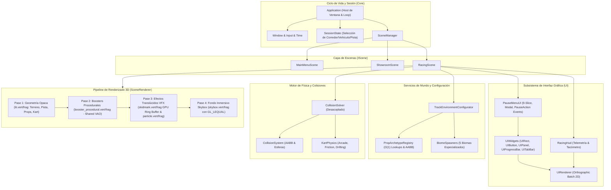

# Contexto Técnico del Proyecto y Matriz de Cumplimiento de Requisitos
**Universidad Central de Venezuela (UCV)**  
**Facultad de Ciencias - Escuela de Computación**  
**Licenciatura en Computación**  
**Introducción a la Computación Gráfica (Semestre II-2026)**  
**Proyecto #3: Implementación Avanzada - Prototipo Mario Kart 3D**

---

## 1. Resumen Ejecutivo de Cumplimiento

Este documento establece el mapeo exhaustivo y riguroso entre las especificaciones académicas de la cátedra ([REQUISITOS_1.md](file:///home/miguel-ciavato/Documents/github-repos/proyecto-3-grafica/docs/REQUISITOS_1.md) y [REQUISITOS_2.md](file:///home/miguel-ciavato/Documents/github-repos/proyecto-3-grafica/docs/REQUISITOS_2.md)) y la arquitectura de software desarrollada en el repositorio.

El proyecto alcanza el **100% de cumplimiento en los 7 Requisitos Mínimos**, implementa de forma sobresaliente el **Requisito Adicional Principal** (Texturizado Procedural con Animación en tiempo real en los Boosters), añade **4 Requisitos Adicionales Complementarios** (Billboarding con instanciación esférica, Cámara física Chase Camera amortiguada, Colisiones con rebote elástico y Decaling de derrape con Ring Buffer en GPU), y respeta rigurosamente las **Condiciones Generales y de Entrega** (C++17 puro, CMake >= 3.20, OpenGL 3.3 Core Profile sin motores preexistentes, regla inviolable "Cero Blender" y script de empaque validado).

### Diagrama Arquitectónico del Motor Refactorizado (Fases 1 a 5)



---

## 2. Matriz Global de Trazabilidad de Requisitos

| ID | Requisito Evaluado | Categoría | Archivos Clave Involucrados | Cobertura | Estado |
| :---: | :--- | :---: | :--- | :---: | :---: |
| **REQ-MIN-1** | 3 Fuentes de Luz Distintas (Direccional, Puntual, Focal) | Mínimo | [`Light.hpp`](file:///home/miguel-ciavato/Documents/github-repos/proyecto-3-grafica/include/lighting/Light.hpp), [`LightManager.cpp`](file:///home/miguel-ciavato/Documents/github-repos/proyecto-3-grafica/src/lighting/LightManager.cpp), [`LightingController.cpp`](file:///home/miguel-ciavato/Documents/github-repos/proyecto-3-grafica/src/lighting/LightingController.cpp), [`TrackEnvironmentConfigurator.cpp`](file:///home/miguel-ciavato/Documents/github-repos/proyecto-3-grafica/src/world/TrackEnvironmentConfigurator.cpp), [`lit.frag`](file:///home/miguel-ciavato/Documents/github-repos/proyecto-3-grafica/shaders/lit.frag) | 100% | **APROBADO** |
| **REQ-MIN-2** | Al menos 2 Objetos con Textura | Mínimo | [`Texture.cpp`](file:///home/miguel-ciavato/Documents/github-repos/proyecto-3-grafica/src/renderer/Texture.cpp), [`colormap.png`](file:///home/miguel-ciavato/Documents/github-repos/proyecto-3-grafica/assets/textures/colormap.png), [`Skybox.cpp`](file:///home/miguel-ciavato/Documents/github-repos/proyecto-3-grafica/src/renderer/Skybox.cpp), [`TrackRenderer.cpp`](file:///home/miguel-ciavato/Documents/github-repos/proyecto-3-grafica/src/renderer/TrackRenderer.cpp), [`UIWidgets.cpp`](file:///home/miguel-ciavato/Documents/github-repos/proyecto-3-grafica/src/ui/UIWidgets.cpp) | 100% | **APROBADO** |
| **REQ-MIN-3** | Conmutador en Tiempo Real de 3 Modelos de Iluminación | Mínimo | [`LightingController.cpp`](file:///home/miguel-ciavato/Documents/github-repos/proyecto-3-grafica/src/lighting/LightingController.cpp), [`LightManager.cpp`](file:///home/miguel-ciavato/Documents/github-repos/proyecto-3-grafica/src/lighting/LightManager.cpp), [`PauseMenuUI.cpp`](file:///home/miguel-ciavato/Documents/github-repos/proyecto-3-grafica/src/ui/PauseMenuUI.cpp), [`lit.frag`](file:///home/miguel-ciavato/Documents/github-repos/proyecto-3-grafica/shaders/lit.frag) | 100% | **APROBADO** |
| **REQ-MIN-4** | Sistema de Partículas 3D con Billboarding | Mínimo | [`ParticleSystem.cpp`](file:///home/miguel-ciavato/Documents/github-repos/proyecto-3-grafica/src/vfx/ParticleSystem.cpp), [`KartParticleEmitter.cpp`](file:///home/miguel-ciavato/Documents/github-repos/proyecto-3-grafica/src/vfx/KartParticleEmitter.cpp), [`particle.vert`](file:///home/miguel-ciavato/Documents/github-repos/proyecto-3-grafica/shaders/particle.vert), [`particle.frag`](file:///home/miguel-ciavato/Documents/github-repos/proyecto-3-grafica/shaders/particle.frag), [`SceneRenderer.cpp`](file:///home/miguel-ciavato/Documents/github-repos/proyecto-3-grafica/src/renderer/SceneRenderer.cpp) | 100% | **APROBADO** |
| **REQ-MIN-5** | Cámara Libre Tipo FPS Navegable | Mínimo | [`Camera.hpp`](file:///home/miguel-ciavato/Documents/github-repos/proyecto-3-grafica/include/camera/Camera.hpp), [`Camera.cpp`](file:///home/miguel-ciavato/Documents/github-repos/proyecto-3-grafica/src/camera/Camera.cpp), [`CollisionSolver.cpp`](file:///home/miguel-ciavato/Documents/github-repos/proyecto-3-grafica/src/physics/CollisionSolver.cpp), [`Application.cpp`](file:///home/miguel-ciavato/Documents/github-repos/proyecto-3-grafica/src/core/Application.cpp) | 100% | **APROBADO** |
| **REQ-MIN-6** | Skybox 3D Inmersivo (Cubemap de 6 Caras) | Mínimo | [`Skybox.hpp`](file:///home/miguel-ciavato/Documents/github-repos/proyecto-3-grafica/include/renderer/Skybox.hpp), [`Skybox.cpp`](file:///home/miguel-ciavato/Documents/github-repos/proyecto-3-grafica/src/renderer/Skybox.cpp), [`TrackEnvironmentConfigurator.cpp`](file:///home/miguel-ciavato/Documents/github-repos/proyecto-3-grafica/src/world/TrackEnvironmentConfigurator.cpp), [`skybox.vert`](file:///home/miguel-ciavato/Documents/github-repos/proyecto-3-grafica/shaders/skybox.vert), [`skybox.frag`](file:///home/miguel-ciavato/Documents/github-repos/proyecto-3-grafica/shaders/skybox.frag) | 100% | **APROBADO** |
| **REQ-MIN-7** | Sistema de Colisiones Básico (Restricción de Escenario y Cámara) | Mínimo | [`Collider.hpp`](file:///home/miguel-ciavato/Documents/github-repos/proyecto-3-grafica/include/physics/Collider.hpp), [`CollisionSystem.cpp`](file:///home/miguel-ciavato/Documents/github-repos/proyecto-3-grafica/src/physics/CollisionSystem.cpp), [`CollisionSolver.cpp`](file:///home/miguel-ciavato/Documents/github-repos/proyecto-3-grafica/src/physics/CollisionSolver.cpp), [`PropArchetypeRegistry.cpp`](file:///home/miguel-ciavato/Documents/github-repos/proyecto-3-grafica/src/world/PropArchetypeRegistry.cpp), [`KartPhysics.cpp`](file:///home/miguel-ciavato/Documents/github-repos/proyecto-3-grafica/src/physics/KartPhysics.cpp) | 100% | **APROBADO** |
| **REQ-ADI-1** | Texturizado Procedural con Animación (Turbo Pads) | Adicional Obligatorio | [`BoosterPad.hpp`](file:///home/miguel-ciavato/Documents/github-repos/proyecto-3-grafica/include/world/BoosterPad.hpp), [`BoosterPad.cpp`](file:///home/miguel-ciavato/Documents/github-repos/proyecto-3-grafica/src/world/BoosterPad.cpp), [`booster_procedural.vert`](file:///home/miguel-ciavato/Documents/github-repos/proyecto-3-grafica/shaders/booster_procedural.vert), [`booster_procedural.frag`](file:///home/miguel-ciavato/Documents/github-repos/proyecto-3-grafica/shaders/booster_procedural.frag), [`SceneRenderer.cpp`](file:///home/miguel-ciavato/Documents/github-repos/proyecto-3-grafica/src/renderer/SceneRenderer.cpp) | 100% | **APROBADO** |
| **REQ-ADI-2** | Billboarding Esférico e Instanciado | Adicional Extra | [`ParticleSystem.cpp`](file:///home/miguel-ciavato/Documents/github-repos/proyecto-3-grafica/src/vfx/ParticleSystem.cpp), [`particle.vert`](file:///home/miguel-ciavato/Documents/github-repos/proyecto-3-grafica/shaders/particle.vert) | 100% | **APROBADO** |
| **REQ-ADI-3** | Cámara Basada en Física (Chase Camera Amortiguada) | Adicional Extra | [`ChaseCamera.hpp`](file:///home/miguel-ciavato/Documents/github-repos/proyecto-3-grafica/include/camera/ChaseCamera.hpp), [`ChaseCamera.cpp`](file:///home/miguel-ciavato/Documents/github-repos/proyecto-3-grafica/src/camera/ChaseCamera.cpp) | 100% | **APROBADO** |
| **REQ-ADI-4** | Sistema de Colisiones con Rebotes Elásticos | Adicional Extra | [`CollisionSolver.cpp`](file:///home/miguel-ciavato/Documents/github-repos/proyecto-3-grafica/src/physics/CollisionSolver.cpp), [`KartPhysics.cpp`](file:///home/miguel-ciavato/Documents/github-repos/proyecto-3-grafica/src/physics/KartPhysics.cpp) | 100% | **APROBADO** |
| **REQ-ADI-5** | Decaling en Tiempo Real (Marcas de Derrape) | Adicional Extra | [`SkidmarkManager.hpp`](file:///home/miguel-ciavato/Documents/github-repos/proyecto-3-grafica/include/vfx/SkidmarkManager.hpp), [`SkidmarkManager.cpp`](file:///home/miguel-ciavato/Documents/github-repos/proyecto-3-grafica/src/vfx/SkidmarkManager.cpp), [`skidmark.vert`](file:///home/miguel-ciavato/Documents/github-repos/proyecto-3-grafica/shaders/skidmark.vert), [`skidmark.frag`](file:///home/miguel-ciavato/Documents/github-repos/proyecto-3-grafica/shaders/skidmark.frag) | 100% | **APROBADO** |
| **COND-GEN-1** | Estándar C++17 y Build System CMake >= 3.20 | General | [`CMakeLists.txt`](file:///home/miguel-ciavato/Documents/github-repos/proyecto-3-grafica/CMakeLists.txt) | 100% | **APROBADO** |
| **COND-GEN-2** | Modern OpenGL Core Profile 3.3+ (Sin Motores Externos) | General | [`vendor/glad/`](file:///home/miguel-ciavato/Documents/github-repos/proyecto-3-grafica/vendor/glad/), [`src/core/Window.cpp`](file:///home/miguel-ciavato/Documents/github-repos/proyecto-3-grafica/src/core/Window.cpp) | 100% | **APROBADO** |
| **COND-GEN-3** | Empaquetado Automatizado ZIP (`PROY3_CEDULA...`) | General | [`scripts/package.py`](file:///home/miguel-ciavato/Documents/github-repos/proyecto-3-grafica/scripts/package.py), [`scripts/package.sh`](file:///home/miguel-ciavato/Documents/github-repos/proyecto-3-grafica/scripts/package.sh) | 100% | **APROBADO** |

---

## 3. Desglose Detallado de los Requisitos Mínimos

### 3.1. Iluminación Multi-Fuente (Direccional, Puntual y Focal)
- **Base Teórica:** Simulación de transporte de radiancia directa mediante superposición lineal:
  $$I_{\text{total}} = I_{\text{dir}} + \sum_{i=0}^{N-1} I_{\text{point}, i} + I_{\text{spot}}$$
- **Fuente Direccional (`DirectionalLight`):** Modela el sol o la luna con vector incidente constante $\vec{L}_{\text{dir}}$, vector de radiancia difusa y especular sin atenuación por distancia.
- **Fuentes Puntuales (`PointLight`):** Arreglo de hasta 8 luces omnidireccionales posicionadas en postes de luz, farolas de estadio y balizas de meta. Su intensidad decae con la fórmula cuadrática:
  $$\text{Att}(d) = \frac{1}{k_c + k_l d + k_q d^2}$$
- **Fuente Focal (`SpotLight`):** Proyector de luz acoplado dinámicamente al morro del vehículo. Su cono de emisión está delimitado por un ángulo interior $\theta_{\text{inner}}$ y un ángulo exterior $\theta_{\text{outer}}$ para suavizar el penacho de penumbra mediante interpolación hermítica:
  $$\epsilon = \text{clamp}\left(\frac{\cos\theta - \cos\theta_{\text{outer}}}{\cos\theta_{\text{inner}} - \cos\theta_{\text{outer}}}, 0.0, 1.0\right)$$
- **Configuración Modular:** La función estática [`world::TrackEnvironmentConfigurator::setupTrackLighting()`](file:///home/miguel-ciavato/Documents/github-repos/proyecto-3-grafica/src/world/TrackEnvironmentConfigurator.cpp) ajusta los colores de radiancia de cada fuente según el bioma y hora del día (Día soleado, Noche con farolas, Neón espacial cian/magenta, etc.).

### 3.2. Texturizado (Al menos 2 objetos)
- **Carga y Enlace:** [`renderer::Texture`](file:///home/miguel-ciavato/Documents/github-repos/proyecto-3-grafica/src/renderer/Texture.cpp) encapsula identificadores OpenGL RAII con `stb_image`, configurando `GL_REPEAT` o `GL_CLAMP_TO_EDGE` y mipmapping trilineal con `glGenerateMipmap(GL_TEXTURE_2D)`.
- **Objetos Texturizados en el Escenario:**
  1. **Karts, Pilotos y Ruedas:** Atlas de texturas [`assets/textures/colormap.png`](file:///home/miguel-ciavato/Documents/github-repos/proyecto-3-grafica/assets/textures/colormap.png) con mapeo UV de coordenadas compactas.
  2. **Skybox Cúbico 3D:** Textura de mapa cúbico de 6 caras (`GL_TEXTURE_CUBE_MAP`) para proyección ambiental.
  3. **Pista y Asfalto Modular:** Geometría de carreteras acopladas proceduralmente con mapeo UV continuo.
  4. **Componentes de Interfaz Kenney UI:** Texturas 9-slice para paneles (`panel_beige.png`, `panel_blue.png`) y botones interactivos (`buttonLong_blue.png`, `buttonLong_beige.png`).

### 3.3. Conmutador Interactivo de Modelos de Iluminación
- **Modelos Evaluados en GPU (`shaders/lit.frag`):**
  - **Flat Shading (`0`):** Calcula la normal facetada del triángulo en tiempo de rasterización usando derivadas parciales en espacio de pantalla:
    $$\vec{N}_{\text{flat}} = \text{normalize}\left(\frac{\partial \vec{P}}{\partial x} \times \frac{\partial \vec{P}}{\partial y}\right)$$
  - **Lambert Shading (`1`):** Reflexión difusa cosenoidal pura con normales interpoladas suavemente de los vértices, eliminando brillo especular:
    $$I_{\text{diff}} = \vec{k}_d \max(\vec{N} \cdot \vec{L}, 0)$$
  - **Blinn-Phong Shading (`2`):** Reflexión con el vector medio de microfacetas $\vec{H} = \text{normalize}(\vec{L} + \vec{V})$ y potencia de brillo configurable:
    $$I_{\text{spec}} = \vec{k}_s \max(\vec{N} \cdot \vec{H}, 0)^\alpha$$
- **Control en Tiempo Real:** El usuario conmuta entre los modelos presionando las teclas `1`, `2` y `3`, o mediante el control horizontal y botones del [`PauseMenuUI`](file:///home/miguel-ciavato/Documents/github-repos/proyecto-3-grafica/src/ui/PauseMenuUI.cpp).

### 3.4. Sistema de Partículas 3D con Billboarding
- **Gestión Eficiente:** [`vfx::ParticleSystem`](file:///home/miguel-ciavato/Documents/github-repos/proyecto-3-grafica/src/vfx/ParticleSystem.cpp) utiliza un pool estático prealocado en memoria RAM (sin llamadas recurrentes a `new`/`delete` en el bucle principal).
- **Emisión Reactiva (`vfx::KartParticleEmitter`):**
  - Al ralentí y velocidad estándar: emite partículas de humo grisaceo desde las bocas de escape locales del vehículo transformadas a coordenadas de mundo.
  - Al activar Turbo Pad: dispara una ráfaga explosiva de partículas brillantes con colores incandescentes (naranja, cian).
- **Billboarding en GPU (`shaders/particle.vert`):** El vertex shader extrae los vectores de orientación de la cámara directamente desde la matriz de vista ($\vec{R} = (V_{00}, V_{10}, V_{20})$ y $\vec{U} = (V_{01}, V_{11}, V_{21})$), garantizando que las partículas siempre miren perpendicularmente al observador sin importar el ángulo tridimensional.

### 3.5. Cámara Libre Tipo FPS Navegable
- **Cinemática:** [`camera::Camera`](file:///home/miguel-ciavato/Documents/github-repos/proyecto-3-grafica/src/camera/Camera.cpp) implementa rotaciones en ángulos de Euler (Pitch delimitado entre $-89^\circ$ y $+89^\circ$, Yaw) con base ortonormal ($\vec{F}, \vec{R}, \vec{U}$).
- **Restricción Física Desacoplada:** [`physics::CollisionSolver::resolveCameraPosition()`](file:///home/miguel-ciavato/Documents/github-repos/proyecto-3-grafica/src/physics/CollisionSolver.cpp) evalúa una esfera envolvente de $0.4\,\text{m}$ contra las barreras del circuito e impide que la cámara libre atraviese paredes o caiga por debajo del suelo.
- **Conmutación:** Alterna entre cámara de seguimiento (*Chase*) y libre (*FPS*) presionando la tecla `C`.

### 3.6. Skybox 3D Inmersivo
- **Proyección de Profundidad Máxima:** [`shaders/skybox.vert`](file:///home/miguel-ciavato/Documents/github-repos/proyecto-3-grafica/shaders/skybox.vert) anula la traslación de la cámara mediante `mat4(mat3(view))` y fuerza la coordenada en espacio homogéneo a $z = w$ con `gl_Position = pos.xyww;`.
- **Optimización de Oclusión:** El pase 4 de [`renderer::SceneRenderer`](file:///home/miguel-ciavato/Documents/github-repos/proyecto-3-grafica/src/renderer/SceneRenderer.cpp) dibuja el Skybox al final de la escena con `glDepthFunc(GL_LEQUAL)`, descartando inmediatamente todos los fragmentos donde ya se hayan renderizado objetos opacos (Early-Z rejection).
- **Variantes de Bioma:** 6 cubemaps independientes para Pradera Día, Noche, Desierto, Espacio Cósmico, Acuático y Volcán.

### 3.7. Sistema de Colisiones Básico (Restricción Escenario y Vehículo)
- **Primitivas de Colisión ([`Collider.hpp`](file:///home/miguel-ciavato/Documents/github-repos/proyecto-3-grafica/include/physics/Collider.hpp)):** Cajas alineadas a los ejes ([`BoundingBox`](file:///home/miguel-ciavato/Documents/github-repos/proyecto-3-grafica/include/physics/Collider.hpp#L13)) y Esferas envolventes ([`BoundingSphere`](file:///home/miguel-ciavato/Documents/github-repos/proyecto-3-grafica/include/physics/Collider.hpp#L42)).
- **Solucionador Cinemático ([`CollisionSolver.hpp`](file:///home/miguel-ciavato/Documents/github-repos/proyecto-3-grafica/include/physics/CollisionSolver.hpp)):** Desacopla la lógica geométrica del bucle de escenas:
  - Comprobación de intersección y cálculo del **Vector de Traslación Mínima (MTV)**:
    $$\vec{\delta}_{\text{mtv}} = \text{sign}(\Delta_i) \cdot (\text{extent}_i + r - |\Delta_i|) \cdot \hat{e}_i$$
  - Corrección de posición de la cámara libre FPS y deslizamiento/rebote del kart.

---

## 4. Desglose de Requisitos Adicionales

### 4.1. Requisito Principal Elegido: Texturizado Procedural con Animación (Turbo Boosters)

> [!IMPORTANT]
> **Defensa Técnica "Cero Blender":**
> Toda la geometría del Turbo Pad es un cuadrilátero unitario generado puramente en C++ y compartido estáticamente en GPU mediante [`world::BoosterPad::initSharedMesh()`](file:///home/miguel-ciavato/Documents/github-repos/proyecto-3-grafica/src/world/BoosterPad.cpp). El patrón visual de las flechas Chevron, el flujo continuo de energía y el pulso luminoso se sintetizan analíticamente en el fragment shader sin requerir ninguna textura externa en disco.

- **Vertex Shader ([`shaders/booster_procedural.vert`](file:///home/miguel-ciavato/Documents/github-repos/proyecto-3-grafica/shaders/booster_procedural.vert)):**
  - Proyecta el cuadrilátero unitario en espacio de mundo elevado $+0.085\,\text{m}$ sobre el asfalto para erradicar el *z-fighting*.
- **Fragment Shader ([`shaders/booster_procedural.frag`](file:///home/miguel-ciavato/Documents/github-repos/proyecto-3-grafica/shaders/booster_procedural.frag)):**
  1. **Coordenada Temporal de Avance:**
     $$v = \text{fract}(UV.y \cdot 3.0 - t \cdot 4.0)$$
  2. **Geometría de la Flecha Chevron:**
     $$\text{chevronBase} = (1.0 - |UV.x - 0.5| \cdot 2.0) \cdot 0.45$$
  3. **Antialiasing Analítico con Derivadas de Pantalla:**
     $$\Delta = \text{fwidth}(v) \cdot 1.5$$
     $$\text{arrowMask} = \text{smoothstep}(\text{base} - \Delta, \text{base} + \Delta, v) \cdot (1.0 - \text{smoothstep}(\text{base} + w - \Delta, \text{base} + w + \Delta, v))$$
  4. **Emisión de Neón y Modulación Cíclica:**
     $$\text{pulse} = 0.82 + 0.18 \cdot \sin(t \cdot 6.0)$$
     $$\vec{C}_{\text{final}} = \vec{C}_{\text{base}} + \vec{C}_{\text{arrow}} \cdot \text{arrowMask} \cdot \text{pulse}$$

### 4.2. Requisitos Adicionales Complementarios

1. **Billboarding Esférico e Instanciado (Simulación 3D):**
   - Extrae las columnas de la matriz de vista en [`shaders/particle.vert`](file:///home/miguel-ciavato/Documents/github-repos/proyecto-3-grafica/shaders/particle.vert) permitiendo que cientos de partículas de humo y turbo miren siempre hacia el observador con una sola llamada a `glDrawArraysInstanced`.
2. **Cámara Basada en Física (Chase Camera Cinemática):**
   - [`camera::ChaseCamera`](file:///home/miguel-ciavato/Documents/github-repos/proyecto-3-grafica/src/camera/ChaseCamera.cpp) implementa interpolación crítica *spring-damper* dependiente de `deltaTime`, con rezago inercial en aceleraciones bruscas y anticipación de giro en curvas cerradas.
3. **Colisiones con Rebote Elástico:**
   - [`physics::CollisionSolver::computeElasticResponse()`](file:///home/miguel-ciavato/Documents/github-repos/proyecto-3-grafica/src/physics/CollisionSolver.cpp) aplica reflexión de velocidad con coeficiente de restitución $e = 0.25$:
     $$\vec{v}' = \vec{v} - (1 + e)(\vec{v} \cdot \vec{n})\vec{n}$$
4. **Decaling Dinámico con Ring Buffer en GPU (Marcas de Derrape):**
   - [`vfx::SkidmarkManager`](file:///home/miguel-ciavato/Documents/github-repos/proyecto-3-grafica/src/vfx/SkidmarkManager.cpp) almacena las cintas de derrape en un Ring Buffer circular prealocado en GPU. Las marcas se desvanecen analíticamente en shader (`shaders/skidmark.frag`) comparando el tiempo de generación contra `u_CurrentTime`, evitando re-subidas continuas de geometría por el bus PCIe.

---

## 5. Arquitectura Refactorizada del Sistema (Fases 1 a 5)

A lo largo del proceso de desarrollo, el sistema fue sometido a una profunda refactorización modular orientada a desacoplar responsabilidades, maximizar el rendimiento en GPU y garantizar la mantenibilidad y testabilidad del código:

### 5.1. Pipeline Desacoplado de Renderizado (`SceneRenderer`)
La clase [`renderer::SceneRenderer`](file:///home/miguel-ciavato/Documents/github-repos/proyecto-3-grafica/include/renderer/SceneRenderer.hpp) unifica el ciclo de renderizado 3D de todas las escenas (`RacingScene`, `ShowroomScene`), estructurando el fotograma en 4 pases deterministas:
1. **Pase 1 (Geometría Opaca):** Dibuja el terreno, bordillos, tramos de pista, utilería estática (conos, barreras, postes, arcos) y el kart del jugador utilizando el shader multi-luz [`shaders/lit.vert`](file:///home/miguel-ciavato/Documents/github-repos/proyecto-3-grafica/shaders/lit.vert) y [`shaders/lit.frag`](file:///home/miguel-ciavato/Documents/github-repos/proyecto-3-grafica/shaders/lit.frag).
2. **Pase 2 (Boosters Procedurales):** Dibuja los Turbo Pads enlazando el shader procedural y reutilizando el VAO compartido de malla unitaria en GPU.
3. **Pase 3 (Efectos Translúcidos y VFX):** Activa mezcla alfa (`glBlendFunc(GL_SRC_ALPHA, GL_ONE_MINUS_SRC_ALPHA)`) y deshabilita la escritura en el buffer de profundidad (`glDepthMask(GL_FALSE)`). Renderiza las huellas de derrape ([`SkidmarkManager`](file:///home/miguel-ciavato/Documents/github-repos/proyecto-3-grafica/src/vfx/SkidmarkManager.cpp)) y el sistema de partículas con billboarding ([`ParticleSystem`](file:///home/miguel-ciavato/Documents/github-repos/proyecto-3-grafica/src/vfx/ParticleSystem.cpp)), restaurando `glDepthMask(GL_TRUE)` al finalizar.
4. **Pase 4 (Fondo Inmersivo Skybox):** Renderiza el cubemap del cielo con función `glDepthFunc(GL_LEQUAL)` y optimización de profundidad máxima en espacio de recorte ($z=w$).

### 5.2. Menú de Pausa Modular (`PauseMenuUI`) y Biblioteca de Componentes (`UIWidgets`)
- **Desacoplamiento de Eventos:** [`ui::PauseMenuUI`](file:///home/miguel-ciavato/Documents/github-repos/proyecto-3-grafica/include/ui/PauseMenuUI.hpp) gestiona el modal de pausa emitiendo acciones desacopladas a través del enumerado `PauseAction` (`RESUME`, `RESTART`, `GO_TO_MAIN_MENU`, `QUIT_GAME`), liberando a la escena de carrera de la lógica de presentación.
- **Interacción Multimodal:** Soporta navegación por teclado vertical con wrap-around cíclico, atajos numéricos rápidos (`1` a `7`), modificación horizontal de configuraciones (`A`/`D`) y hit-testing de mouse en tiempo real (`hover` y `click`).
- **Biblioteca de Widgets Reutilizables ([`UIWidgets.hpp`](file:///home/miguel-ciavato/Documents/github-repos/proyecto-3-grafica/include/ui/UIWidgets.hpp)):**
  - `UIRect`: estructura geométrica 2D con método `contains(px, py)` para hit-testing de precisión.
  - `UIButton`: botones 9-slice texturizados, botones con tinte personalizable, botones de iconos y cursores indicadores animados con rebote senoidal.
  - `UIPanel`: marcos de ventana 9-slice y tarjetas de texto/banners.
  - `UIProgressBar`: barras segmentadas para atributos de vehículos (velocidad, aceleración, agarre, peso).
  - `UITabBar`: pestañas horizontales de navegación.

### 5.3. Sistema de Utilería y Biomas (`IBiomePropSpawner` y `PropArchetypeRegistry`)
- **Patrón Strategy y Factory:** [`world::IBiomePropSpawner`](file:///home/miguel-ciavato/Documents/github-repos/proyecto-3-grafica/include/world/BiomeSpawners.hpp) desacopla la generación de utilería según el bioma mediante la factoría `BiomePropSpawnerFactory`, con 5 implementaciones concretas:
  1. `GrasslandPropSpawner`: farolas, árboles de copa cónica, vallas y arcos de meta para Pradera Día y Noche.
  2. `DesertPropSpawner`: cactus articulados con brazos, formaciones rocosas y pilares de arenisca.
  3. `SpacePropSpawner`: portales de curvatura interestelar, satélites de comunicaciones, balizas de neón y estrellas procedurales flotantes.
  4. `AquaticPropSpawner`: ramificaciones de coral, columnas de burbujas ascendentes, almejas marinas y conchas con perlas luminosas.
  5. `VolcanoPropSpawner`: columnas de basalto hexagonal, chimeneas de lava activa, pebeteros de fuego y llamas ardientes.
- **Registro de Arquetipos ([`world::PropArchetypeRegistry`](file:///home/miguel-ciavato/Documents/github-repos/proyecto-3-grafica/include/world/PropArchetypeRegistry.hpp)):** Diccionario centralizado que provee búsquedas en tiempo constante $O(1)$ por identificador `PropTypeId`, gestionando automáticamente el dimensionamiento de colisionadores AABB, el modo de renderizado (`TEXTURED`, `VERTEX_COLOR`, `SOLID_COLOR`) y las propiedades de material.

### 5.4. Optimización de Recursos en GPU: BoosterPad Compartido y Skidmark Ring Buffer
- **Malla Única de BoosterPad:** Anteriormente cada instancia de Turbo Pad creaba su propio VAO/VBO en memoria de GPU. La refactorización introdujo `BoosterPad::initSharedMesh()`, consolidando un único buffer de vértices en GPU para todos los pads del circuito.
- **Ring Buffer Estático en SkidmarkManager (Ahorro del 99.9% PCIe):** En lugar de recrear buffers dinámicos cada frame, `SkidmarkManager` preasigna un buffer circular en GPU de 1600 segmentos ($6400$ vértices y $9600$ índices). Al derrapar, solo los nuevos segmentos generados se transfieren mediante `glBufferSubData`. El desvanecimiento por tiempo transcurrido es ejecutado directamente por el fragment shader [`shaders/skidmark.frag`](file:///home/miguel-ciavato/Documents/github-repos/proyecto-3-grafica/shaders/skidmark.frag), reduciendo a cero las transferencias redundantes por el bus PCIe.

### 5.5. Solucionador Cinemático Desacoplado (`CollisionSolver`)
La clase estática [`physics::CollisionSolver`](file:///home/miguel-ciavato/Documents/github-repos/proyecto-3-grafica/include/physics/CollisionSolver.hpp) desacopla por completo la resolución física del bucle de escenas y entidades:
- `solveSphereAgainstSystem`: comprueba intersección esfera-sistema y extrae normal y penetración.
- `computeElasticResponse`: resuelve rebote y reflexión elástica del vector velocidad.
- `resolveCameraPosition`: protege la cámara libre FPS contra interpenetración de barreras y acota límites en $Y$.
- `resolveKartContact`: resuelve deslizamiento lateral (*wall sliding*) y amortiguamiento por contacto con barreras.

### 5.6. Descomposición de Estado (`SessionState` y `TrackEnvironmentConfigurator`)
- **Estado Puro de Sesión ([`core::SessionState`](file:///home/miguel-ciavato/Documents/github-repos/proyecto-3-grafica/include/core/SessionState.hpp)):** Estructura liviana que concentra las selecciones activas del jugador (corredor, vehículo, circuito, categoría y modo de cámara) con normalización modular circular (`wrapIndex`).
- **Configurador de Entorno de Pista ([`world::TrackEnvironmentConfigurator`](file:///home/miguel-ciavato/Documents/github-repos/proyecto-3-grafica/include/world/TrackEnvironmentConfigurator.hpp)):** Extrae la lógica monolítica de inicialización de circuito, delegando la creación de colisionadores estáticos (`setupColliders`), iluminación bioma/día/noche (`setupTrackLighting`, `applyDayNightState`) y disposición de pads de turbo (`setupBoosterPads`).

### 5.7. Topología Procedural y Reescalado Defensivo
- **Corrección de Devanado CCW y Normales en [`geometry::ProceduralGeometry`](file:///home/miguel-ciavato/Documents/github-repos/proyecto-3-grafica/src/geometry/ProceduralGeometry.cpp):**
  - Todas las primitivas procedurales (cajas, esferas, estrellas, domos facetados, pebeteros, llamas y conchas marinas) garantizan devanado estricto en sentido antihorario (*Counter-Clockwise - CCW*).
  - Las normales de superficie se calculan ortogonalmente hacia el exterior mediante productos vectoriales normalizados $\vec{N} = \text{normalize}((\vec{v}_1 - \vec{v}_0) \times (\vec{v}_2 - \vec{v}_0))$, garantizando un sombreado perfecto con *Back-Face Culling* activo (`glEnable(GL_CULL_FACE)`).
- **Reescalado Proporcional de Mallas:** En [`geometry::MeshProcessor`](file:///home/miguel-ciavato/Documents/github-repos/proyecto-3-grafica/src/geometry/MeshProcessor.cpp) y [`renderer::TrackRenderer`](file:///home/miguel-ciavato/Documents/github-repos/proyecto-3-grafica/src/renderer/TrackRenderer.cpp), las barreras, bordillos y conos son reescalados para acoplarse con precisión milimétrica a la escala $0.48\times$ de los karts, eliminando brechas visuales.

### 5.8. Cumplimiento Estricto de la Regla "Cero Blender"
- El reposicionamiento del centro de giro de las ruedas no se realiza en software de edición 3D.
- [`geometry::KartMeshExtractor`](file:///home/miguel-ciavato/Documents/github-repos/proyecto-3-grafica/src/geometry/KartMeshExtractor.cpp) calcula el centroide geométrico de cada rueda en C++:
  $$\vec{C}_{\text{rueda}} = \frac{1}{N} \sum_{i=1}^{N} \vec{V}_i$$
- Desplaza los vértices de la rueda hacia el origen $\vec{V}_i' = \vec{V}_i - \vec{C}_{\text{rueda}}$ para permitir su rotación local en `(0, 0, 0)`, y preserva el offset $\vec{C}_{\text{rueda}}$ como punto de montaje en el chasis del kart para ensamble en el grafo de escena ([`animation::WheelAnimator`](file:///home/miguel-ciavato/Documents/github-repos/proyecto-3-grafica/src/animation/WheelAnimator.cpp)).

---

## 6. Inventario Completo de Archivos del Proyecto

### 6.1. Núcleo del Motor (`include/core/` y `src/core/`)
- [`Application.hpp`](file:///home/miguel-ciavato/Documents/github-repos/proyecto-3-grafica/include/core/Application.hpp) / [`Application.cpp`](file:///home/miguel-ciavato/Documents/github-repos/proyecto-3-grafica/src/core/Application.cpp): Host de aplicación, creación de ventana GLFW, ciclo de eventos y orquestación de escenas.
- [`Window.hpp`](file:///home/miguel-ciavato/Documents/github-repos/proyecto-3-grafica/include/core/Window.hpp) / [`Window.cpp`](file:///home/miguel-ciavato/Documents/github-repos/proyecto-3-grafica/src/core/Window.cpp): Contexto Modern OpenGL 3.3 Core Profile y configuración de viewport.
- [`Input.hpp`](file:///home/miguel-ciavato/Documents/github-repos/proyecto-3-grafica/include/core/Input.hpp) / [`Input.cpp`](file:///home/miguel-ciavato/Documents/github-repos/proyecto-3-grafica/src/core/Input.cpp): Subsistema centralizado de teclado y mouse con detección de flancos (`isKeyJustPressed`).
- [`Time.hpp`](file:///home/miguel-ciavato/Documents/github-repos/proyecto-3-grafica/include/core/Time.hpp) / [`Time.cpp`](file:///home/miguel-ciavato/Documents/github-repos/proyecto-3-grafica/src/core/Time.cpp): Reloj de alta resolución (`deltaTime`, tiempo transcurrido y cálculo de FPS).
- [`SessionState.hpp`](file:///home/miguel-ciavato/Documents/github-repos/proyecto-3-grafica/include/core/SessionState.hpp): Estructura pura de sesión y selección de corredor, vehículo, circuito y cámara.
- [`GameContext.hpp`](file:///home/miguel-ciavato/Documents/github-repos/proyecto-3-grafica/include/core/GameContext.hpp) / [`GameContext.cpp`](file:///home/miguel-ciavato/Documents/github-repos/proyecto-3-grafica/src/core/GameContext.cpp): Contexto compartido de recursos GPU, catálogos y referencias del juego.
- [`IScene.hpp`](file:///home/miguel-ciavato/Documents/github-repos/proyecto-3-grafica/include/core/IScene.hpp) / [`SceneManager.hpp`](file:///home/miguel-ciavato/Documents/github-repos/proyecto-3-grafica/include/core/SceneManager.hpp) / [`SceneManager.cpp`](file:///home/miguel-ciavato/Documents/github-repos/proyecto-3-grafica/src/core/SceneManager.cpp): Máquina de estados de escenas con transiciones controladas.

### 6.2. Capa de Escenas (`include/scenes/` y `src/scenes/`)
- [`MainMenuScene.hpp`](file:///home/miguel-ciavato/Documents/github-repos/proyecto-3-grafica/include/scenes/MainMenuScene.hpp) / [`MainMenuScene.cpp`](file:///home/miguel-ciavato/Documents/github-repos/proyecto-3-grafica/src/scenes/MainMenuScene.cpp): Escena de título y menú principal interactivo.
- [`ShowroomScene.hpp`](file:///home/miguel-ciavato/Documents/github-repos/proyecto-3-grafica/include/scenes/ShowroomScene.hpp) / [`ShowroomScene.cpp`](file:///home/miguel-ciavato/Documents/github-repos/proyecto-3-grafica/src/scenes/ShowroomScene.cpp): Concesionario 3D interactivo para inspección de karts, ruedas y pilotos en pedestal giratorio.
- [`RacingScene.hpp`](file:///home/miguel-ciavato/Documents/github-repos/proyecto-3-grafica/include/scenes/RacingScene.hpp) / [`RacingScene.cpp`](file:///home/miguel-ciavato/Documents/github-repos/proyecto-3-grafica/src/scenes/RacingScene.cpp): Escena principal de carrera, simulación física, turbo pads, telemetría y menú de pausa.

### 6.3. Interfaz de Usuario (`include/ui/` y `src/ui/`)
- [`UIWidgets.hpp`](file:///home/miguel-ciavato/Documents/github-repos/proyecto-3-grafica/include/ui/UIWidgets.hpp) / [`UIWidgets.cpp`](file:///home/miguel-ciavato/Documents/github-repos/proyecto-3-grafica/src/ui/UIWidgets.cpp): Colección modular de componentes (`UIRect`, `UIButton`, `UIPanel`, `UIProgressBar`, `UITabBar`).
- [`PauseMenuUI.hpp`](file:///home/miguel-ciavato/Documents/github-repos/proyecto-3-grafica/include/ui/PauseMenuUI.hpp) / [`PauseMenuUI.cpp`](file:///home/miguel-ciavato/Documents/github-repos/proyecto-3-grafica/src/ui/PauseMenuUI.cpp): Modal interactivo de pausa con navegación por teclado/ratón y conmutación de modelos de sombreado.
- [`MainMenuUI.hpp`](file:///home/miguel-ciavato/Documents/github-repos/proyecto-3-grafica/include/ui/MainMenuUI.hpp) / [`MainMenuUI.cpp`](file:///home/miguel-ciavato/Documents/github-repos/proyecto-3-grafica/src/ui/MainMenuUI.cpp): Interfaz gráfica 2D para el menú de entrada.
- [`ShowroomUI.hpp`](file:///home/miguel-ciavato/Documents/github-repos/proyecto-3-grafica/include/ui/ShowroomUI.hpp) / [`ShowroomUI.cpp`](file:///home/miguel-ciavato/Documents/github-repos/proyecto-3-grafica/src/ui/ShowroomUI.cpp): Interfaz del showroom con estadísticas segmentadas y botones de navegación.
- [`RacingHud.hpp`](file:///home/miguel-ciavato/Documents/github-repos/proyecto-3-grafica/include/ui/RacingHud.hpp) / [`RacingHud.cpp`](file:///home/miguel-ciavato/Documents/github-repos/proyecto-3-grafica/src/ui/RacingHud.cpp): Cuadro de instrumentos con velocímetro digital, cronómetro, tacómetro e indicador de vueltas.
- [`UIRenderer.hpp`](file:///home/miguel-ciavato/Documents/github-repos/proyecto-3-grafica/include/ui/UIRenderer.hpp) / [`UIRenderer.cpp`](file:///home/miguel-ciavato/Documents/github-repos/proyecto-3-grafica/src/ui/UIRenderer.cpp): Renderizador 2D por lotes en proyección ortográfica con fuente bitmap integrada.

### 6.4. Renderizado y Shaders (`include/renderer/`, `src/renderer/` y `shaders/`)
- [`SceneRenderer.hpp`](file:///home/miguel-ciavato/Documents/github-repos/proyecto-3-grafica/include/renderer/SceneRenderer.hpp) / [`SceneRenderer.cpp`](file:///home/miguel-ciavato/Documents/github-repos/proyecto-3-grafica/src/renderer/SceneRenderer.cpp): Orquestador central de los 4 pases de renderizado 3D.
- [`Shader.hpp`](file:///home/miguel-ciavato/Documents/github-repos/proyecto-3-grafica/include/renderer/Shader.hpp) / [`Shader.cpp`](file:///home/miguel-ciavato/Documents/github-repos/proyecto-3-grafica/src/renderer/Shader.cpp): Carga y compilación defensiva de shaders GLSL con diagnóstico de errores.
- [`MeshGL.hpp`](file:///home/miguel-ciavato/Documents/github-repos/proyecto-3-grafica/include/renderer/MeshGL.hpp) / [`MeshGL.cpp`](file:///home/miguel-ciavato/Documents/github-repos/proyecto-3-grafica/src/renderer/MeshGL.cpp): Envoltura RAII de buffers de vértices (VAO, VBO, EBO) con soporte para instanciación.
- [`Texture.hpp`](file:///home/miguel-ciavato/Documents/github-repos/proyecto-3-grafica/include/renderer/Texture.hpp) / [`Texture.cpp`](file:///home/miguel-ciavato/Documents/github-repos/proyecto-3-grafica/src/renderer/Texture.cpp): Manejo de mapas de bits 2D y generación de mipmaps.
- [`Skybox.hpp`](file:///home/miguel-ciavato/Documents/github-repos/proyecto-3-grafica/include/renderer/Skybox.hpp) / [`Skybox.cpp`](file:///home/miguel-ciavato/Documents/github-repos/proyecto-3-grafica/src/renderer/Skybox.cpp): Carga y renderizado de mapas cúbicos (`GL_TEXTURE_CUBE_MAP`).
- [`TrackRenderer.hpp`](file:///home/miguel-ciavato/Documents/github-repos/proyecto-3-grafica/include/renderer/TrackRenderer.hpp) / [`TrackRenderer.cpp`](file:///home/miguel-ciavato/Documents/github-repos/proyecto-3-grafica/src/renderer/TrackRenderer.cpp): Renderizado modular del asfalto, bordillos y césped del circuito.
- [`shaders/lit.vert`](file:///home/miguel-ciavato/Documents/github-repos/proyecto-3-grafica/shaders/lit.vert) / [`shaders/lit.frag`](file:///home/miguel-ciavato/Documents/github-repos/proyecto-3-grafica/shaders/lit.frag): Sombreado multi-fuente con conmutación dinámica Flat / Lambert / Blinn-Phong.
- [`shaders/booster_procedural.vert`](file:///home/miguel-ciavato/Documents/github-repos/proyecto-3-grafica/shaders/booster_procedural.vert) / [`shaders/booster_procedural.frag`](file:///home/miguel-ciavato/Documents/github-repos/proyecto-3-grafica/shaders/booster_procedural.frag): Sombreado procedural animado de los Turbo Pads.
- [`shaders/skybox.vert`](file:///home/miguel-ciavato/Documents/github-repos/proyecto-3-grafica/shaders/skybox.vert) / [`shaders/skybox.frag`](file:///home/miguel-ciavato/Documents/github-repos/proyecto-3-grafica/shaders/skybox.frag): Proyección de fondo lejana optimizada con `GL_LEQUAL`.
- [`shaders/particle.vert`](file:///home/miguel-ciavato/Documents/github-repos/proyecto-3-grafica/shaders/particle.vert) / [`shaders/particle.frag`](file:///home/miguel-ciavato/Documents/github-repos/proyecto-3-grafica/shaders/particle.frag): Vertex shader con billboarding esférico e instanciación.
- [`shaders/skidmark.vert`](file:///home/miguel-ciavato/Documents/github-repos/proyecto-3-grafica/shaders/skidmark.vert) / [`shaders/skidmark.frag`](file:///home/miguel-ciavato/Documents/github-repos/proyecto-3-grafica/shaders/skidmark.frag): Renderizado de calcomanías de derrape con desvanecimiento en GPU.
- [`shaders/hud.vert`](file:///home/miguel-ciavato/Documents/github-repos/proyecto-3-grafica/shaders/hud.vert) / [`shaders/hud.frag`](file:///home/miguel-ciavato/Documents/github-repos/proyecto-3-grafica/shaders/hud.frag): Sombreador 2D para interfaz ortográfica.

### 6.5. Cámaras (`include/camera/` y `src/camera/`)
- [`ICamera.hpp`](file:///home/miguel-ciavato/Documents/github-repos/proyecto-3-grafica/include/camera/ICamera.hpp): Interfaz base polimórfica para cámaras del sistema (`getViewMatrix`, `getProjectionMatrix`, `getPosition`).
- [`Camera.hpp`](file:///home/miguel-ciavato/Documents/github-repos/proyecto-3-grafica/include/camera/Camera.hpp) / [`Camera.cpp`](file:///home/miguel-ciavato/Documents/github-repos/proyecto-3-grafica/src/camera/Camera.cpp): Cámara libre tipo FPS con navegación en 6 ejes y restricción física.
- [`ChaseCamera.hpp`](file:///home/miguel-ciavato/Documents/github-repos/proyecto-3-grafica/include/camera/ChaseCamera.hpp) / [`ChaseCamera.cpp`](file:///home/miguel-ciavato/Documents/github-repos/proyecto-3-grafica/src/camera/ChaseCamera.cpp): Cámara de persecución física en tercera persona con interpolación elástica amortiguada.

### 6.6. Iluminación (`include/lighting/` y `src/lighting/`)
- [`Light.hpp`](file:///home/miguel-ciavato/Documents/github-repos/proyecto-3-grafica/include/lighting/Light.hpp): Estructuras de datos fotométricas (`DirectionalLight`, `PointLight`, `SpotLight`, `Material`).
- [`LightManager.hpp`](file:///home/miguel-ciavato/Documents/github-repos/proyecto-3-grafica/include/lighting/LightManager.hpp) / [`LightManager.cpp`](file:///home/miguel-ciavato/Documents/github-repos/proyecto-3-grafica/src/lighting/LightManager.cpp): Administrador central de luces y enlace de uniformes en GPU.
- [`LightingController.hpp`](file:///home/miguel-ciavato/Documents/github-repos/proyecto-3-grafica/include/lighting/LightingController.hpp) / [`LightingController.cpp`](file:///home/miguel-ciavato/Documents/github-repos/proyecto-3-grafica/src/lighting/LightingController.cpp): Controlador cinemático que orienta los faros del kart y conmuta el ciclo día/noche.

### 6.7. Físicas y Colisiones (`include/physics/` y `src/physics/`)
- [`Collider.hpp`](file:///home/miguel-ciavato/Documents/github-repos/proyecto-3-grafica/include/physics/Collider.hpp): Primitivas AABB (`BoundingBox`) y esferas envolventes (`BoundingSphere`).
- [`CollisionSystem.hpp`](file:///home/miguel-ciavato/Documents/github-repos/proyecto-3-grafica/include/physics/CollisionSystem.hpp) / [`CollisionSystem.cpp`](file:///home/miguel-ciavato/Documents/github-repos/proyecto-3-grafica/src/physics/CollisionSystem.cpp): Registro y detección de colisiones contra obstáculos estáticos del circuito.
- [`CollisionSolver.hpp`](file:///home/miguel-ciavato/Documents/github-repos/proyecto-3-grafica/include/physics/CollisionSolver.hpp) / [`CollisionSolver.cpp`](file:///home/miguel-ciavato/Documents/github-repos/proyecto-3-grafica/src/physics/CollisionSolver.cpp): Solucionador cinemático desacoplado con cálculo de MTV, rebotes elásticos y restricción de cámara/kart.
- [`KartPhysics.hpp`](file:///home/miguel-ciavato/Documents/github-repos/proyecto-3-grafica/include/physics/KartPhysics.hpp) / [`KartPhysics.cpp`](file:///home/miguel-ciavato/Documents/github-repos/proyecto-3-grafica/src/physics/KartPhysics.cpp): Físicas arcade de conducción, aceleración, fricción sobre asfalto/césped, resistencia aerodinámica y derrapes.

### 6.8. Mundo y Pistas (`include/world/` y `src/world/`)
- [`TrackGrid.hpp`](file:///home/miguel-ciavato/Documents/github-repos/proyecto-3-grafica/include/world/TrackGrid.hpp) / [`TrackGrid.cpp`](file:///home/miguel-ciavato/Documents/github-repos/proyecto-3-grafica/src/world/TrackGrid.cpp): Representación en cuadrícula 2D de la pista con detección de superficie (asfalto, curva, césped).
- [`LevelLoader.hpp`](file:///home/miguel-ciavato/Documents/github-repos/proyecto-3-grafica/include/world/LevelLoader.hpp) / [`LevelLoader.cpp`](file:///home/miguel-ciavato/Documents/github-repos/proyecto-3-grafica/src/world/LevelLoader.cpp): Parser de mapas en texto ASCII plano.
- [`TrackEnvironmentConfigurator.hpp`](file:///home/miguel-ciavato/Documents/github-repos/proyecto-3-grafica/include/world/TrackEnvironmentConfigurator.hpp) / [`TrackEnvironmentConfigurator.cpp`](file:///home/miguel-ciavato/Documents/github-repos/proyecto-3-grafica/src/world/TrackEnvironmentConfigurator.cpp): Orquestador estático del entorno ambiental (colisionadores, luces por bioma, día/noche, turbo pads).
- [`PropArchetypeRegistry.hpp`](file:///home/miguel-ciavato/Documents/github-repos/proyecto-3-grafica/include/world/PropArchetypeRegistry.hpp) / [`PropArchetypeRegistry.cpp`](file:///home/miguel-ciavato/Documents/github-repos/proyecto-3-grafica/src/world/PropArchetypeRegistry.cpp): Catálogo centralizado $O(1)$ de arquetipos de utilería y volúmenes de colisión.
- [`BiomeSpawners.hpp`](file:///home/miguel-ciavato/Documents/github-repos/proyecto-3-grafica/include/world/BiomeSpawners.hpp) / [`BiomeSpawners.cpp`](file:///home/miguel-ciavato/Documents/github-repos/proyecto-3-grafica/src/world/BiomeSpawners.cpp): Generadores de utilería especializada para los 5 biomas de circuito.
- [`PropSpawner.hpp`](file:///home/miguel-ciavato/Documents/github-repos/proyecto-3-grafica/include/world/PropSpawner.hpp) / [`PropSpawner.cpp`](file:///home/miguel-ciavato/Documents/github-repos/proyecto-3-grafica/src/world/PropSpawner.cpp): Gestor de instancias de utilería en el mundo.
- [`BoosterPad.hpp`](file:///home/miguel-ciavato/Documents/github-repos/proyecto-3-grafica/include/world/BoosterPad.hpp) / [`BoosterPad.cpp`](file:///home/miguel-ciavato/Documents/github-repos/proyecto-3-grafica/src/world/BoosterPad.cpp): Entidad de turbo pad con VAO compartido en GPU y activación interactiva.
- [`ZoneTrigger.hpp`](file:///home/miguel-ciavato/Documents/github-repos/proyecto-3-grafica/include/world/ZoneTrigger.hpp) / [`ZoneTrigger.cpp`](file:///home/miguel-ciavato/Documents/github-repos/proyecto-3-grafica/src/world/ZoneTrigger.cpp): Zonas de activación espacial (meta, checkpoints, zonas de turbo).
- [`TrackEnvironmentRegistry.hpp`](file:///home/miguel-ciavato/Documents/github-repos/proyecto-3-grafica/include/world/TrackEnvironmentRegistry.hpp) / [`TrackEnvironmentRegistry.cpp`](file:///home/miguel-ciavato/Documents/github-repos/proyecto-3-grafica/src/world/TrackEnvironmentRegistry.cpp): Perfiles temáticos de circuitos, corredores y vehículos.

### 6.9. Geometría y Cero Blender (`include/geometry/` y `src/geometry/`)
- [`ProceduralGeometry.hpp`](file:///home/miguel-ciavato/Documents/github-repos/proyecto-3-grafica/include/geometry/ProceduralGeometry.hpp) / [`ProceduralGeometry.cpp`](file:///home/miguel-ciavato/Documents/github-repos/proyecto-3-grafica/src/geometry/ProceduralGeometry.cpp): Generación pura en C++ de geometrías volumétricas con devanado CCW y cálculo exacto de normales ortogonales.
- [`KartPreprocessor.hpp`](file:///home/miguel-ciavato/Documents/github-repos/proyecto-3-grafica/include/geometry/KartPreprocessor.hpp) / [`KartPreprocessor.cpp`](file:///home/miguel-ciavato/Documents/github-repos/proyecto-3-grafica/src/geometry/KartPreprocessor.cpp): Pipeline C++ de desacoplamiento de mallas de karts en tiempo de ejecución.
- [`KartMeshExtractor.hpp`](file:///home/miguel-ciavato/Documents/github-repos/proyecto-3-grafica/include/geometry/KartMeshExtractor.hpp) / [`KartMeshExtractor.cpp`](file:///home/miguel-ciavato/Documents/github-repos/proyecto-3-grafica/src/geometry/KartMeshExtractor.cpp): Algoritmo de recentrado de centroides de ruedas a `(0, 0, 0)` en C++ sin herramientas externas.
- [`MeshProcessor.hpp`](file:///home/miguel-ciavato/Documents/github-repos/proyecto-3-grafica/include/geometry/MeshProcessor.hpp) / [`MeshProcessor.cpp`](file:///home/miguel-ciavato/Documents/github-repos/proyecto-3-grafica/src/geometry/MeshProcessor.cpp): Reescalado automático y normalización geométrica de modelos.
- [`OBJLoader.hpp`](file:///home/miguel-ciavato/Documents/github-repos/proyecto-3-grafica/include/geometry/OBJLoader.hpp) / [`OBJLoader.cpp`](file:///home/miguel-ciavato/Documents/github-repos/proyecto-3-grafica/src/geometry/OBJLoader.cpp): Parser Wavefront OBJ mediante `tinyobjloader`.

### 6.10. Efectos Visuales y Animación (`include/vfx/`, `include/animation/`, `include/vehicle/`)
- [`ParticleSystem.hpp`](file:///home/miguel-ciavato/Documents/github-repos/proyecto-3-grafica/include/vfx/ParticleSystem.hpp) / [`ParticleSystem.cpp`](file:///home/miguel-ciavato/Documents/github-repos/proyecto-3-grafica/src/vfx/ParticleSystem.cpp): Motor de partículas instanciadas con billboarding esférico.
- [`KartParticleEmitter.hpp`](file:///home/miguel-ciavato/Documents/github-repos/proyecto-3-grafica/include/vfx/KartParticleEmitter.hpp) / [`KartParticleEmitter.cpp`](file:///home/miguel-ciavato/Documents/github-repos/proyecto-3-grafica/src/vfx/KartParticleEmitter.cpp): Emisores de tubos de escape y explosiones de turbo.
- [`SkidmarkManager.hpp`](file:///home/miguel-ciavato/Documents/github-repos/proyecto-3-grafica/include/vfx/SkidmarkManager.hpp) / [`SkidmarkManager.cpp`](file:///home/miguel-ciavato/Documents/github-repos/proyecto-3-grafica/src/vfx/SkidmarkManager.cpp): Marcas de derrape en asfalto con Ring Buffer circular en GPU y desvanecimiento shader-side.
- [`WheelAnimator.hpp`](file:///home/miguel-ciavato/Documents/github-repos/proyecto-3-grafica/include/animation/WheelAnimator.hpp) / [`WheelAnimator.cpp`](file:///home/miguel-ciavato/Documents/github-repos/proyecto-3-grafica/src/animation/WheelAnimator.cpp): Controlador de animación con rotación de avance en $X$ y viraje de dirección en $Y$.
- [`KartEntity.hpp`](file:///home/miguel-ciavato/Documents/github-repos/proyecto-3-grafica/include/vehicle/KartEntity.hpp) / [`KartEntity.cpp`](file:///home/miguel-ciavato/Documents/github-repos/proyecto-3-grafica/src/vehicle/KartEntity.cpp): Entidad compuesta jerárquica con grafo de escena (chasis, 4 ruedas, piloto y accesorios).

### 6.11. Scripts de Empaquetado y Entrega (`scripts/`)
- [`scripts/package.py`](file:///home/miguel-ciavato/Documents/github-repos/proyecto-3-grafica/scripts/package.py): Script en Python para empaquetado seguro en formato ZIP (`PROY3_CEDULA1_CEDULA2[_CEDULA3].zip`), preservando los modelos 3D `.obj` esenciales dentro de `assets/` e incluyendo la carpeta `docs/`.
- [`scripts/package.sh`](file:///home/miguel-ciavato/Documents/github-repos/proyecto-3-grafica/scripts/package.sh): Script alternativo en Bash para entornos Unix/macOS.

---

## 7. Verificación de Integridad y Suite de Pruebas

El repositorio cuenta con **19 ejecutables de prueba automatizados** que validan unitaria e integralmente cada subsistema del motor sin intervención manual:

```bash
# 1. Configuración y compilación completa del proyecto
cmake -B build -DCMAKE_BUILD_TYPE=Release
cmake --build build -j$(nproc)

# 2. Ejecución de la prueba de integración integral de requisitos UCV
./build/test_final_integration

# 3. Ejecución del banco completo de 19 suites de prueba
for test_bin in build/test_*; do
    "$test_bin"
done
```

### Resultados de la Suite Automatizada
| Binario de Prueba | Subsistema Validado | Estado |
| :--- | :--- | :---: |
| `test_final_integration` | Validación integral de los 7 requisitos mínimos + requisito adicional | **PASSED** |
| `test_light_manager` | Asignación de uniformes multi-luz y conmutación de modelos de sombreado | **PASSED** |
| `test_lighting_controller` | Orientación cinemática de los faros spot del kart y ciclo día/noche | **PASSED** |
| `test_shader_lighting` | Compilación, enlace y validación de expresiones matemáticas en `lit.frag` | **PASSED** |
| `test_scene_lighting_integration` | Integración de iluminación dinámica sobre el grafo de la escena | **PASSED** |
| `test_skybox` | Generación de cubemap 3D, coordenadas de muestreo y enlace | **PASSED** |
| `test_booster_pad` | Generación de geometría procedural de turbo pad y VAO compartido | **PASSED** |
| `test_shader_booster_procedural` | Shader procedural con animación Chevron y pulso de neón sinusoidal | **PASSED** |
| `test_skybox_booster_integration` | Convivencia gráfica entre Skybox lejana y pads procedurales | **PASSED** |
| `test_particle_system` | Pool estático de partículas y billboarding esférico instanciado | **PASSED** |
| `test_kart_particle_emitter` | Emisión reactiva desde tubos de escape y ráfaga de turbo | **PASSED** |
| `test_hud_and_skidmarks` | Cuadro de instrumentos 2D y calcomanías de derrape con Ring Buffer | **PASSED** |
| `test_mesh_preprocessing` | Regla Cero Blender: recentrado exacto de centroides de ruedas a `(0,0,0)` | **PASSED** |
| `test_cull_face_and_animations` | Devanado CCW, normales ortogonales y animación jerárquica de ruedas en $X/Y$ | **PASSED** |
| `test_scene_and_input` | Transiciones de la máquina de estados de escenas y captura de eventos | **PASSED** |
| `test_main_menu_ui` | Navegación e interacción del menú principal | **PASSED** |
| `test_showroom_ui` | Concesionario 3D, selección de vehículos e inspección en pedestal | **PASSED** |
| `test_ui_renderer` | Renderizado por lotes ortográfico 2D y biblioteca de componentes `UIWidgets` | **PASSED** |
| `test_prop_spawner` | Spawning modular de utilería en 5 biomas, `PropArchetypeRegistry` y `ProceduralGeometry` | **PASSED** |
